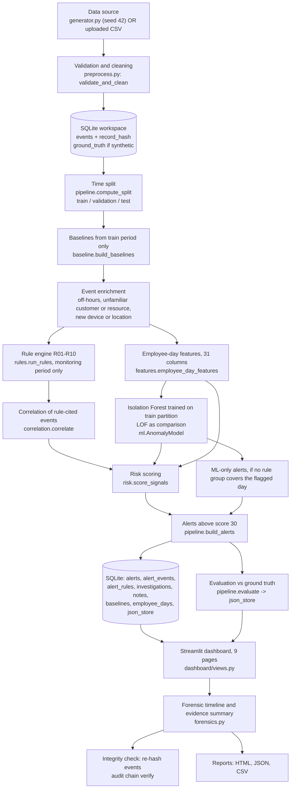

# Behavioral and Forensic Analytics-Based Insider Threat Detection System for Banking Environments
## Complete Technical Explanation (built from the actual source code, data and stored results)

> **Document status.** Written on 2026-10-27 by reading every Python module in `insider/`, `dashboard/`, `tests/`, `scripts/`, `run.py`, the configuration, the existing `docs/`, and by querying the stored `demo` workspace **read-only** (`data/workspaces/demo.db`, opened with SQLite `mode=ro`). No project file was modified, no data were regenerated, and no stored result was altered.
>
> **Labels used throughout**
>
> | Label | Meaning |
> |---|---|
> | **IMPLEMENTED** | Confirmed in the source code (file and function given). |
> | **OBSERVED RESULT** | Verified from the stored database / stored evaluation JSON. |
> | **INTERPRETATION** | My reasoned explanation of an observed result (not proven by experiment). |
> | **ILLUSTRATIVE EXAMPLE** | Hypothetical numbers for teaching. Not real observations. |
> | **LIMITATION** | A known weakness or boundary. |
> | **FUTURE WORK** | Not implemented. |
>
> **Source-reference format.** `path:line` or `path:function (line)`. Line numbers were taken from the files as they exist today. Paths are relative to the project root.

---

## Table of contents

1. Project overview
2. Complete system architecture
3. Technology stack
4. Dataset and data generation
5. Data preprocessing and database operations
6. Behavioural analytics and baselines
7. Rule-based detection engine (R01-R10)
8. Feature engineering (31 features)
9. Machine-learning methodology (Isolation Forest, LOF)
10. Event correlation
11. Risk-scoring algorithm
12. Digital forensics - complete technical explanation
13. Every dashboard page and every graph
14. Insights from the actual results
15. Evaluation metrics and mathematics
16. Testing and code quality
17. Security, privacy and ethical considerations
18. Complete end-to-end example
19. Source-code walkthrough
20. Strengths, limitations, future work
21. Viva preparation (50 questions)
22. Demonstration script
23. Quick revision sheet
24. Glossary

Appendix A - Verification log and discrepancies found.

---

## 0. Read this first: ten facts that are easy to get wrong

| # | Fact | Where verified |
|---|---|---|
| 1 | **All data are synthetic** (seed 42, `insider/generator.py`). Nothing here is evidence of real-bank performance. | `insider/generator.py:1-6`, `data/synthetic/dataset_meta.json` |
| 2 | The ML score is `-IsolationForest.score_samples(x)`. **Higher = more anomalous. It is not a probability.** | `insider/ml.py:72-73` |
| 3 | **LOF is a comparison detector only.** It is scored and evaluated, but it does not enter the risk score or create alerts. | `insider/ml.py:78-89`, `insider/pipeline.py:121-125, 218-225` |
| 4 | The risk score is a **weighted prioritisation index** with hand-set weights - not learned, not calibrated. | `insider/config.py:104-111`, `insider/risk.py:30-51` |
| 5 | The robust z-score **does not divide by `1.4826 x MAD` alone**; the denominator is floored (`max(1.4826 x MAD, floor)`), which is how `MAD = 0` is handled. | `insider/baseline.py:65-66`, `insider/features.py:54-55` |
| 6 | SHA-256 per event is computed over the **normalised record at ingest**, not over the original uploaded bytes. The reference hash lives **in the same database** as the data. | `insider/preprocess.py:20-28, 113` |
| 7 | The audit log is a **hash chain** (tamper-*evident*). It is not signed, keyed, or externally anchored. Truncating its tail would not be detected. | `insider/db.py:126-146` |
| 8 | The ML threshold was chosen on the **validation** split using only **4 positive employee-days**. Rule thresholds were refined while looking at validation **and test** alerts, so **the test split is not a clean hold-out**. | `insider/pipeline.py:92-107`, `docs/EVALUATION.md` (procedure step 3) |
| 9 | There is **no authentication, no authorisation, no real-time ingestion, no automated response, no PDF export.** The "analyst" name is free text. | `dashboard/app.py:65-70`, `dashboard/views.py:1070-1081`, `README.md:77-78` |
| 10 | The dashboard is **batch**: it reads a pre-computed SQLite workspace. Detection runs when a workspace is created/processed, not when a page loads. | `insider/pipeline.py:311-380`, `dashboard/common.py` |

---

# SECTION 1: PROJECT OVERVIEW

## 1.1 Exact title
**Behavioral and Forensic Analytics-Based Insider Threat Detection System for Banking Environments.** In the application the product name shown in the browser tab and sidebar is "Sentinel Intelligence - Banking Threat Analytics" (`dashboard/app.py:9`).

## 1.2 Problem statement
A bank gives hundreds of employees legitimate access to customer accounts, transaction systems and bulk-export tools. A malicious or compromised insider does not need to "break in": they use access they already have. The problem is to **notice abnormal, risky use of legitimate access early enough for a human investigator to act, and to give that investigator evidence they can trust and explain.**

## 1.3 Why insider threats matter in banking
* Insiders already hold valid credentials, so perimeter defences (firewalls, malware filters) do not stop them.
* Banking data are high-value (customer identities, balances, transactions) and heavily regulated.
* One employee can touch thousands of customer records; a bulk export plus an external transfer can be a data breach in minutes.
* Detection needs context: a teller viewing 50 accounts may be fraud; a support agent viewing 50 accounts under a ticket may be normal.

## 1.4 What "insider threat" means
A person (employee, contractor) - or an attacker using that person's stolen credentials - who misuses authorised access to harm the organisation: stealing data, committing fraud, sabotaging systems. In this project, insider activity is **simulated** (eight scripted incident types, `insider/generator.py:39`).

## 1.5 Why conventional rules alone are not enough
Fixed rules ("alert if > 100 MB download") are transparent but (a) cannot adapt to each person (an auditor's normal is a teller's incident), (b) only catch what someone thought of in advance, (c) fire on every legitimate exception (approved overtime, ticket-driven work), producing false positives.

## 1.6 Why ML anomaly detection alone is not enough
An unsupervised model such as Isolation Forest says "this day looks unusual", but not *why*, not *how severe*, and not *whether it is part of a sequence*. **OBSERVED RESULT:** on this dataset the Isolation Forest alone detected only 6 of 18 positive employee-days in the test split (recall 0.333, `docs/EVALUATION.md`; verified in the stored evaluation JSON).

## 1.7 Research gap addressed
Most prototypes pick one technique. This project combines **per-employee statistical baselines, ten explainable rules, an unsupervised anomaly model, multi-event correlation, a transparent weighted risk score, and a forensic evidence layer** (timeline, record hashing, hash-chained audit log, structured report) in one traceable pipeline - and evaluates each component separately and together.

## 1.8 Aim
Build and evaluate a prototype that detects, prioritises and supports the investigation of insider-threat behaviour in a *simulated* banking environment, with every alert explainable and traceable to source events.

## 1.9 Objectives (as implemented)
1. Generate reproducible synthetic banking activity with ground truth kept separate from detection inputs.
2. Validate and normalise event data, including uploaded CSVs.
3. Build robust per-employee behavioural baselines (with a role fallback for new staff).
4. Apply ten configurable detection rules.
5. Train an unsupervised anomaly model on employee-day features.
6. Correlate rule-flagged events into attack-style sequences.
7. Compute an explainable 0-100 risk score and severity.
8. Provide a dashboard for triage, investigation, timeline reconstruction and reporting.
9. Preserve evidence integrity (record hashes, audit chain) and export reports.
10. Evaluate honestly (rule-only vs ML-only vs LOF vs combined) with stated caveats.

## 1.10 Scope and boundaries
In scope: batch analysis of event logs held in a local SQLite workspace; single-user analyst dashboard. Out of scope (stated in `docs/PROJECT_REPORT.md:23`): real systems, real-time streaming, authentication/multi-user workflows, automated response or sanction, legal-grade evidence handling, PDF export.

## 1.11 Main contribution
**The integration and its transparency**: a pipeline where every alert carries its rule evidence, ML score, correlation stages, signal-by-signal score breakdown, source-log references and an integrity-checked timeline - and where the evaluation is reported with its leakage caveats. It is *not* a new algorithm and is *not* validated on real data.

## 1.12 Intended users
Security analysts / fraud investigators (triage and case work), compliance reviewers (reports), and - for this project - students/examiners reviewing the methodology.

## 1.13 What the completed application can actually do (IMPLEMENTED)
* Generate the seeded dataset and build the `demo` workspace (`python run.py`).
* Validate/clean uploaded CSVs (size/row limits, required columns, timestamp/number checks, duplicate handling, event-type alias mapping) and import them into a **new** workspace.
* Build baselines, run 10 rules, train Isolation Forest (+LOF comparison), correlate, score, create alerts.
* Dashboard with 9 pages: Overview, Security Events, Employee Risk, Behavioral Analytics, Threat Investigations, Forensic Timeline, Alerts & Cases, Reports (exports + evaluation), System Settings.
* Analyst workflow: status (5 values), disposition (5 values), conclusion text, notes - persisted in SQLite and written to the audit chain.
* Exports: HTML investigation report, evidence JSON, timeline CSV, alerts CSV/JSON, evaluation JSON, filtered-events CSV.
* Re-hash stored events and compare to the ingest fingerprint; verify the audit chain.

## 1.14 What it cannot currently do (LIMITATION / FUTURE WORK)
Real-time ingestion; authentication or roles; verification of approval tags against ticketing systems; supervised/learned or calibrated scoring; online baseline updates; peer-group baselines; signed or externally anchored logs; PDF export; automatic blocking of any user; validation on real bank data.

## 1.15 Explanations at four levels

**One sentence.** A prototype that learns what is normal for each bank employee, flags unusual and risky activity using rules, machine learning and event sequences, scores it for priority, and gives investigators a verified timeline and report - all on simulated data.

**30 seconds (say aloud).** "Banks can't stop insiders at the firewall because insiders already have access. My system learns each employee's normal behaviour, then checks new activity with ten explainable rules and an Isolation Forest anomaly model. It links related suspicious events into a sequence - like unusual login, mass account access, bulk download, external transfer - and gives each case a 0-100 priority score. Investigators then see a timeline, check that the stored records still match their SHA-256 fingerprints, add notes, and export a report. Everything is tested on synthetic data, and the score is a priority index, not a probability of guilt."

**Two minutes.**
1. *Data*: 21,863 synthetic events, 24 employees, 5 roles, 60 days; 22 simulated malicious incidents and 35 legitimate-but-unusual episodes; labels held separately.
2. *Baselines*: for each employee, from the first 35 days only, medians, MAD, 95th percentiles, usual hours, familiar customers/devices/locations; approved-exception days are excluded; new staff fall back to their role's baseline.
3. *Detection*: ten rules (R01-R10) compare each day to that employee's baseline; an Isolation Forest scores each employee-day over 31 features.
4. *Correlation*: rule-flagged events within 90 minutes are grouped; the group is classed `sequence` (≥4 core stages), `partial` (2-3) or `isolated` (1).
5. *Risk*: five signals (rules 0.30, ML 0.20, deviation 0.15, correlation 0.20, sensitivity 0.15) are combined, reduced by up to 40% if events carry an approval tag, and mapped to Medium (≥30), High (≥50), Critical (≥75).
6. *Forensics*: timeline reconstruction, SHA-256 record re-hash, hash-chained audit log, five-part evidence summary and HTML/JSON/CSV exports.
7. *Results*: on the 18 test incidents the combined system catches all 18 (but with 8 false alerts, mostly legitimate approved work); High/Critical alerts only: precision 1.0, recall 0.778. Because the data are synthetic and thresholds were tuned with the generator in view, these numbers are optimistic.

**Technical (for a project review).** The pipeline (`insider/pipeline.py:analyze`) is a pure function from a clean event DataFrame to baselines, enriched events, rule hits, employee-day features, ML scores, correlated groups and alerts. Baselines use median/MAD/percentiles with an exception-day exclusion filter and role fallback. Rules are pure functions over one employee's enriched events and return `Hit` objects carrying evidence. Features are 19 raw counts/volumes, 7 robust z-scores (floored denominator, clipped to [-8, 20]) and 5 role indicators. Isolation Forest (300 trees, seed 42) is trained on train-partition employee-days only; its flag threshold is a quantile of in-sample training scores selected on validation F1. Correlation partitions rule-cited events per employee by gap (90 min) and span (12 h). The risk score is `100 × Σ wᵢSᵢ × (1 − 0.4 × approved_coverage)` with noisy-OR for rules. Forensic components are SQLite-backed with per-event SHA-256 fingerprints and a SHA-256 hash-chained audit log.

## 1.16 Three real-world style scenarios (ILLUSTRATIVE EXAMPLES)
1. **The curious teller.** A teller who normally views ~20 customers a day views 54, of which 38 were never in their portfolio, at 01:55 from an unfamiliar device on an external network. A single "many accounts" rule might be dismissed; the *combination* with off-hours login, new device/location and a later export is what raises the priority. (This mirrors the `full_chain` scenario.)
2. **The busy support agent.** A support agent processes a surge of tickets and touches 40 customers in a day. Per-employee baselines plus an approval tag (`SUPPORT-TKT-…`) lower the score; the alert still appears as Medium so a human can mark it "Explained / legitimate". (Mirrors `legit_support`.)
3. **The stolen credentials.** Six failed logins, then a successful login from an external location, then a burst of sensitive searches. The employee did nothing wrong, but the *behaviour* is the same as an insider. This is why the system prioritises for human review rather than declaring guilt. (Mirrors `failed_then_sensitive`.)

---

# SECTION 2: COMPLETE SYSTEM ARCHITECTURE

## 2.1 Architecture diagram (matches the real execution order)



**Execution-order note.** A linear "rules → features → ML" reading is a simplification. In the code both consume the *enriched events* produced by baselines (`pipeline.py:58-62`); they are independent siblings. Correlation depends only on rule hits; ML scores are joined later, at risk scoring (`pipeline.py:111-134`).

## 2.2 Stage-by-stage table

| Stage | Input | Processing | Output | Source | Methods | Why needed | Consumed by |
|---|---|---|---|---|---|---|---|
| 1. Data generation / ingestion | Seed 42 or CSV bytes | Poisson/uniform role models + 8 malicious + 5 legitimate-unusual scenario types; or `read_csv_safely` | `bank_events.csv`, `ground_truth.csv`, `dataset_meta.json` | `insider/generator.py:301`; `insider/preprocess.py:31` | `numpy.random.default_rng` | Reproducible, labelled test data | Stage 2 |
| 2. Validation / preprocessing | Raw DataFrame of strings | Column check, timestamp parse (UTC), numeric parse, negative check, alias mapping, duplicate rules, `record_hash` | Clean DataFrame + quality report | `insider/preprocess.py:55 validate_and_clean` | pandas, SHA-256 | Reject bad rows; fingerprint evidence | Stage 3 |
| 3. Database storage | Clean events, report, ground truth | Replace workspace tables, insert events, store JSON blobs, audit entry | SQLite `.db` | `insider/pipeline.py:288 ingest_events` | `sqlite3` | Persistence for dashboard & forensics | Stage 4+ |
| 4. Split | Events, dataset meta | Use `train_end`/`val_end` from metadata, else 58%/17% time fractions | `{train_end, val_end}` | `insider/pipeline.py:32 compute_split` | Time-based split | Prevent future data in baselines/training | 5, 7, 9 |
| 5. Baselines | Events `< train_end` | Exclude exception-tagged employee-days; per-employee and per-role stats | `baselines` dict (also stored in `baselines` table) | `insider/baseline.py:102 build_baselines` | median, MAD, p95, quantiles | "Normal for this person" | 6, 7, 8 |
| 6. Enrichment | Events + baselines | Per-event boolean flags | `off_hours_login`, `off_hours`, `unfamiliar_customer`, `unfamiliar_resource`, `new_device`, `new_location` | `insider/baseline.py:150 enrich_events` | Set membership, hour bands | Make rules/features simple | 7, 8 |
| 7. Rule engine | Enriched events ≥ `train_end` | R01-R10 per employee | `Hit` objects with evidence | `insider/rules.py:283 run_rules` | Thresholds, sliding windows | Explainable detection | 10 |
| 8. Feature engineering | Enriched events + baselines | Group by employee-day; 19 raw + 7 z + 5 role | 31-column feature table | `insider/features.py:24` | counts, robust z | Model input | 9 |
| 9. ML | Train-partition features | Fit IF (+scaler+LOF); threshold quantile; score all days | `anomaly_score`, `ml_norm`, `ml_flag`, `lof_score`, `lof_flag` | `insider/ml.py:44, 78` | Isolation Forest, LOF | Catch unusual days no rule anticipates | 11, 12 |
| 10. Correlation | Rule hits | Group by employee, 90-min gap, 12-h span; map to stages | `Group` objects (`sequence/partial/isolated`) | `insider/correlation.py:45` | Heuristic grouping | Link events into an attack story | 11 |
| 11. Risk scoring | Per-group signals | Weighted sum × context discount | `risk_score`, `priority`, contributions | `insider/risk.py:30` | Noisy-OR + weights | Prioritise | 12 |
| 12. Alert generation | Groups + features + scores | Build alert dicts; add ML-only alerts; drop < 30 | alert list | `insider/pipeline.py:111, 159` | — | Unit of work for analysts | 13 |
| 13. Persistence | Alert list, model info, evaluation | Upsert alerts, rules, events links, investigations; save model | DB + `models/<name>_iforest.joblib` | `insider/pipeline.py:311 process_workspace` | joblib | Dashboard reads these | 14 |
| 14. Dashboard | SQLite | SQL queries cached on file mtime; Plotly charts | UI | `dashboard/app.py`, `dashboard/views.py` | Streamlit, Plotly | Triage/investigation | 15 |
| 15. Forensics | Alert id | Timeline, 5-part summary, re-hash, reports | HTML/JSON/CSV | `insider/forensics.py` | SHA-256 | Evidence | analyst |
| 16. Evaluation | Results + ground truth | Employee-day and incident-level metrics | `evaluation` JSON in `json_store` | `insider/pipeline.py:202 evaluate` | Confusion matrix | Honest assessment | Reports page |

## 2.3 How components communicate; where data are stored
* **Components communicate by function calls and DataFrames** (a single Python process). There are no microservices, REST APIs, message queues or external integrations.
* **Persistence** is one SQLite file per workspace in `data/workspaces/<name>.db`; `data/active_workspace.txt` stores the active workspace name; trained models are joblib files in `models/`; the seeded CSV/JSON files are in `data/synthetic/`; `outputs/evaluation.json` is an extra output file.
* The dashboard opens the DB through `dashboard/common.py`; query results are cached by `(path, file mtime, SQL, params)` via `st.cache_data` (`dashboard/common.py:26-37`), so any DB write invalidates the cache.

## 2.4 Database tables (IMPLEMENTED - `insider/db.py:23-61`; the `employee_days` table is created at runtime by `DataFrame.to_sql`, `insider/pipeline.py:330`)

| Table | Key columns | Notes / relationships |
|---|---|---|
| `meta` | `key`, `value` | Created by the schema; not used by the code paths I read. |
| `events` | PK `event_id`; `timestamp`, `employee_id`, `role`, `event_type`, `resource`, `customer_id`, `device_id`, `location`, `volume_mb` (CHECK ≥ 0), `record_count`, `outcome`, `context_tag`, `source_ref`, `record_hash` | Indexes on `(employee_id, timestamp)` and `event_type`. |
| `ground_truth` | PK `event_id`; `is_malicious`, `scenario_type`, `scenario_id` | Only for synthetic workspaces; used by evaluation and validation-threshold selection. |
| `baselines` | PK `employee_id`; `role`, `status`, `history_days`, `baseline_json` | Full profile stored as JSON. |
| `alerts` | PK `alert_id`; `employee_id`, `role`, `alert_type`, `kind`, `ts_detect`, `window_start/end`, `risk_score` (CHECK 0-100), `priority`, `ml_anomaly_score`, `ml_norm`, `explanation`, `signals_json`, `stages_json`, `context_coverage`, `baseline_status`, `stale`, `created_at` | `stale=1` marks alerts that disappeared on re-processing but have analyst work attached. |
| `alert_events` | PK `(alert_id, event_id)`; `seq` | FK → `alerts` (ON DELETE CASCADE). Links alert to its events. |
| `alert_rules` | `id`, `alert_id`, `rule_id`, `rule_name`, `severity`, `explanation`, `evidence_json`, `low_confidence`, `event_ids_json` | FK → `alerts`. One row per rule hit. |
| `investigations` | PK/FK `alert_id`; `status`, `disposition`, `conclusion`, `updated_at` | One row per alert. |
| `notes` | `id`, FK `alert_id`; `author`, `note`, `created_at` | Analyst notes. |
| `audit_log` | `id`, `ts`, `actor`, `action`, `target`, `details`, `prev_hash`, `hash` | Hash chain (Section 12C). |
| `json_store` | PK `name`; `value`, `updated_at` | Holds `quality_report`, `dataset_meta`, `role_baselines`, `baseline_meta`, `model_info`, `evaluation`. |
| `employee_days` (runtime) | 31 feature columns + `employee_id`, `date`, `role`, `partition`, `anomaly_score`, `ml_norm`, `ml_flag`, `lof_score`, `lof_flag` | Replaced each time the workspace is processed. |

**OBSERVED RESULT (demo workspace):** 21,863 events; 21,863 ground-truth rows; 24 baselines; 34 alerts; 89 `alert_rules` rows; 1,019 employee-days; 22 audit rows.

---

# SECTION 3: COMPLETE TECHNOLOGY STACK

Versions: the **declared** range is from `requirements.txt`; the **installed** version is what `pip list` reports on this machine (Python 3.13.6, Windows 11). Rationale text is my explanation of why each fits; the repository itself does not state a rationale for every choice.

| Technology | What it is | Where it appears | Task in this project | Core / optional | Declared → installed |
|---|---|---|---|---|---|
| **Python** | General-purpose language | everything | All logic. Code targets 3.13 (`requirements.txt:1` comment) | Core | 3.13.6 |
| **pandas** | Tabular data library | `insider/*`, `dashboard/*` | Validation, group-by per employee-day, SQL result frames, `DataFrame.to_sql` for `employee_days` | Core | `>=2.2,<3` → 2.2.3 |
| **NumPy** | Numeric arrays | `generator.py`, `baseline.py`, `rules.py`, `ml.py` | Seeded RNG (`default_rng`), `searchsorted` sliding windows, clipping, quantiles | Core | `>=2.1,<3` → 2.1.3 |
| **scikit-learn** | ML library | `insider/ml.py` | `IsolationForest`, `LocalOutlierFactor`, `StandardScaler` | Core | `>=1.5,<2` → 1.7.1 |
| **joblib** | Object serialisation | `insider/ml.py:92-100` | Save/load the trained `AnomalyModel` (`models/<ws>_iforest.joblib`, ≈2.9 MB for demo) | Core for persistence (model is also retrained on every process run) | `>=1.4,<2` → 1.5.1 |
| **SQLite (`sqlite3`)** | Embedded SQL database in the Python standard library | `insider/db.py`, `forensics.py`, `dashboard/common.py` | All persistence: events, alerts, investigations, notes, audit chain, JSON blobs | Core | bundled with Python |
| **Streamlit** | Python web-app framework | `dashboard/app.py`, `views.py`, `design.py` | Multi-page UI (`st.navigation`, `st.Page`), forms, dialogs, data tables, downloads; also `streamlit.testing.v1.AppTest` in tests | Core | `>=1.40,<2` → 1.57.0 |
| **Plotly** | Interactive charting | `dashboard/views.py`, `design.py` | `plotly.express` and `graph_objects` figures; a custom template `sentinel` | Core | `>=5.24,<8` → 7.1.0 |
| **hashlib / SHA-256** | Standard-library cryptographic hash | `preprocess.py:20-28`, `db.py:126-127`, `pipeline.py:28` (SHA-1 for alert IDs) | Event fingerprint (`record_hash`), audit hash chain. Alert IDs use the first 8 hex characters of a **SHA-1** purely as a short deterministic identifier (not for security) | Core | stdlib |
| **pytest** | Test framework | `tests/` | 61 test functions = 69 test cases in 7 files (`test_page_renders` is parametrised over 9 pages; see §16) | Dev dependency | `>=8,<10` → 9.1.1 |
| **HTML / CSS** | Markup / styling | `dashboard/design.py` (CSS token block, `inject_css`), HTML snippets in `views.py` and `forensics.report_html` | KPI cards, badges, timeline list, the downloadable HTML report | Core to UI | n/a |
| **JavaScript** | — | **Not authored.** No `<script>` tags or JS files exist in the repository (searched `dashboard/design.py`). Streamlit and Plotly use JS internally. | — | — | — |
| **Material icons** | Icon font used through Streamlit's `:material/...` syntax | `dashboard/app.py`, `views.py` | Navigation and button icons | Cosmetic | — |
| **SciPy** | Scientific library | not imported by project code | Installed (1.16.1) as a dependency of scikit-learn; not listed in `requirements.txt` | Transitive | → 1.16.1 |
| **Ruff** | Linter | `.ruff_cache/` folder exists; `# noqa` comments in code | Static linting during development; not in `requirements.txt` | Dev tool (inferred from cache) | unverified |
| **Mermaid** | Diagram syntax | Only in this document | — | — | — |

Technologies **not** used (searched and absent): FastAPI/Flask (README states a FastAPI layer is not implemented, `README.md:77`), PostgreSQL, Kafka, Docker, any cloud service, any external API.

**Configuration files:** `insider/config.py` (all thresholds/weights, `DEFAULT_CONFIG`), optional override `config/detection_config.json` (the `config/` folder does not exist, so defaults apply), `.streamlit/config.toml` (localhost binding, light theme, XSRF protection, 20 MB upload cap, usage stats off).

---

# SECTION 4: DATASET AND DATA GENERATION

## 4.1 Facts (all OBSERVED RESULT unless noted; queried read-only from `demo.db` and cross-checked with `data/synthetic/dataset_meta.json`)

| Item | Value | Source |
|---|---|---|
| Source | **Synthetic**, produced by `insider/generator.py` | `generator.py:1-6`; `dataset_meta.json: "synthetic": true` |
| Records | **21,863** events | DB `events`; `dataset_meta.json` |
| Employees | **24** | DB |
| Roles | **5** - teller 8, support 5, loan_officer 4, admin 4, auditor 3 | DB; `generator.py:22-34` (7 tellers + 1 new hire) |
| Time span | 2026-03-02 07:37:43 → 2026-04-30 17:29:37 (60 calendar days, weekdays only, plus a few scenario placements on weekends) | DB |
| Event types (9) | account_access 11,087 · transaction_view 4,186 · sensitive_search 2,448 · resource_access 2,053 · login_success 1,348 · privileged_op 529 · bulk_download 114 · login_failed 72 · data_transfer 26 | DB |
| Malicious events | **449** in **22** simulated incidents | `ground_truth`; `dataset_meta.json` |
| Legitimate-unusual episodes | **35** (11 overtime, 9 support, 7 bulk, 4 untagged-late, 4 new-device) | `ground_truth` |
| Seed | 42 (`SEED`) | `config.py:21` |

## 4.2 Columns (`insider/config.py:29-32`)
Required: `event_id`, `timestamp`, `employee_id`, `event_type`. Optional: `role`, `resource`, `customer_id`, `device_id`, `location`, `volume_mb`, `record_count`, `outcome`, `context_tag`, `source_ref`. Stored additionally: `record_hash`.

| Column | Meaning |
|---|---|
| `event_id` | Unique id (`EVT-018085`). Assigned after time-sorting in the generator (`generator.py:295`). |
| `timestamp` | Event time, `YYYY-MM-DD HH:MM:SS`. |
| `employee_id` | Pseudonymous employee (`EMP-1003`). |
| `role` | teller / loan_officer / support / auditor / admin (`unknown` if absent). |
| `event_type` | One of 9 canonical types (§5). |
| `resource` | System/module touched (`core-banking/accounts`); `external:*` = outside destination; `internal:*` = internal. |
| `customer_id` | Customer account referenced (`CUST-00760`). Null for logins, downloads, etc. |
| `device_id` / `location` | Workstation and branch/network (`DEV-6941`, `BR-04`, `HQ`, `EXT-30` = external network). |
| `volume_mb` / `record_count` | Data volume / rows touched. |
| `outcome` | `success` / `failure`. |
| `context_tag` | Approval/ticket reference (`OT-APPROVED-1234`). **An unverified claim.** |
| `source_ref` | Pointer to the (simulated) original log line (`core-log-20260422.log#L18085`). The log file itself does not exist in the repository. |

Ground-truth file `ground_truth.csv`: `event_id`, `is_malicious`, `scenario_type`, `scenario_id`.

## 4.3 Employee-role relationships (`ROLE_SPEC`, `generator.py:22-34`)

| Role | n | Daily Poisson rates (acc / txn / sens) | Customer pool size | Bulk-download probability & median MB | Privileged ops/day | Resources |
|---|---|---|---|---|---|---|
| teller | 7 (+1 new hire) | 14 / 5 / 2 | 60 | 0.05, 2 | 0 | core-banking/accounts, /transactions, kyc/viewer |
| loan_officer | 4 | 9 / 4 / 2 | 40 | 0.10, 5 | 0 | loans/applications, core-banking/accounts, credit/bureau-view |
| support | 5 | 12 / 3 / 3 | 120 | 0.05, 3 | 0 | crm/tickets, core-banking/accounts, kyc/viewer |
| auditor | 3 | 8 / 8 / 4 | 100 | 0.15, 20 | 0 | audit/reports, core-banking/transactions, core-banking/accounts, compliance/archive |
| admin | 4 | 4 / 1 / 0.5 | 20 | 0.20, 50 | Poisson(3) | admin/console, iam/directory, db/backup, core-banking/accounts |

Each employee has a personal `shift_start` (8, 8.5, 9 or 9.5 h), one device, one location (HQ for admin/auditor/support; `BR-01..04` otherwise) and a personal pool of customers drawn from 2,000 (`generator.py:48-67`).

**Special employee:** `EMP-1099`, a teller who starts on day 52 (2026-04-23) - **insufficient history by design** (`NEW_HIRE_START_DAY`, `generator.py:37`). **OBSERVED:** 163 events, first at 2026-04-23 09:02:14; baseline `status="insufficient"`, `history_days=0`, `fallback="role baseline"`.

## 4.4 How normal behaviour is generated (`normal_day`, `generator.py:96-126`)
For each weekday and each active employee: login at `shift_start + N(0, 0.2)` h; 4% chance of a preceding failed login; 30% chance of a second login ~4 h later; account accesses, transaction views, sensitive searches ~ Poisson(role rate); resource accesses ~ Poisson(2); a bulk download with the role's probability (log-normal MB, capped at 120); privileged operations ~ Poisson; admins have a 10% chance of an internal backup transfer. **95% of customers come from the employee's personal pool; 5% from any of the 2,000** (this matters for the novelty features - see §8.7).

## 4.5 Unusual-but-legitimate activity (`legit`, `generator.py:129-168`)
| Type | Pattern | Tag |
|---|---|---|
| `legit_overtime` | 20:30 login + 8-13 account accesses | `OT-APPROVED-nnnn` |
| `legit_support` | 30-45 random customers + 8-12 sensitive searches under a ticket | `SUPPORT-TKT-nnnn` |
| `legit_bulk` | 400-800 MB download + internal transfer | `CHG-APPROVED-nnnn` |
| `legit_untagged_late` | 19:00 login + 3-6 accesses | **none** (will alert; the analyst must judge) |
| `legit_new_device` | New device login mid-day + 2-4 accesses | `DEV-REPLACE-APPROVED` |

Episodes are placed in **all three partitions** (4/2/5 overtime, 3/2/4 support, 3/1/3 bulk, 1/1/2 untagged-late, 1/1/2 new-device for train/validation/test; `generator.py:269-277`).

**LIMITATION / design caveat (verified):** every one of the 598 tagged events belongs to a legitimate episode (14 + 14 + 134 + 436 = 598), and **no malicious event carries a tag.** In the data, a tag therefore perfectly indicates "legitimate". In real life an insider could forge a tag; the system treats tags as claims, but the synthetic design makes the discount look more effective than it could be in reality.

## 4.6 Simulated malicious incidents (`malicious`, `generator.py:171-240`)

| Type | Pattern (counts are the generator's random ranges) | Count |
|---|---|---|
| `off_hours_login` | Login 01:30-04:00 + 3-6 account accesses | 3 |
| `unrelated_access` | 28-41 random customers outside the portfolio in ~1.5 h | 3 |
| `search_burst` | 15-25 sensitive searches in ~20 min | 2 |
| `large_download` | One 600-1500 MB download | 3 |
| `unusual_privileged` | Admin: 6-9 privileged ops at 02:00-04:00 on `iam/directory`; others: 3-5 on `admin/console` | 2 |
| `failed_then_sensitive` | 6-10 failed logins → success from an external location → 4-8 sensitive searches | 2 |
| `unusual_resource` | 2-4 accesses to payroll / treasury / board / customer-master export | 2 |
| `full_chain` | 3 failed logins → off-hours login (new device + `EXT-nn` location) → 24-31 unrelated account accesses → 11-15 sensitive searches → 800-1100 MB download of `db/customer-master-export` → external transfer to `external:file-share-77` | 5 |

Placement (`build`, `generator.py:260-292`): **validation** gets 4 (one each of `off_hours_login`, `unrelated_access`, `large_download`, `full_chain`); **test** gets 17 from `test_plan`, plus a **deterministic showcase** `full_chain` for `EMP-1003` on day 51 (2026-04-22) - 18 in total. **The training partition contains no malicious incident.**

## 4.7 Randomness, seed and reproducibility
`_Gen.__init__` creates `np.random.default_rng(seed)` (`generator.py:71-72`). Every random draw (employees, shifts, Poisson counts, scenario placement) uses `self.rng`, so the same seed gives the same file. Test `test_generator_is_reproducible` (`tests/test_generator_preprocess.py:18`) checks this. The Isolation Forest also uses `random_state=SEED` (`ml.py:49-50`).

## 4.8 Ground-truth representation
`ground_truth.csv` is written separately from `bank_events.csv` (`generator.py:306-309`). Fields: `is_malicious` (0/1), `scenario_type`, `scenario_id` (`SIM-057-full_chain`). In the database it lives in a separate `ground_truth` table. A day-level label is derived as "employee-day contains ≥1 malicious event" (`pipeline.py:86-89`).

## 4.9 Partitioning
Taken from `dataset_meta.json` (`train_end = 2026-04-06`, `val_end = 2026-04-16`) by `compute_split` (`pipeline.py:32-41`); if absent, 58% / 17% time fractions are used. `_partition(date, split)` returns `train` if date < `train_end`, `validation` if < `val_end`, else `test` (`pipeline.py:44-46`).

| Partition | Dates | Employee-days | Positive days | Source |
|---|---|---|---|---|
| train / baseline | 2026-03-02 → 2026-04-05 | 576 | 0 (no incidents by construction) | DB `employee_days` |
| validation | 2026-04-06 → 2026-04-15 | 184 | 4 | stored evaluation JSON |
| test | 2026-04-16 → 2026-04-30 | 259 | 18 | stored evaluation JSON |

## 4.10 What the detectors can see at prediction time; how ground truth is kept out
Detection inputs are the **event columns only** (including `context_tag`). `analyze()` accepts `gt` only for `_day_labels` → `_select_threshold` (validation) (`pipeline.py:66-70`). Ground truth never enters `FEATURE_COLUMNS` (`features.py:21`); test `test_ground_truth_never_used_as_feature` (`tests/test_end_to_end.py:40`) asserts this. Ground truth *is* used for: (i) choosing the ML threshold quantile on the validation split and (ii) computing evaluation metrics.

## 4.11 Data-quality checks and result
See §5. **OBSERVED RESULT** (`quality_report`): rows in 21,863 = accepted 21,863; rejected 0; exact duplicates removed 0; missing counts: resource 1,420 · customer_id 4,142 · volume_mb 21,723 · record_count 4,028 · context_tag 21,265 · role/device_id/location/outcome/source_ref 0; no unrecognised event types; no limitation notes. (Nulls are structurally expected - e.g. logins have no customer.)

## 4.12 Representative rows - the hero incident (real rows from the database, EMP-1003, 2026-04-22)

| event_id | timestamp | event_type | resource | customer_id | device | location | volume_mb | outcome | rules citing it |
|---|---|---|---|---|---|---|---|---|---|
| EVT-018085 | 01:46:50 | login_failed | — | — | DEV-6941 | EXT-30 | — | failure | (none - 3 failures < R02's 4) |
| EVT-018088 | 01:52:50 | login_success | — | — | DEV-6941 | EXT-30 | — | success | R01, R09 |
| EVT-018089 | 01:55:50 | account_access | core-banking/accounts | CUST-00760 | DEV-6941 | EXT-30 | — | success | R01, R03, R04 |
| EVT-018131 | 02:24:02 | sensitive_search | kyc/viewer | CUST-01456 | DEV-6941 | EXT-30 | — | success | R01, R03, R04, R06 |
| EVT-018158 | 02:40:50 | bulk_download | db/customer-master-export | — | DEV-6941 | EXT-30 | 1076.1 | success | R01, R05, R07 |
| EVT-018171 | 02:52:50 | data_transfer | external:file-share-77 | — | DEV-6941 | EXT-30 | 1022.3 | success | R01, R05, R10 |

*Reading it:* a failed login, then success from a never-seen device and external location at ~02:00, mass access to customer accounts, then a 1 GB export and a transfer to an external destination. The `source_ref` column (e.g. `core-log-20260422.log#L18085`) lets an investigator find the line in the (simulated) source log. These are **simulated** employees and events; none is evidence about a real person.

## 4.13 Limitations of synthetic data
Behaviour is drawn from simple Poisson/uniform models, so it is much more regular than real logs; incidents were designed by the same author as the detectors (so recall is optimistic); tags align perfectly with legitimate behaviour; there are no organisational structures (teams, shifts, holidays), no network or HR context, and only 24 people. The dataset has a stray feature: scenario placement allows weekends 10% of the time (`generator.py:248`), producing one Sunday episode (2026-03-15, a `legit_support` with 43 events) - the only weekend spike in the Overview chart.

## 4.14 Documentation vs data discrepancies
None found for dataset statistics: `docs/DATASET.md` (21,863 events, 449 malicious events, scenario counts, 24 employees) matches the database exactly.

---

# SECTION 5: DATA PREPROCESSING AND DATABASE OPERATIONS

All steps below are in `insider/preprocess.py` unless stated. Synthetic data go through the *same* `validate_and_clean` as uploads (`insider/cli.py:22-23`).

## 5.1 Upload safety (`read_csv_safely`, line 31)
* Bytes larger than **20 MB** (`MAX_UPLOAD_MB`) → `IngestError`.
* Read with `dtype=str, keep_default_na=False, na_values=[""]` so nothing is silently converted; at most `MAX_UPLOAD_ROWS + 1` rows are read; > **500,000 rows** → `IngestError`.
* Parse failure → `IngestError("Could not parse file as CSV…")`.
* Streamlit additionally caps uploads at 20 MB (`.streamlit/config.toml: maxUploadSize`).

## 5.2 Schema validation (`validate_and_clean`, line 55)
1. Column names are lower-cased and stripped.
2. Missing **required** column → `IngestError` naming the missing and listing required/optional columns (lines 64-68). **Nothing is imported.**
3. Absent **optional** columns are added as NA; the frame is restricted to `EVENT_COLUMNS` (**extra unknown columns are silently dropped** - line 72).
4. All values are converted to pandas `string`, stripped; empty strings → NA.

## 5.3 Row rejection (`reject`, line 80)
A rejected row is recorded with its CSV row number (`index + 2`, assuming a header line), `event_id` and a reason. Reasons implemented: `missing event_id`, `missing employee_id`, `missing event_type`, `unparseable timestamp` (also covers a missing timestamp), `non-numeric volume_mb` / `non-numeric record_count`, `negative volume/record_count`, `duplicate event_id with conflicting content`. The report keeps the first 200 rejected rows.

## 5.4 Timestamp handling
`pd.to_datetime(..., errors="coerce", utc=True)` then `tz_convert("UTC").tz_localize(None)` (lines 89-91). **Consequences:** a timestamp with an offset is converted to UTC; a naive timestamp is treated as already UTC and left unchanged. All "off-hours" logic therefore operates on whatever clock the file uses (UTC for offset-bearing data). **LIMITATION:** no per-branch time-zone handling.

| Before (raw CSV) | After |
|---|---|
| `2026-04-22T03:52:50+02:00` | `2026-04-22 01:52:50` |
| `2026-04-22 01:52:50` | `2026-04-22 01:52:50` |
| `not a date` | row rejected: "unparseable timestamp" |

## 5.5 Event-type normalisation (`normalise_event_type`, line 48; alias table `config.py:39-50`)
Lower-case, `-` and space → `_`, then alias lookup. Unknown types are **kept as-is** and reported in `unrecognised_event_types` (they still count towards `n_events` but no rule or stage uses them).

| Before | After |
|---|---|
| `Login` / `LOGON` | `login_success` |
| `Failed Login` | `login_failed` |
| `bulk-export` | `bulk_download` |
| `Search` | `sensitive_search` |
| `weird_event` | `weird_event` (flagged as unrecognised) |

## 5.6 Numeric handling
`volume_mb`, `record_count` → float; non-numeric → reject; negative → reject (lines 94-99). The DB also enforces `volume_mb >= 0` (`db.py:28`).

## 5.7 Duplicate handling (lines 101-107)
* **Exact duplicates** (all fields identical after normalisation): first kept, others removed, counted in `exact_duplicates_removed`.
* **Same `event_id`, different content:** later copies rejected.

## 5.8 Defaults
`outcome` lower-cased; `role` missing → `"unknown"`; `source_ref` missing → `upload:row<N>`. **There is no imputation of missing numbers or customers** - missing values remain NULL and rules that need a column are skipped (see 5.10).

## 5.9 Ordering and fingerprinting
Rows sorted by `(timestamp, event_id)`; `record_hash` computed over the 14 `EVENT_COLUMNS` (lines 112-113; details in §12B).

## 5.10 Graceful degradation (`_limitations`, line 131; `rules.available_rules`, `rules.py:266`)
If an optional column is missing or entirely empty the pipeline continues, and the quality report says what is skipped: no `customer_id` → R03/R04 skipped; no `volume_mb` → R07; no `device_id`/`location` → R09 (only skipped if *both* are missing - `rules.py:274-275`); no `resource` → R05/R10; no `context_tag` → "approval discount cannot be applied". Test `test_missing_columns_skip_rules`.

## 5.11 What happens on a CSV upload (UI path, `dashboard/views.py:1018-1054`)
`read_csv_safely` → `validate_and_clean` → summary and warnings → 50-row preview → analyst names a **new** workspace (letters/digits/-/_ , ≤ 40 chars; existing names refused) and ticks "synthetic or explicitly authorised data" → `ingest_events` (no ground truth; `dataset_meta = {"synthetic": False, "source": filename}`) → `process_workspace` → workspace activated. **Existing workspaces are never overwritten by an upload.** Without ground truth: no evaluation page, ML threshold quantile stays at the default 0.98, split uses time fractions.

## 5.12 Re-processing behaviour
* `ingest_events` (`pipeline.py:288`) **deletes** alert_events, alert_rules, notes, investigations, alerts, baselines, ground_truth and events of that workspace, then inserts - used when (re)building a workspace. The `audit_log` is *not* deleted.
* `process_workspace` (`pipeline.py:311`) is idempotent: baselines/employee_days replaced; alerts upserted by deterministic `alert_id` (`SHA-1(employee|type|first_event)[:8]`); old alerts that vanished are deleted unless they have notes or a non-"Pending review" status, in which case `stale=1`. Test `test_reprocessing_does_not_duplicate_and_keeps_analyst_work`.

## 5.13 How the dashboard queries the database
Plain SQL through `dashboard/common.query(sql, params)` (cached by file mtime). Examples: `SELECT substr(timestamp,1,10) d, COUNT(*) events FROM events GROUP BY d` (Overview chart); a window-function join `ROW_NUMBER() OVER (PARTITION BY ae.event_id ORDER BY a.risk_score DESC)` links each event to its highest-risk alert (`views.py:301-308`). User filters are passed as bound parameters (`?`) - test `test_sql_injection_text_is_stored_literally`.

## 5.14 Batch vs real-time
**Batch.** Analysis runs when a workspace is created or processed (`python run.py`, CLI `process`, or UI import). The dashboard never recomputes detection; it re-reads the DB whenever the file's modification time changes. **No streaming ingestion** exists.

---

# SECTION 6: BEHAVIOURAL ANALYTICS AND BASELINES

## 6.1 First principles
**Behavioural baseline - simple definition.** A summary of what is *normal for one person*: when they log in, how many customers they touch per day, how much data they download, which systems they use.
**Why it matters.** "50 customer accounts in a day" is routine for a support agent and alarming for a teller; a fixed global threshold either misses the teller or floods the analyst with support agents.
**Why roles still matter.** Brand-new staff have no history. The code falls back to a **pooled role baseline** for them (`baseline.py:130-133`). Roles also appear as one-hot features (§8) so the ML model can learn that "normal" differs by role.

## 6.2 How the implementation builds a baseline (`build_baselines`, `insider/baseline.py:102-147`)
1. `prepare_events` adds `date`, `hour_f` (hour + minute/60 + second/3600) and `weekday` (line 73).
2. **History window:** only events with `timestamp < baseline_end` (`= split["train_end"]`, i.e. before 2026-04-06 for the demo) (line 108). Nothing from validation or test enters a baseline (test `test_baseline_excludes_tagged_events_and_future`).
3. **Exception-tagged days are excluded** (when `exclude_tagged_days` is true): any event with a `context_tag` marks that *employee-date*; **all** that employee's events on that date are dropped from the history (lines 110-117). This prevents approved overtime/ticket/change-window days from widening "normal".
   *OBSERVED:* `baseline_meta` = 12,015 events in history; 199 tagged events found (`tagged_events_excluded`; note the field counts the tagged events, while the events actually removed are *every* event of those employee-days, so more than 199).
4. **Role baselines**: pooled `_profile_from` per role over all that role's clean history (lines 118-122).
5. **Employee baselines**: `n_days` = distinct clean dates. `status = "established"` if `n_days >= min_history_days (7)`, else `"insufficient"` (lines 124-128). Insufficient employees copy these keys from the role profile: login/active hour bands, usual weekdays, stats, known resources, logins per day (lines 130-133), and get **empty** `known_devices`, `known_locations`, `familiar_customers` (lines 139-141).
6. Result stored in the `baselines` table as JSON; role baselines in `json_store["role_baselines"]`.

**Contents of a profile** (`_profile_from`, lines 82-99):
| Field | Calculation |
|---|---|
| `login_hour_lo/hi` | 1st / 99th percentile of the employee's `login_success` hour-of-day, minus/plus `hour_margin` (1.0 h) |
| `active_hour_lo/hi` | 0.5th / 99.5th percentile of the hour of *all* events, ∓ 1.0 h |
| `usual_weekdays` | Weekdays on which the employee ever logged in |
| `logins_per_day` | login events ÷ distinct dates |
| `stats[m]` for 7 metrics | `median`, `mad`, `p95`, `max`, `mean` of the **daily** metric (see below) |
| `known_resources` | every resource seen in clean history |
| (established only) `known_devices`, `known_locations`, `familiar_customers` | sets of values seen |

**The seven daily metrics** (`daily_metrics`, line 32; `METRICS`, line 19): `n_events`, `n_failed` (failed logins), `distinct_accounts` (unique customers), `distinct_resources`, `download_mb` (sum of bulk-download MB), `n_priv` (privileged ops), `max_sens_30min` (largest number of sensitive searches in any 30-min window).

**OBSERVED RESULT - EMP-1003 (teller), established** (from `baselines`): 25 history days, 657 history events, login window 7.70 h-14.39 h, active band 7.93 h-18.12 h, weekdays Mon-Fri, 83 familiar customers, 1 known device (DEV-1759), 1 location (BR-04), 3 known resources. **EMP-1099 (new hire), insufficient:** 0 history days, `fallback = "role baseline"`, login band 6.77 h-14.81 h (the pooled teller band).

## 6.3 Statistical techniques - definition, formula, example, use

### (a) Median
* *Definition:* the middle value of the sorted daily values.
* *Why useful:* one wild day does not move it.
* *Use:* centre of each metric; `baseline.py:_stat` line 55. *Example (EMP-1003 `n_events`):* median = 26 events/day.

### (b) Mean
* Sum ÷ count. Stored (`stats.mean`) and shown in the Behavioral Analytics table, but **not used by any rule or z-score**. EMP-1003 `n_events` mean = 26.28.

### (c) Standard deviation
* **Not used anywhere in the detection code** (searched). Robust statistics (MAD, percentiles) replace it.

### (d) Percentiles (`Series.quantile`, linear interpolation)
* *p95* of daily metrics (`_stat`, line 56) - the "normal range" ceiling. EMP-1003 `distinct_accounts` p95 = 25.6.
* *p1/p99* of login hours and *p0.5/p99.5* of all-event hours - the usual time bands.
* *Limitation:* with ≈25 history days, "p95" is basically interpolation between the 24th and 25th largest values.

### (e) Median Absolute Deviation (MAD)
* *Definition:* `MAD = median(|xᵢ − median(x)|)`, the typical distance from the median.
* *Code:* `float((s - med).abs().median())` (`baseline.py:56`).
* *ILLUSTRATIVE EXAMPLE:* daily `n_events` = [20, 22, 25, 26, 28, 30, 90]. median = 26. Absolute deviations = [6, 4, 1, 0, 2, 4, 64] → sorted [0, 1, 2, 4, 4, 6, 64] → **MAD = 4**. The outlier 90 barely affects it. (Classic mean = 34.4 and population standard deviation = 22.9: the outlier inflates the spread, so the classic z-score of 90 is only (90−34.4)/22.9 = **2.4**, while the robust z is **10.8** - see (f).)
* *Real:* EMP-1003 `n_events` MAD = 3.0; `distinct_accounts` MAD = 3.0.

### (f) Robust z-score
* *Definition:* how many "robust standard deviations" a value lies from the median.
* **Formula in the code** (`baseline.py:65-66`): 

  `z = (x − median) / max(1.4826 × MAD, floor)`

  with `floor = 1.0` by default. In `features.py:54-55` the floor is `max(1.0, 0.1 × median)` and the result is clipped: `clip(z, −z_cap, +z_cap × 2.5)` = **[−8, +20]** (`z_cap = 8`).
* *Why 1.4826:* for normally distributed data, `MAD × 1.4826 ≈ standard deviation` (1.4826 = 1 / Φ⁻¹(0.75)). It puts the robust z on the familiar "standard deviations" scale.
* **The `MAD = 0` case (verified):** many daily metrics are constant (e.g. failed logins are almost always 0, so median = 0 and MAD = 0). Dividing by zero is avoided because the denominator is **floored**: `max(1.4826×0, floor) = floor` - 1.0 count by default, or 10% of the median for large counts. A value equal to the median gives z = 0; each extra unit above the median adds +1/floor.
* *Worked example, real (EMP-1003, 2026-04-22, `n_events` = 65):* median = 26, MAD = 3 → 1.4826 × 3 = 4.4478; floor = max(1.0, 0.1 × 26 = 2.6) = 2.6; denominator = max(4.4478, 2.6) = **4.4478**; z = (65 − 26)/4.4478 = **8.768**. The stored value `z_n_events` for that employee-day is 8.76838 ✓.
* *Worked example, `MAD = 0` (same day, `download_mb` = 1076.1):* median = 0, MAD = 0, floor = max(1.0, 0) = 1.0 → z = 1076.1 / 1.0 = 1076.1 → clipped to **20.0**. Stored `z_download_mb` = 20.0 ✓. Similarly `n_failed` = 3 → z = 3.0 ✓ and `max_sens_30min` = 11 → (11−1)/1 = 10 ✓.
* *Interpretation:* z ≈ 0 typical; z ≥ 3 notable; the dashboard "Explained deviations" panel lists metrics with z ≥ 3 in words. A value above the 8 cap is treated as "maximally deviant" in the risk score (`dev_z_cap`).
* *Discrepancy:* `docs/PROJECT_STUDY_GUIDE.md:557` and the task statement give `(x − median)/(1.4826·MAD)` without the floor. The code is the authority. LIMITATION: the floor makes the denominator partly arbitrary for metrics with tiny natural variation.

### (g) Robust upper fence (`upper_fence`, `baseline.py:60-62`)
`fence = max(p95, median + k × max(1.4826 × MAD, floor_scale))`, `k = 3.0` (`config.py:66`), `floor_scale = 1.0`.
*Real example, R03 for EMP-1003:* median 20, MAD 3, p95 25.6 → 20 + 3 × max(4.4478, 1) = 33.34; fence = max(25.6, 33.34) = **33.34**; R03 threshold = max(`abs_min` 35, 33.34) = **35** (the stored explanation says "threshold for this employee is 35" ✓).

### (h) Sliding-window maximum (`_max_in_window`, line 23)
Sort timestamps; for each event count how many events fall within the next *m* minutes (`np.searchsorted`); take the maximum. *ILLUSTRATIVE:* searches at minutes [0, 5, 10, 40], window 30 → counts from each start = [3, 2, 1, 1] → max = **3**. Used for `max_sens_30min`, R06 and the "burst" evidence.

### (i) Familiarity / novelty measures (`enrich_events`, line 150)
Boolean per event, set only for **established** baselines (except resources):
* `unfamiliar_customer` = customer not in `familiar_customers`.
* `new_device`, `new_location` = value not in `known_devices` / `known_locations`.
* `unfamiliar_resource` = resource not in `known_resources` (applies to insufficient employees too, using the role's resource list).
Test: `test_enrichment_flags_novelty`.

### (j) Off-hours measures (lines 163-166)
* `off_hours_login` = hour outside `[login_hour_lo, login_hour_hi]` **or** weekday not in `usual_weekdays`.
* `off_hours` = same with the wider `active_hour_*` band.
**Both flags are computed for every event, not only for logins.** R01 filters to `login_success` itself, so R01 is correct, but the *feature* named `off_hours_logins` actually counts events of any type outside the login band. **OBSERVED RESULT:** mean `off_hours_logins` per employee-day is 6.5 on training days, while mean `off_hours_events` is only 0.16 - because afternoon activity after the last login hour (≈14.4 h) is "outside the login band". See Appendix A.

## 6.4 Direct answers to the ten questions
1. *Baseline:* §6.1. 2. *Why per employee:* personalised thresholds. 3. *Roles:* fallback + one-hot. 4. *Build:* §6.2. 5. *Period:* events before `train_end` (35 days, 25 weekdays for the demo). 6. *Tagged days:* excluded wholesale. 7. *Insufficient history (< 7 active days):* role profile; novelty checks needing personal history are skipped, rules R04/R09 return nothing, other rules mark hits `low_confidence`. 8. *Familiar items:* Python lists of IDs in the profile JSON. 9. *Unusual hours/volumes:* hour bands and robust z/fences. 10. *Downstream use:* enrichment flags feed rules and features; `stats` feed R03/R06/R07/R08 thresholds and the z-features.

## 6.5 Limitations
* Static baseline - never updated after `train_end` (no online learning); a changed role would raise alerts for weeks.
* Short history (≈5 weeks) → noisy percentiles.
* Familiar-customer set is exact membership, not a similarity measure.
* Hour bands ignore day-of-week patterns beyond "ever logged in on that weekday".
* Time zone: see §5.4.

## 6.6 How to explain it (say aloud)
"For each person I keep the middle value and the typical spread of their daily activity, using median and MAD rather than mean and standard deviation, so a few odd days can't distort what 'normal' means. A robust z-score then says how many typical spreads today is above their middle. Where the spread is zero I use a small floor so the maths stays finite."

---

# SECTION 7: RULE-BASED DETECTION ENGINE

**How rules work (IMPLEMENTED).** Each rule is a pure function `r0N(ev, base, params, cfg) -> list[Hit]` over one employee's enriched events (sorted, restricted to ≥ `train_end`) (`rules.py:66-239`). `run_rules` loops employees and runnable rules (`rules.py:283-304`). Rules are registered in `RULES` (line 242) with a `requires` list; `available_rules` skips a rule if its required column is missing/empty or it is disabled in config (line 266). A `Hit` stores: `rule_id`, `rule_name`, `severity`, `employee_id`, `ts_start/ts_end`, `event_ids`, `evidence` (dict), `explanation` (sentence), `low_confidence` (true when the employee's baseline is not established) (line 17). **Severity** per rule and **thresholds** (`params`) are in `config.py:70-92` and can be overridden by `config/detection_config.json` (not present). Severity weights for scoring: low 0.25, medium 0.5, high 0.75, critical 1.0 (`config.py:69`).

**Path from event to alert:** event → enrichment flags → rule `Hit` (with the `event_ids` it cites) → those events become *signal events* → correlation group → risk score (rule severities, stages) → alert row + `alert_rules` row per hit + `alert_events` link per event.

## 7.1 Master table (thresholds are the real configured values)

| ID | Name (config) | Severity | Targets | Requires | Detection condition | Threshold / timing |
|---|---|---|---|---|---|---|
| **R01** | Login outside usual working pattern | medium | Off-hours / unusual-day access | `timestamp` | `login_success` where hour ∉ [login_lo, login_hi] or weekday ∉ usual weekdays | window from baseline (p1−1 h … p99+1 h); evidence adds off-hours activity within 2 h after the first such login |
| **R02** | Repeated failed logins followed by sensitive activity | high | Credential guessing / account takeover | `outcome` | ≥ `min_failed` `login_failed` within `fail_window_min`, then a `login_success` **and** ≥ 1 of {sensitive_search, bulk_download, account_access, data_transfer} within `follow_window_min` after the last failure | `min_failed=4`, `fail_window_min=15`, `follow_window_min=60` |
| **R03** | Unusually many distinct customer accounts in a day | medium | Mass look-up / harvesting | `customer_id` | distinct customers (account_access, transaction_view, sensitive_search) on a date `>` `max(abs_min, upper_fence)` | `abs_min=35`, `k_mad=3.0` |
| **R04** | Access to unfamiliar customer accounts | medium | Accessing outside own portfolio | `customer_id` | established baseline only; unfamiliar distinct customers ≥ `min_count` **and** ratio to the day's distinct customers ≥ `min_ratio` | `min_count=8`, `min_ratio=0.5` |
| **R05** | Access to unfamiliar resources | high | Reaching systems never used | `resource` | any event with a resource not in known resources (≥ `min_count` per date) | `min_count=1` |
| **R06** | Burst of sensitive searches | medium | Rapid targeted searching | none | `sensitive_search` count in a sliding window ≥ `max(abs_min, ceil(hist_mult × personal max_sens_30min))` | `abs_min=10`, `window_min=30`, `hist_mult=1.5` |
| **R07** | Unusually large download | high | Bulk data collection | `volume_mb` | a single `bulk_download` ≥ `max(abs_min_mb, p95_mult × personal p95 daily download MB)` | `abs_min_mb=200`, `p95_mult=3.0` |
| **R08** | Unusual privileged operation | high | Abuse of admin rights | none | `privileged_op` on a date where (no privileged history for employee/role) **or** count > `max(abs_min_daily, p95_mult × p95)` **or** any privileged op is outside the active-hour band | `abs_min_daily=8`, `p95_mult=2.0` |
| **R09** | New device or location | medium | Possible credential misuse / new endpoint | `device_id`, `location` (needs at least one) | established only; `login_success` with `new_device` or `new_location` | — |
| **R10** | Data transfer to external destination | high | Exfiltration | `resource` | `data_transfer` whose `resource` starts with the prefix | `prefix="external:"` |

**OBSERVED hit counts attached to the 34 stored alerts** (rows in `alert_rules`, 89 total, none `low_confidence`): R01 10 · R02 2 · R03 15 · R04 16 · R05 13 · R06 7 · R07 12 · R08 2 · R09 7 · R10 5.
Severity counts by rule are constant per rule (R02/R05/R07/R08/R10 high; R01/R03/R04/R06/R09 medium).

## 7.2 Rule-by-rule detail

### R01 - Login outside usual working pattern (`rules.py:66-82`)
* **Output/evidence:** `login_hours`, `usual_login_window`, `usual_weekdays`; explanation names the dates/hours and the employee's window. The hit's events = the off-hours logins of that date **plus** off-hours events within 2 h of the first one.
* **Triggers (real):** EMP-1003, 2026-04-22, logins at 01.88 h - 01.94 h vs usual 7.7 h-14.4 h (seen in the stored explanation).
* **Does not trigger (ILLUSTRATIVE):** the same employee logging in at 13:00 on a Tuesday. (Careful: because the login band's upper bound comes from a 99th percentile of ≈25-35 logins, a login at 14:30 *would* trigger.)
* **Limitations:** depends on a few tail logins; fires on every legitimate evening session (the overtime/untagged-late episodes); uses the file's clock.

### R02 - Failed-login burst then sensitive activity (`rules.py:85-111`)
* Scans failure timestamps; for a start `t0`, takes failures within 15 min; requires ≥ 4. Then looks 60 min after the last failure in the window for a success **and** sensitive activity. Non-overlapping hits (`used_until`).
* **Evidence:** failed count, window, counts by following event type.
* **Triggers (real):** the two `failed_then_sensitive` incidents - e.g. EMP-1010 alert `ALR-59CB0BAF`: "9 failed logins within 15 min were followed by a successful login…".
* **Does not trigger:** 3 failures then success - which is exactly the `full_chain` hero (3 failures) → **R02 does not appear in the hero alert** (verified: its rules are R01, R09, R03, R04, R06, R05, R07, R10).
* **Limitation:** "sensitive" includes ordinary `account_access`, so a person who fumbles a password four times and then works normally triggers it; attacker who tries 3 passwords evades it.

### R03 - Many distinct accounts (`rules.py:114-128`)
* Per date, distinct customers over account_access/transaction_view/sensitive_search. Threshold `max(35, upper_fence)`. Evidence: the count, threshold, baseline median/p95, and the **densest 2-hour burst** of first-time-in-day accounts (`_densest_burst`).
* **Triggers (real):** hero day, 54 distinct accounts vs threshold 35.
* **Does not trigger:** EMP-1003's own baseline maximum is 26 accounts.
* **Limitation:** per calendar date; a split-across-midnight attack halves the count; legitimate ticket surges trigger (the `legit_support` alerts show R03+R04).

### R04 - Unfamiliar accounts (`rules.py:131-146`)
* Established baselines only. Requires ≥ 8 never-seen customers **and** ≥ 50% of the day's distinct customers. **Real trigger:** 38 of 54 accounts unfamiliar (83 familiar). **Non-trigger:** normal days include ≈5% out-of-pool customers (≈1 of 14 accounts) → below 8 and below 50%.
* **Limitation:** employee-specific, requires history; legitimate portfolio changes look like attacks.

### R05 - Unfamiliar resources (`rules.py:149-158`)
* Any event with a resource outside the employee's `known_resources` (for new hires, the role's list). **Real trigger:** `db/customer-master-export` and `external:file-share-77`.
* **Limitation:** one access is enough, and severity is high. **INTERPRETATION:** R05 co-fired with R07 on all three test-period `legit_bulk` alerts (rules R07,R05) probably because the approved internal transfer destination was new to the employee; this was not confirmed event-by-event.

### R06 - Search burst (`rules.py:161-181`)
* Threshold `max(10, ceil(1.5 × personal historic max in a 30-min window))`; for EMP-1003 that max is 2 → threshold 10. **Real trigger:** 11 searches in 30 min (hero). **Non-trigger:** 9 in 30 min or 20 spread over 4 hours. After a hit the scan jumps past the window.

### R07 - Large download (`rules.py:184-194`)
* Per **event** `volume_mb ≥ max(200, 3 × p95 of daily download MB)`; for EMP-1003 p95 daily = 1.74 MB → threshold **200 MB**. **Real trigger:** 1,076 MB. **Non-trigger:** 120 MB (the generator caps normal downloads at 120 MB).
* **Limitation:** compares a single event to a *daily* statistic; many 150 MB chunks evade it; legitimate bulk jobs trigger.

### R08 - Unusual privileged operation (`rules.py:197-217`)
* `typical` = the employee/role has any privileged history (p95 > 0 or median > 0). If not typical → every privileged day is flagged ("no history of privileged operations"). If typical → flagged when count > `max(8, 2×p95)` or when any privileged op is off-hours. **Real triggers:** the 2 `unusual_privileged` incidents (one non-admin with 3-5 ops; one admin at night). **Non-trigger (ILLUSTRATIVE):** an admin with 3 privileged ops at 11:00.

### R09 - New device/location (`rules.py:220-232`)
* Established baselines only; `login_success` with an unseen device or location. **Real trigger:** hero login from `DEV-6941`/`EXT-30` (known: 1 device, 1 location). Also fires on the approved replacement-laptop episode.

### R10 - External data transfer (`rules.py:235-239`)
* `data_transfer` whose resource starts with `external:`. Always fires - no baseline, no volume threshold. **Real trigger:** 1,022.3 MB to `external:file-share-77`. **Non-trigger:** admin backup transfer to `internal:backup-server`.

## 7.3 Advantages and limitations of the rule engine
**Advantages:** every alert has human-readable evidence; thresholds are visible in one file; each rule is unit-tested for firing and not firing (`tests/test_rules.py`); rules adapt per employee via baselines.
**Limitations:** thresholds were set by the author against synthetic data; tag awareness lives in the risk score, not in the rules (legitimate episodes still fire rules - 16 rule-only false positives on test days); hard `abs_min` floors are arbitrary; rules know nothing about each other except through correlation.

---

# SECTION 8: FEATURE ENGINEERING

## 8.1 How an employee-day observation is built (`employee_day_features`, `features.py:24-61`)
Group the enriched events by `(employee_id, date)`. For each group compute 19 raw features from the events, 7 robust z-features by comparing 7 of the raw values with that employee's baseline, and 5 role indicators. `daily_metrics` (the same function used for baselines) supplies five of the raw values so baseline and feature definitions are identical (`features.py:28`).
Feature count **verified = 31** (`19 + 7 + 5`; DB `model_info.n_features = 31`; test `test_feature_matrix_consistent`).

## 8.2 The 31 features

| # | Feature | Type | Calculation (per employee-day) | Meaning / why useful |
|---|---|---|---|---|
| 1 | `n_events` | int | count of all events | overall activity volume |
| 2 | `n_logins` | int | `login_success` count | session count |
| 3 | `n_failed` | int | `login_failed` count | guessing / lock-outs |
| 4 | `distinct_accounts` | int | unique `customer_id` | breadth of customer access |
| 5 | `unfamiliar_accounts` | int | unique customers among events with `unfamiliar_customer` | access outside portfolio |
| 6 | `distinct_resources` | int | unique `resource` | breadth of systems |
| 7 | `unfamiliar_resources` | int | unique resources among `unfamiliar_resource` events | new systems |
| 8 | `download_mb` | float | sum of `volume_mb` over `bulk_download` | data collected |
| 9 | `max_download_mb` | float | largest single bulk download (0 if none) | one large export |
| 10 | `n_bulk` | int | `bulk_download` count | number of exports |
| 11 | `n_priv` | int | `privileged_op` count | admin activity |
| 12 | `n_sensitive` | int | `sensitive_search` count | searching volume |
| 13 | `max_sens_30min` | int | max searches in any 30-min window | burstiness |
| 14 | `n_transfer` | int | `data_transfer` count | transfers |
| 15 | `transfer_mb` | float | sum `volume_mb` over transfers (NaN → 0) | data moved |
| 16 | `off_hours_events` | int | sum of `off_hours` flag | activity outside active band / unusual weekday |
| 17 | `off_hours_logins` | int | sum of `off_hours_login` flag **over all events** (name is misleading, §6.3-j) | activity outside login band |
| 18 | `new_device_events` | int | sum of `new_device` | unseen devices |
| 19 | `new_location_events` | int | sum of `new_location` | unseen locations |
| 20 | `z_n_events` | float | robust z of #1 | deviation from own normal |
| 21 | `z_n_failed` | float | robust z of #3 | |
| 22 | `z_distinct_accounts` | float | robust z of #4 | |
| 23 | `z_download_mb` | float | robust z of #8 | |
| 24 | `z_n_priv` | float | robust z of #11 | |
| 25 | `z_max_sens_30min` | float | robust z of #13 | |
| 26 | `z_distinct_resources` | float | robust z of #6 | |
| 27-31 | `role_teller`, `role_loan_officer`, `role_support`, `role_auditor`, `role_admin` | 0/1 int | one-hot of role | lets the model learn role-specific normality; unknown roles → all 0 |

Constants: `RAW_FEATURES` (19), `Z_FEATURES` (7), `FEATURE_COLUMNS` (31) in `features.py:13-21`.

## 8.3 Robust-z features, floors and clipping
`z = clip( (x − median)/max(1.4826×MAD, max(1, 0.1×median)), −8, +20 )` (`features.py:52-57`). If an employee has no baseline (should not happen) → z = 0. Note the **asymmetric clip**: lower bound −z_cap (−8), upper z_cap×2.5 (+20).

## 8.4 Missing values and defaults
`NaN` volumes are treated as 0 in sums; `max_download_mb` is 0 when there is no download; counts are 0 when nothing matches; `float` conversion happens at fit/score time (`ml.py:48, 82`). There is no imputation of customers or devices.

## 8.5 Consistency between training and prediction
Training and scoring use the same `FEATURE_COLUMNS` in the same order (`ml.py:48, 82`); the saved model records the feature list in `info["features"]` (`ml.py:60-62`). Nothing re-checks the column list when loading an older model.

## 8.6 Worked example
**ILLUSTRATIVE (hypothetical "E-DEMO"; median/MAD for `download_mb` are 0/0):**

| time | event | resource | customer | MB |
|---|---|---|---|---|
| 09:00 | login_success | — | — | — |
| 09:10 | account_access | core-banking/accounts | CUST-1 (familiar) | — |
| 09:12 | account_access | core-banking/accounts | CUST-2 (never seen) | — |
| 09:15 | sensitive_search | kyc/viewer | CUST-1 | — |
| 09:20 | bulk_download | db/export | — | 150 |

→ `n_events=5`, `n_logins=1`, `n_failed=0`, `distinct_accounts=2`, `unfamiliar_accounts=1`, `distinct_resources=3`, `unfamiliar_resources=1` (if `db/export` is new), `download_mb=150`, `max_download_mb=150`, `n_bulk=1`, `n_sensitive=1`, `max_sens_30min=1`, everything else 0. `z_download_mb = (150 − 0)/max(0, max(1, 0)) = 150 → clipped to 20.`

**OBSERVED REAL EXAMPLE - EMP-1003, from `employee_days`:**

| feature | 2026-04-21 (ordinary) | 2026-04-22 (hero incident) |
|---|---|---|
| n_events | 29 | 65 |
| distinct_accounts / unfamiliar_accounts | 22 / 1 | 54 / 38 |
| n_failed | 0 | 3 |
| download_mb / transfer_mb | 0 / 0 | 1076.1 / 1022.3 |
| max_sens_30min | 1 | 11 |
| off_hours_events / new_device_events | 0 / 0 | 44 / 44 |
| z_n_events / z_download_mb / z_max_sens_30min | 0.67 / 0 / 0 | 8.77 / 20.0 / 10.0 |
| **anomaly_score / ml_norm / ml_flag** | 0.380 / 0.00 / 0 | 0.811 / 1.00 / 1 |

## 8.7 Observed feature drift between partitions (LIMITATION)
Mean values per employee-day (OBSERVED, `employee_days`):

| partition | unfamiliar_accounts | new_device_events | off_hours_events | z_n_events |
|---|---|---|---|---|
| train | 0.26 | 0.005 | 0.16 | 0.15 |
| validation | 1.85 | 0.29 | 0.47 | 0.44 |
| test | 2.60 | 0.75 | 1.05 | 0.71 |

**INTERPRETATION (not tested by experiment):** baselines are built from the same training days the model sees, so "familiar" is almost tautologically true on training days (familiar set = everything seen) while later days naturally include some new accounts (the generator draws 5% of customers from outside the personal pool, `generator.py:107`) plus real incidents. Part of the rise is the incident days themselves; part is this in-sample effect. The model therefore never sees a "normal day with a few unfamiliar customers" during training. This may contribute to the Isolation Forest's behaviour on test data, and is another reason ML-only recall/precision should be read cautiously.

---

# SECTION 9: MACHINE-LEARNING METHODOLOGY

Source: `insider/ml.py` (100 lines) and `insider/pipeline.py:49-107`.

## 9A. Isolation Forest

**Anomaly detection** = finding observations that differ markedly from the bulk of the data. **Unsupervised learning** = the model is trained without labels: it never sees which days are malicious; it only learns the shape of the training data. (In this project the labels are used *only* to choose a threshold and to evaluate - never to fit the forest.)

**Why Isolation Forest suits this prototype (rationale):** no labels needed; works on mixed count/volume/z-score features without scaling; fast on ~600 rows; deterministic given a seed; widely understood.

**How it isolates observations.** Build many random trees. At each node pick a random feature and a random split value between that feature's min and max in the node's sample; recurse until each point is alone. Points that are far from the crowd are separated after **few** splits (short path); points inside dense regions need **many** splits (long path). Average path length over trees is `E[h(x)]`.

**Score (formula).** Paper score `s(x) = 2^(−E[h(x)] / c(ψ))` where `c(ψ) = 2H(ψ−1) − 2(ψ−1)/ψ` and `H(i) ≈ ln(i) + 0.5772`. scikit-learn's default sub-sample size is `min(256, n_samples)` → ψ = 256 (training has 576 rows) → `c(256) ≈ 10.245`. **ILLUSTRATIVE:** `E[h] = 4 → s = 0.763` (clearly anomalous); `E[h] = 8 → s = 0.582`; `E[h] = c = 10.245 → s = 0.5` (ambiguous).

**What the code calls "score" (verified, `ml.py:72-73`):** scikit-learn's `score_samples` returns `−s`. The code returns `−score_samples = s`. So **`anomaly_score` = s; higher = more anomalous.** Three different quantities exist - do not mix them:

| Quantity | Definition | Where | Example (demo) |
|---|---|---|---|
| **Raw anomaly score** | `s = −score_samples(x)` | `ml.py:_if_score`, DB `anomaly_score` | hero day 0.8110; ordinary day 0.3800 |
| **Transformed severity index `ml_norm`** | `clip((s − q50)/(q999 − q50), 0, 1)` where `q50`, `q999` are the median and 99.9th percentile of the **training** scores (`ml.py:54-55, 85-87`) | DB `ml_norm`; input to the risk score | `(0.8110−0.3963)/(0.6983−0.3963) = 1.37 → 1.0`; `0.3800 < 0.3963 → 0.0` |
| **Binary flag `ml_flag`** | `s >= threshold` (`ml.py:87`); `threshold` = the `q`-quantile of the training scores (`ml.py:65-69`) | DB `ml_flag` | threshold = **0.6275** (q = 0.99); hero day flagged, ordinary day not |

The score is **not a probability** of maliciousness: it measures how easy a point is to isolate relative to training data, nothing more. A score of 0.81 does not mean "81% likely malicious."

**Training (`AnomalyModel.fit`, `ml.py:44-63`)**
1. Training rows = employee-days with `partition == "train"` (dates < 2026-04-06) → **576 rows** (`pipeline.py:65`). If fewer than `min_train_rows = 100` → `InsufficientDataError` → ML disabled, risk weights renormalised (`pipeline.py:73-76`).
2. Features: the 31 `FEATURE_COLUMNS`, as float, **unscaled** for the forest (`ml.py:48-50`).
3. `IsolationForest(n_estimators=300, contamination="auto", random_state=42, n_jobs=1)`. (`contamination` only affects scikit-learn's own `predict`, which this code never uses; flags come from the custom threshold.)
4. Scores of the training rows → `train_scores`; `q_lo` = median, `q_hi` = 99.9th percentile (**OBSERVED:** 0.3963 and 0.6983; training min/mean/max = 0.344 / 0.410 / 0.700).
5. Threshold = `quantile(train_scores, q)`.

**Threshold selection (`_select_threshold`, `pipeline.py:92-107`).** Only when ground truth is available: for each candidate q ∈ {0.95, 0.97, 0.98, 0.99}, flag the **validation** employee-days and compute F1; keep the best (ties keep the first). Otherwise the default q = 0.98. **OBSERVED:** q = 0.99 selected, validation F1 = 0.4444 (TP 2, FP 3, FN 2). With only **4 positive validation days** this choice is statistically fragile (see 9C).

**Prediction.** `score(feats)` scores every employee-day (train, validation, test) (`pipeline.py:71`) and returns `anomaly_score`, `ml_norm`, `ml_flag`, `lof_score`, `lof_flag`. **OBSERVED flagged days:** train 6/576 (1.0%, by construction of the 0.99 quantile), validation 5/184 (2.7%), test 13/259 (5.0%).

**Persistence.** `AnomalyModel.save` writes the whole dataclass with `joblib.dump` to `models/<workspace>_iforest.joblib` (`ml.py:92-96`; ≈2.98 MB). `load` is `joblib.load`. The dashboard does not load the file; it reads thresholds from `json_store["model_info"]`. **Security note:** joblib uses pickle - only load model files you created.

**How output reaches alerts.** (1) For each rule-based group, `build_alerts` takes the **maximum** `ml_norm` and `anomaly_score` over the group's employee-days (`pipeline.py:123-124`); `ml_norm` is the S_ml input of the risk score. (2) **ML-only alerts** are created for ML-flagged non-training employee-days not covered by any rule group (`pipeline.py:136-153`), scored with `rules=0`, `correlation=0`. **OBSERVED:** the stored workspace contains **zero** ML-only alerts (all 34 alerts have `alert_type = rule_correlation`).

**Limitations and failure modes**
* In-sample threshold: the threshold is a quantile of scores of the same rows the forest was trained on.
* Only 5 weeks of data; legitimate-unusual (tagged) days are included in training, so the model treats them as normal-ish.
* Train/monitoring feature drift (§8.7).
* No per-feature explanation; the dashboard uses z-scores for explanation instead.
* Single random seed; no confidence interval.
* **OBSERVED weakness:** Isolation Forest alone found only 6/18 test positives (recall 0.333) and missed every lone off-hours login, unrelated-access, privileged-op and unusual-resource incident.

## 9B. Local Outlier Factor (LOF)

* **Local density.** For a point, density ~ 1 / (average distance to its *k* nearest neighbours). **LOF** compares a point's density with its neighbours' densities: LOF ≈ 1 → similar density (inlier); LOF ≫ 1 → much sparser than neighbours (outlier). It detects *local* anomalies that global methods can miss.
* **Implementation (`ml.py:51-52, 75-76`).** `LocalOutlierFactor(n_neighbors=20, novelty=True)` fitted on `StandardScaler(log1p(clip(X, 0)))` - i.e. features are clipped at 0, log-transformed and standardised (LOF is distance-based so scale matters; negative z-scores are clipped to 0, so "below normal" information is discarded for LOF). Score = `−score_samples` (= the LOF value; ≈1 inlier).
* **Threshold:** the same quantile q as the forest's chosen quantile applied to LOF scores of the training rows (`ml.py:57-59, 65-69`). It is **not** tuned separately.
* **Role in the system: comparison only (verified).** `lof_score`/`lof_flag` are stored and evaluated as the method "ML-only (LOF, 2nd detector)" (`pipeline.py:219, 222-224`). They are **not** used in `build_alerts`, `score_signals` or any alert.
* **How it differs from Isolation Forest:** distance/density based vs. random-partition based; needs scaling; sensitive to *k*; IF scales better.
* **OBSERVED RESULT:** LOF flagged 6/576 train, 17/184 validation, **32/259 test (12.4%)** days versus IF 6, 5, 13. Test performance (TP 13, FP 19, FN 5): precision 0.406, recall 0.722, F1 0.520 - higher recall but many more false alarms than the forest; validation precision only 0.118.
* **INTERPRETATION (not tested):** in novelty mode scikit-learn expects scores on *new* data; scoring the training rows themselves (to set the threshold) makes them look less outlying than genuinely new points, so the 0.99-quantile threshold is too low for unseen data, which would explain the flood of LOF flags on validation/test. A cleaner approach would take the threshold from `negative_outlier_factor_` or a hold-out.

## 9C. Training, validation and test boundaries; leakage

| Boundary | Value (demo) | Used for |
|---|---|---|
| Baseline window | events < 2026-04-06 | baselines |
| Training window | employee-days dated < 2026-04-06 (576 rows) | fit IF, LOF, scaler; quantiles |
| Validation | 2026-04-06 → 2026-04-15 (184 days, 4 positive) | ML threshold quantile choice |
| Test | 2026-04-16 → 2026-04-30 (259 days, 18 positive) | reporting |

**What is protected (verified):** baselines use only the past (test `test_baseline_excludes_tagged_events_and_future`); training uses only the train partition (`test_training_uses_only_baseline_period`); ground truth is never a feature; every incident lies entirely in one partition (`test_no_incident_leakage_between_partitions`); no malicious incident is in training.

**What is NOT protected - disclose prominently**
1. **The test split is not a clean hold-out.** `docs/EVALUATION.md` (procedure step 3) states that rule logic and thresholds (R03/R04 evidence selection, the R03 absolute floor, R05 severity, the alert minimum score) were refined by inspecting alerts over the validation *and test* periods. Results for the combined system are therefore optimistic development-time numbers.
2. The ML threshold was chosen on validation labels - but with **4 positive days and 4 candidate quantiles**; the selection is nearly arbitrary.
3. Risk weights, severity weights and `alert_min_score` were set by hand while the author knew the generator.
4. The generator and detectors have the same author; incident designs map directly onto rule conditions, so high rule recall on designed incidents is expected and says little about real-world recall.
5. In-sample baselines (§8.7) and tags that perfectly mark legitimate episodes (§4.5).

**Why a test set must not guide tuning.** If you adjust thresholds until the test score looks good, the test score no longer estimates performance on unseen data - it becomes a training signal and the reported number is biased upward. The answer to "does the implementation fully prevent leakage?" is **no**.

---

# SECTION 10: EVENT CORRELATION

Source: `insider/correlation.py` (107 lines).

**What it is.** Grouping *related* suspicious events of one employee into a single "story", and describing how far that story has progressed along an attack chain.
**Why.** One event ("search") may be normal; a login at 02:00, 50 unfamiliar accounts, a 1 GB download and an external transfer within an hour is far more significant than any one of them.

## 10.1 Algorithm (IMPLEMENTED, `correlate`, lines 45-91)
1. **Signal events** = events cited by at least one rule hit (`ev_hits`, lines 55-59). ML flags do not create signal events.
2. Per employee, sort signal events by time. Start a new group when the **gap** to the previous signal event exceeds `max_gap_min = 90` minutes **or** the group's span would exceed `max_span_hours = 12` (lines 61-71; config `correlation`).
3. **No double counting of events:** each signal event goes into exactly one batch (test `test_events_assigned_to_exactly_one_group`). Rule hits are de-duplicated *within* a group by object id (lines 73-77); a hit whose events straddle two groups would be listed in both.
4. **Stages**: each event type maps to a stage (`STAGE_OF`, line 24): login_success / login_failed → `login_anomaly`; account_access / transaction_view / resource_access → `account_access`; sensitive_search; bulk_download; data_transfer; privileged_op (tracked but **not** a core stage). Stages are listed in order of first occurrence.
5. **Core stages** = `login_anomaly → account_access → sensitive_search → bulk_download → data_transfer` (line 23). `core_stages` = how many appear. **Order consistency:** the core-stage indices of first occurrences must be non-decreasing (`ordered`).
6. **Kind:** `sequence` if ≥ 4 core stages; `partial` if 2-3; `isolated` otherwise (line 88). The explanation sentence is generated by `_explain`.
7. `find_missing_stages(group)` lists core stages not seen (shown in the UI as "Not observed").

**What counts as evidence for each stage:** only events that some rule cited. E.g. a `login_anomaly` stage requires a login event cited by R01/R02/R09; an ordinary `account_access` event in the same hour but not cited by a rule is not in the group.

## 10.2 Effect on risk
`S_corr = 0` if `core_stages < 2`; otherwise `min(1, (core_stages − 1)/4) × (1.0 if ordered else 0.8)` (`risk.py:39`). Weight 0.20. So 5 stages → 1.0 (20 points), 4 → 0.75 (15), 3 → 0.5 (10), 2 → 0.25 (5), ≤1 → 0.

## 10.3 Concrete example (OBSERVED, hero alert ALR-44ED9840)
Signal events: 41 events from 01:52:50 to 02:52:50 (the three earlier `login_failed` events were *not* cited by any rule, since R02 needs 4). Gaps ≤ ~12 min (< 90) and span 60 min (< 12 h) → one group. Stages by first occurrence: `login_anomaly` (01:52:50) → `account_access` (01:55:50) → `sensitive_search` (02:24:02) → `bulk_download` (02:40:50) → `data_transfer` (02:52:50): 5 core stages, in order → **kind = sequence**, `missing_stages = []`, S_corr = 1.0.

**Partial example (OBSERVED, ALR-59CB0BAF, EMP-1010):** stages login_anomaly, account_access, sensitive_search (3 core) → `partial`; missing: bulk_download, data_transfer; S_corr = 0.5.

**Observed distribution across the 34 alerts:** sequence 5, partial 20, isolated 9.

## 10.4 If one stage is missing; if the attack is slow
* *One stage missing:* with 4 of 5 stages the group is still a `sequence` (S_corr 0.75); with 3 it is `partial` (0.5). No fixed stage is required.
* *Slow attack:* any gap > 90 min between consecutive signal events, or span > 12 h, splits the activity into separate groups, each of which may be `isolated` (S_corr = 0). Rules still fire individually, so the activity is not invisible, but it loses the correlation credit. **LIMITATION:** a patient insider who spaces actions hours or days apart evades correlation. **FUTURE WORK:** multi-day windows and per-account chaining.

## 10.5 Heuristic vs trained sequence model
This is a hand-written, rule-like **heuristic** (stage counting). It is not a Markov model, LSTM, or any trained sequence model; it has no learned probabilities, and the "kill-chain" order is the author's assumption.

---

# SECTION 11: RISK-SCORING ALGORITHM

Source: `insider/risk.py` (51 lines); weights `insider/config.py:104-111`; use in `insider/pipeline.py:111-134`.

## 11.1 Formula (verified directly against the code)

```
R = 100 × ( 0.30·S_rules + 0.20·S_ml + 0.15·S_dev + 0.20·S_corr + 0.15·S_sens ) × (1 − 0.40·A)
R = clip(R, 0, 100), rounded to 1 decimal
```
This is exactly the formula in the task statement (`risk.py:46-49`: `contrib[k] = 100·w[k]·s[k]`, `raw = Σ`, `discount = context_discount × clip(approved_coverage, 0, 1)`, `final = clip(raw × (1 − discount), 0, 100)`).

| Symbol | Meaning | Where its value comes from |
|---|---|---|
| `S_rules` | `1 − Π(1 − w_sev)` over **distinct rule IDs** in the group (noisy-OR). `w_sev`: low .25, medium .5, high .75, critical 1.0. Repeated hits of the same rule do not add; if a rule fired at two severities the higher is used (`pipeline.py:126-129`) | `risk.rule_signal` (line 22) |
| `S_ml` | `ml_norm` = max over the group's employee-days (§9A). If ML is unavailable → 0 and the other four weights are rescaled to sum to 1 (`risk.py:42-45`) | `ml.score` |
| `S_dev` | largest positive robust z of the group's employee-day(s) ÷ `dev_z_cap` (8), clipped to [0, 1] | `features.top_deviations`, `risk.py:38` |
| `S_corr` | §10.2 | `correlation.Group` |
| `S_sens` | highest `SENSITIVITY_WEIGHT` among the group's event types (`config.py:53-57`: login .1, account/transaction .3, resource .4, sensitive search .5, privileged .7, bulk download .8, data transfer 1.0; unknown types .2) | `risk.py:40` |
| `A` | fraction of the group's events carrying a non-null `context_tag` (`sub["context_tag"].notna().mean()`, `pipeline.py:130`) | events |
| 0.40 | `context_discount` - the maximum reduction | config |

**Absent signals** are 0 (rules empty for ML-only alerts, `correlation` 0 for isolated groups, `ml` 0 when the model is off). **Bounds:** each signal in [0, 1]; weights sum to 1.0 (0.30+0.20+0.15+0.20+0.15) → raw ∈ [0, 100]; the discount multiplies by [0.6, 1]; final clipped to [0, 100].

## 11.2 Severity thresholds (`config.py:109`, `priority_for` line 133)
`Critical ≥ 75`, `High ≥ 50`, `Medium ≥ 30`, else `Low`. `alert_min_score = 30` (`config.py:108`): groups scoring below 30 are not raised as alerts - so **"Low" never appears among alerts** (**OBSERVED:** 0 Low alerts; 5 Critical, 12 High, 17 Medium). Severity is taken from the unrounded score (`priority_for(final, cfg)`).

## 11.3 Worked numerical examples (real alerts from the database)

**Example A - hero alert ALR-44ED9840 (EMP-1003, 2026-04-22). A = 0.**
* Rules: R01, R03, R04, R06, R09 (medium, 0.5 each) and R05, R07, R10 (high, 0.75 each). `S_rules = 1 − (0.5)⁵(0.25)³ = 1 − 0.03125 × 0.015625 = 1 − 0.00048828 = 0.99951172`.
* `S_ml = 1.0` (anomaly 0.8110 ≥ q999 0.6983). `S_dev`: max z = 20.0 (clipped) → 20/8 = 2.5 → clipped to **1.0**. `S_corr = (5−1)/4 = 1.0` (ordered). `S_sens = 1.0` (data_transfer).
* Points: rules `100 × 0.30 × 0.99951172 = 29.9854`; ML `100 × 0.20 × 1.0 = 20.0`; deviation `100 × 0.15 × 1.0 = 15.0`; correlation `100 × 0.20 × 1.0 = 20.0`; sensitivity `100 × 0.15 × 1.0 = 15.0`.
* Raw = 29.9854 + 20 + 15 + 20 + 15 = **99.9854**; discount 0 → 99.9854 → rounded **100.0 → Critical**. (Matches the stored `risk_score = 100.0`, `raw_score = 99.9853515625`.)

**Example B - ALR-59CB0BAF (EMP-1010, failed-then-sensitive). A = 0.**
* Rules R02 (high .75) and R09 (medium .5): `S_rules = 1 − (0.25)(0.5) = 0.875`. `S_ml = 0.6886`. `S_dev`: max z = 9.0 → 9/8 = 1.125 → **1.0**. `S_corr`: 3 core stages → (3−1)/4 = **0.5**. `S_sens`: sensitive_search .5 (the highest among login .1, account_access .3, sensitive_search .5).
* Points: 26.25 + 13.772 + 15.0 + 10.0 + 7.5 = **72.522** → 72.5 → **High** (< 75). Stored: 72.5 ✓.

**Example C - context discount, ALR-82F182C5 (EMP-1023, approved bulk export; A = 1.0).**
* R07 + R05 (both high): `S_rules = 1 − 0.25 × 0.25 = 0.9375` → 28.125; `S_ml = 0.9886` → 19.772; `S_dev` = 1.0 → 15.0; `S_corr`: 2 core stages (bulk_download, data_transfer) → 0.25 → 5.0; `S_sens` = 1.0 → 15.0.
* Raw = 82.897; discount = 0.40 × 1.0 = 0.40; final = 82.897 × 0.60 = **49.738 → 49.7 → Medium**. Without the tag the raw 82.9 would be **Critical**. Stored: 49.7 ✓.

## 11.4 Weights: learned or configured?
**Manually configured** (expert-set) in `config.py`; no learning, no calibration against outcomes. Shown in System Settings → Risk scoring.

## 11.5 Why it is a prioritisation index, not a probability
It is a weighted sum of heterogeneous quantities (a rule count proxy, an anomaly index, a z-score ratio, a stage count) with arbitrary weights and saturation (five alerts sit at exactly 100.0); it was never fitted to outcome frequencies; a score of 75 does not mean a 75% chance of malice. Scores only **rank** work for human review.

## 11.6 Risk of unverified approval tags
Tags are free text in the log; the system treats them as claims (the explanation says so). **Example C shows the effect: a 100%-tagged exfiltration-like alert drops from Critical territory to Medium.** An insider who can add a plausible `CHG-APPROVED-…` tag to their events could reduce priority by up to 40%. Mitigations present: the alert is still raised (≥ 30 only if the discounted score stays high enough - a raw score below 50 could fall under 30 and disappear), and the explanation and report flag the tag as a claim. **FUTURE WORK:** verify tags against a ticketing system; cap the discount; require two-person approval.

---

# SECTION 12: DIGITAL FORENSICS - COMPLETE TECHNICAL EXPLANATION

## 12A. Fundamentals, related to this project

| Concept | Simple definition | In this project |
|---|---|---|
| **Digital forensics** | Collecting and analysing digital data to reconstruct what happened, in a way others can check | Timeline, evidence summary, report, integrity check (IMPLEMENTED, prototype level) |
| **Digital evidence** | Data that can support or refute a claim | Event rows with `source_ref` and `record_hash` (the *simulated* original log is not stored) |
| **Evidence preservation** | Keeping evidence unchanged | Events are written once at ingest; analysts' tools only read them. No write-protection/WORM storage. **Approximated** |
| **Evidence integrity** | Being able to show data haven't changed | Per-event SHA-256 recomputation (§12B) - detects *accidental or naive* change only |
| **Provenance** | Where data came from | `source_ref` (log file#line) + `dataset_meta`/`quality_report` stored in DB |
| **Traceability** | Following a conclusion back to its inputs | Alert → `alert_rules` evidence → `alert_events` → `events` → `source_ref` (verified 26/26 test alerts have all source refs) |
| **Timeline reconstruction** | Ordering events in time | `forensics.timeline` (§12D) |
| **Chain of custody** | Documented record of who handled evidence, when | **Not implemented as a legal chain.** The audit log records ingest, processing, status changes and notes by a free-text actor name; it does **not** record who viewed/exported evidence, there are no logins, and times come from the local clock |
| **Repeatability / reproducibility** | Another person re-running gets the same result | Seeded data, seeded model, deterministic alert IDs, tests (`test_alert_ids_deterministic`) |
| **Analyst documentation** | Notes, conclusions | `notes`, `investigations.conclusion`, status/disposition (§12E) |
| **Facts vs inferences** | Separating what was observed from what is concluded | Five-part `investigation_summary` (§12F) |
| **Limits of automation** | Machines can mislead | Banner on every page: "a high score does not establish that anyone acted maliciously" |

## 12B. SHA-256 hashing

**What a cryptographic hash does.** A function that maps any input to a fixed-size "fingerprint". SHA-256 returns 256 bits = 32 bytes = **64 hexadecimal characters**, whatever the input size. Properties: deterministic; a tiny input change produces a completely different digest ("avalanche effect"); infeasible to find another input with the same digest (collision/second-preimage resistance); infeasible to recover the input from the digest.

**Illustration (I computed these two with Python's `hashlib` for this document):**

| Input | SHA-256 |
|---|---|
| `bank` | `4381dc2ab14285160c808659aee005d51255add7264b318d07c7417292c7442c` |
| `Bank` | `676c471bc8dc3d1324133cf087c20aa0137fc02348811e4162c79e560298fb11` |

One character differs (b→B) and the digests share no visible structure. **It is not encryption:** there is no key and no way to "decrypt" a digest; its job is comparison, not secrecy.

**How the application computes event hashes (IMPLEMENTED, `preprocess.py:20-28`).** For each of the 14 `EVENT_COLUMNS` in this exact order - `event_id, timestamp, employee_id, event_type, role, resource, customer_id, device_id, location, volume_mb, record_count, outcome, context_tag, source_ref` - build the text `field=value`, using an empty string for null/NaN; join with `|`; encode UTF-8; SHA-256; hex digest. Computed on the **cleaned** record (after timestamp conversion and event-type normalisation, `preprocess.py:113`) and stored in `events.record_hash`.

**Verification (`forensics.verify_event_integrity`, lines 69-82).** Select the alert's events from the DB; rebuild the same canonical dictionary (`_canon` restores the float and timestamp formats, line 85); recompute `record_hash`; compare to the stored value. Returns `{checked, mismatched, ok}`.
**If hashes differ:** the event id is listed in `mismatched`; the Investigations page shows a red error "Integrity mismatch for events: …"; the Timeline KPI shows "Mismatch"; the HTML report prints "MISMATCH: …". Test `test_integrity_check_passes_then_detects_modification`.

**OBSERVED:** for the hero alert, 44 timeline records were re-hashed, 0 mismatches. Example record `EVT-018085` (hero failed login): stored `72bf84f71ae22ff8…a60fc`, independently recomputed value identical (I recomputed it read-only).

**What SHA-256 here does NOT prove**
* It does not show the data were **true** - only that they equal what was ingested.
* It does not show **who created** them.
* The reference hash is stored **in the same database** as the data; an attacker with write access can alter a row and recompute its hash, and verification passes. The check relies on the trustworthiness of the stored reference.
* The hash covers the **normalised** record, not the original file bytes, so it cannot show equality with the original log.
* The `|` separator is not escaped; a value containing `|` could in theory collide with a differently split record (theoretical, not exploited by this data).
* It is not a legal chain of custody or an admissibility guarantee.

## 12C. Hash-chained audit log

**Serialisation and formula (`db.py:126-136`).**
`hash_n = SHA256( prev_hash ∥ "|" ∥ ts ∥ "|" ∥ actor ∥ "|" ∥ action ∥ "|" ∥ target ∥ "|" ∥ details )`, where `prev_hash` of the first row is the literal string `GENESIS`, `details` is JSON with sorted keys, and `ts` is the local time `YYYY-MM-DD HH:MM:SS`.

```
GENESIS ─► [Entry 1: hash₁ = H(GENESIS | content₁)] ─► [Entry 2: prev=hash₁, hash₂ = H(hash₁ | content₂)] ─► [Entry 3: prev=hash₂, hash₃ = H(hash₂ | content₃)] ─► …
```

**Verification (`verify_audit_chain`, lines 139-146).** Iterate by `id`: require each row's `prev_hash` to equal the previous row's `hash` and its `hash` to equal the recomputed value. Return `(True, None)` or `(False, first_bad_id)`.
**OBSERVED:** the `demo` log has 22 rows (ingest_events, process_workspace, update_investigation, add_note, from several rebuilds and analyst sessions); I replicated the verification independently, read-only: **chain valid**. (The Settings page shows a "Chain verified" badge.)

**Tamper detection.** Edit row *k*'s content → its recomputed hash ≠ stored → break at *k*. Edit row *k* and fix its hash → row *k+1*'s `prev_hash` no longer matches → break at *k+1*. Delete a middle row → the next row's `prev_hash` mismatches → break. Test `test_audit_chain_detects_tampering`.

**What it does NOT detect / contain**
* **Tail truncation:** deleting the last N rows leaves a valid shorter chain (nothing anchors the head hash elsewhere).
* **Full rewrite:** an attacker with file access can recompute the entire chain from the first changed row onward.
* **Scope:** only audited actions are chained - `ingest_events`, `process_workspace`, `update_investigation` (old/new status and disposition; the conclusion text is not included), `add_note` (note id and character count; the note text is not included). Edits to `notes`, `investigations.conclusion`, or `events` are not themselves covered (events are covered by their own hashes). Views, exports, workspace switches and profile changes are not logged.
* **No digital signature, no HMAC key, no external timestamp/anchor, no time synchronisation.** Actor names are free text.

**Tamper-evident ≠ tamper-proof.** Tamper-*evident*: modifications can be detected (if the verifier trusts an untouched record of the latest hash). Tamper-*proof*: modification is impossible. This log is the former only, and only against modifications that do not rewrite the tail. The code docstring says the same (`db.py:1-5`).

## 12D. Forensic timeline reconstruction (`forensics.timeline`, lines 49-66)

1. **Alert-to-event relation:** `alert_events` rows give the members.
2. **Retrieval:** all events of that `employee_id` with `timestamp BETWEEN alert.window_start AND alert.window_end`, `ORDER BY timestamp, event_id`. The window is the group's span **± 30 minutes** (set in `pipeline._alert_dict`, line 163). The function has a `context_minutes` argument that is *not used*; the padding comes from the stored window.
3. **Multi-day safety:** member events outside the window are fetched explicitly and merged.
4. **Annotation:** `in_alert` (member or context) and `contributing_rules` (comma-separated rule IDs that cite the event, from `alert_rules.event_ids_json`).
5. **Display:** KPIs; an "Event map" scatter; a vertical chronological list showing time, event ID, type, rules, resource, customer, MB, outcome; an event-detail table; and in the report an HTML table (bold alert rows, grey context rows).

**OBSERVED sample (hero):** 44 rows = 41 alert events + 3 context events (the three failed logins at about 01:46-01:49). Sample, with significance:

| Time | Event | Significance |
|---|---|---|
| 01:46:50 | login_failed (context) | Three failed attempts from a new device on an external network - suggestive but below R02's 4-failure threshold; shown as context |
| 01:52:50 | login_success EXT-30 / DEV-6941 | R01 (hour ≈ 1.9 h vs usual 7.7-14.4 h), R09 (new device + location): session start |
| 01:55:50 → … | account_access × 27 | R03/R04: 54 distinct accounts, 38 never seen before |
| 02:24:02 … | sensitive_search × 11 | R06: 11 searches in 30 min |
| 02:40:50 | bulk_download 1,076 MB `db/customer-master-export` | R07 + R05 (new resource) |
| 02:52:50 | data_transfer 1,022 MB → `external:file-share-77` | R10 (external) + R05 |

**Facts vs inference.** *Observed facts:* what each row says (time, type, resource, MB, device) as stored. *Inferred:* that these events form one sequence/stage progression (timestamp ordering and the 90-min/12-h grouping), that rules "contribute" to events, and the report's sentence that the sequence "resembles data-exfiltration preparation". Intent is never inferred as fact.

## 12E. Investigation workflow

| Step | Where in UI | What is stored |
|---|---|---|
| 1. Open an alert | Click a row → "View details" dialog (Overview/Alerts), Alerts & Cases row select, Investigations case picker, bell menu, global search | — (selected alert kept in session state) |
| 2. Review score and signals | Alert detail: KPIs, "Why this alert?", score-composition chart, triggered-rule expanders | — |
| 3. Inspect supporting events | Evidence summary tab; Forensic Timeline event detail; event dialog on Security Events | — |
| 4. Examine the timeline | Forensic Timeline page | — |
| 5. Verify evidence integrity | Run automatically when the case/timeline loads (`_load_detail`) | — (not persisted, not audited) |
| 6. Add notes | Analyst review tab → "Add note" | `notes` row; audit `add_note` |
| 7. Change status | Analyst review tab form | `investigations.status`; audit `update_investigation` (old/new) |
| 8. Record disposition + conclusion | same form | `investigations.disposition`, `.conclusion`; audit |
| 9. Export/view report | Report tab / Reports page | Downloads; nothing persisted or audited |

**Statuses (`db.py:19`):** Pending review · Under investigation · Explained / legitimate · Escalated · Closed.
**Dispositions (`db.py:20`):** Not set · Confirmed policy violation (needs HR/compliance action) · False positive - legitimate activity · Needs more information · Inconclusive.
Invalid values raise `ValueError`; unknown alert → `KeyError`; empty note → `ValueError`. There is **no enforced state machine** (any status can be chosen at any time) and **no permission control**.

## 12F. Evidence reports and exports (all verified; **no PDF**)

| Format | Produced by | Content / purpose |
|---|---|---|
| **HTML report** | `forensics.report_html` (line 140) | Self-contained page: synthetic-data banner; alert header (ID, employee, score + priority, window, type, status, disposition); explanation; **1 Observed facts**; **2 Detection signals** (rules, ML score, risk signals) + risk-composition table (signal/value/weight/points); **3 Inferred relationships**; **4 Missing or uncertain evidence**; **5 Analyst conclusions** (status, disposition, conclusion, notes); full forensic timeline table (alert rows bold, context rows grey, with rules, event ID, source ref); evidence-integrity statement; methods and limitations. All dynamic text is `html.escape`d. |
| **Evidence JSON** | `forensics.evidence_json` (line 187) | Alert dict, rule hits with evidence, investigation record, notes, the five-part summary, timeline records - for machine processing |
| **Timeline CSV** | UI `d["timeline"].to_csv` | All timeline columns incl. `in_alert`, `contributing_rules` |
| **Alerts CSV / JSON** | `alerts_to_csv` (line 183) / `df.to_json` | Alert table (CSV omits the long explanation; JSON includes it) |
| **Evaluation JSON** | UI download | Stored evaluation results |
| **Filtered events CSV** | Security Events page | Up to 20,000 filtered events |

`investigation_summary` (line 95) builds the five sections: facts are counts and ranges computed from member events; signals are the rule explanations, the ML score (explicitly "not a probability") and risk signals; inferred relationships carry caveats ("does not prove intent", "tags are claims"); missing/uncertain evidence lists limited history, unobserved stages, null columns and "No access to HR records, ticketing systems, badge logs or the employee's explanation"; conclusions list status, disposition, conclusion and timestamped notes. **Uncertainty is therefore explicit; ML signals are separated from rules.** (The report text says "10 configurable rules" as a fixed string.)

## 12G. Forensic limitations (LIMITATION)
Synthetic data; no independently authenticated source systems; the reference hash lives in the same DB; audit chain unsigned and truncatable; local clock without time sync; no custody record of who viewed or exported evidence; no access control; technical integrity ≠ factual truth; no legal admissibility claim. Human review remains essential: the system says an activity is *unusual or risky*, not that a person acted wrongly.

---

# SECTION 13: EVERY DASHBOARD PAGE AND EVERY GRAPH

**How the dashboard is wired (IMPLEMENTED).** `dashboard/app.py` registers 9 `st.Page` objects (lines 22-32) in four navigation groups - *Dashboard* (Overview, Security Events), *Analytics* (Employee Risk, Behavioral Analytics), *Operations* (Threat Investigations, Forensic Timeline, Alerts & Cases, Reports), *System* (System Settings) - and a top bar with global search, a notification bell and a profile menu (`topbar`, lines 42-82). Every number and chart is read from the active SQLite workspace through `dashboard/common.py` (cached by file mtime). Plotly figures are styled by the shared `sentinel` template (`design.py:257-268`), drawn via `ds.plot`. Severity colours: Critical `#DC2626`, High `#EA580C`, Medium `#D97706`, Low `#16A34A` (`design.py:20`).

**Convention for "Observed" lines below:** values were read from the stored `demo` workspace (24 employees, 21,863 events, 34 alerts); they describe the **synthetic** dataset, not reality.

## 13.0 Inventory of all visuals (complete)

| # | Page | Visual (exact title) | Type | Source data | Code |
|---|---|---|---|---|---|
| T1 | Top bar | Global search | text box → alert result buttons | `alerts` frame (id, employee, rules, explanation) | `app.py:45, 71-82` |
| T2 | Top bar | Notification bell | popover with count | alerts with priority High/Critical **and** status Pending review (top 6) | `app.py:52-64` |
| T3 | Top bar | Profile menu | popover | `session_state["analyst"]` | `app.py:65-70` |
| O1-O6 | Overview | KPI cards: Security events · High / Critical employees · Active investigations · Unresolved alerts · Anomaly detection rate · Average risk score | 6 KPI cards | events, alerts, employee_days | `views.py:195-207` |
| O7 | Overview | **Security events over time** | area line + bars (dual axis) | events by day; alerts by detect-day | `views.py:210-221` |
| O8 | Overview | **Alerts by severity** | horizontal bar | alerts.priority | `views.py:222-233` |
| O9 | Overview | **Employee risk-score distribution** | histogram | max alert score per employee (0 if none) | `views.py:235-242` |
| O10 | Overview | **Behavioral anomaly trend** | 2 lines + bars (dual axis) | employee_days (non-train) | `views.py:243-254` |
| O11 | Overview | **Event categories** | horizontal bar | events.event_type counts | `views.py:256-261` |
| O12 | Overview | **Departments (roles)** | horizontal bar | alerts per 1,000 events by role | `views.py:262-271` |
| O13 | Overview | **Investigation status** | donut | alerts.status | `views.py:272-283` |
| O14 | Overview | **Recent security activity** | searchable/sortable/paginated table + details dialog | alerts | `views.py:284-296`, `67-105` |
| E1 | Security Events | Event explorer filters + table (`{n} events`) | table with progress bar, severity styling | events LEFT JOIN best alert | `views.py:362-398` |
| E2 | Security Events | Event details dialog (fields, SHA-256 fingerprint, linked alerts, ±10 min neighbours) | dialog | events, alert_events | `views.py:334-359` |
| E3 | Security Events | Data quality KPIs: Rows in · Accepted · Rejected · Duplicates removed | 4 KPI cards | `quality_report` | `views.py:404-408` |
| E4 | Security Events | Missing values in optional columns (+ limitation notes, rejected rows, time range, scenario ground-truth expander) | tables | `quality_report`, `dataset_meta` | `views.py:410-424` |
| R1 | Employee Risk | Ranked employee table (`{n} employees`) | table | events+baselines+employee_days+alerts | `views.py:428-468` |
| R2 | Employee Risk | **Risk factors** | horizontal bar | `signals_json` contributions averaged over the employee's alerts | `views.py:483-495` |
| R3 | Employee Risk | **Alerts** (employee) + top-alert callout | table | alerts | `views.py:496-502` |
| B1-B4 | Behavioral Analytics | KPI cards: Baseline status · Usual login window · Familiar accounts · ML-flagged days | 4 KPI cards | baselines, employee_days | `views.py:521-526` |
| B5 | Behavioral Analytics | **Baseline versus observed** | line + markers + band + median line (metric selector) | employee_days, baseline stats | `views.py:536-551` |
| B6 | Behavioral Analytics | **Login and access pattern** | grouped bar (hour × share) | events by hour, split baseline vs monitoring | `views.py:552-565` |
| B7 | Behavioral Analytics | **Anomaly score** | line + markers + threshold line | employee_days.anomaly_score, `model_info.threshold` | `views.py:567-576` |
| B8 | Behavioral Analytics | **Explained deviations** (day selector) | callout text + horizontal bar | `z_*` columns | `views.py:577-593` |
| B9 | Behavioral Analytics | **Baseline statistics** | table | baseline JSON stats | `views.py:594-600` |
| B10 | Behavioral Analytics | Recent activity history | expander table (300 rows) | events | `views.py:601-603` |
| A1 | Alerts & Cases | Severity KPI cards (Critical/High/Medium/Low) | 4 KPI cards | filtered alerts | `views.py:649-652` |
| A2 | Alerts & Cases | `{n} of {N} alerts` table + 9 filters | table | alerts, alert_events | `views.py:615-656` |
| A3 | Alerts & Cases | Case detail: 4 KPI cards, "Why this alert?", **Score composition** chart, **Triggered rules and evidence** expanders, correlated sequence | KPIs, bar, text | alert detail | `views.py:107-145` |
| I1 | Threat Investigations | 5 status KPI cards | KPI cards | alerts.status | `views.py:682-686` |
| I2 | Threat Investigations | Case header with status stepper | stepper | investigation status | `views.py:693-702` |
| I3 | Threat Investigations | Tabs: Case overview · Evidence summary (5 sections + integrity callout) · Analyst review (forms) · Report (downloads + preview) | tabs | forensics | `views.py:703-761` |
| F1 | Forensic Timeline | KPI cards: Alert events · Window · Severity · Integrity | 4 KPI cards | timeline, integrity | `views.py:779-785` |
| F2 | Forensic Timeline | **Event map** | scatter (time × event type) | timeline frame | `views.py:787-795` |
| F3 | Forensic Timeline | **Chronological timeline** | HTML vertical list | timeline frame | `views.py:797-810` |
| F4 | Forensic Timeline | **Event detail** | table + rule list | timeline row | `views.py:811-825` |
| P1 | Reports › Exports | Alert export (CSV/JSON/Evaluation JSON), Single-alert report (HTML/JSON/CSV) | tables + download buttons | alerts, forensics | `views.py:834-868` |
| P2 | Reports › Evaluation | KPI cards: Employee-days · Positive days · Negative days · Alert precision (test) | 4 KPI cards | `evaluation` JSON | `views.py:895-899` |
| P3 | Reports › Evaluation | **Method comparison** | grouped bar (precision/recall/F1) | `evaluation.methods` | `views.py:873-881, 903-905` |
| P4 | Reports › Evaluation | **Metrics table** | table | same | `views.py:906-908` |
| P5 | Reports › Evaluation | **Confusion matrices** (×5) | heatmaps | tn, fp, fn, tp | `views.py:909-917` |
| P6 | Reports › Evaluation | KPI cards: Alerts with explanation / timeline / source refs | 3 KPI cards | `alert_quality_test` | `views.py:918-921` |
| P7 | Reports › Evaluation | **Simulated incident detection** (+ per-incident expander) | tables | `evaluation.incidents` | `views.py:923-932` |
| S1 | System Settings | Detection engine tabs: Rules table · ML model (4 KPIs + settings table + feature list) · Risk scoring (formula, weights table, thresholds JSON) · Method comparison chart (test) | tables, KPIs, LaTeX | config, `model_info`, `evaluation` | `views.py:955-1005` |
| S2 | System Settings | Data & workspaces: workspace selector, CSV upload/import, demo regeneration, **Audit log** (badge + table) | forms, table | db | `views.py:1006-1068` |
| S3 | System Settings | Analyst profile | form | session state | `views.py:1069-1081` |

The shared KPI-card component is `ds.kpi(label, value, icon, tone, sub, trend)` (`design.py:216`). All KPI "formulas" below are exactly what the code does.

---

## 13.1 Overview page (`views.overview`, lines 173-296)

### KPI cards (O1-O6)

| Card | Measures | Formula / code | Data | Type | Observed |
|---|---|---|---|---|---|
| **Security events** | Number of event records and monitored employees; trend arrow | `COUNT(*) FROM events`; sub-text `COUNT(DISTINCT employee_id)`; trend = `(last7 − prev7)/prev7 × 100` where last7/prev7 are the sums of the **last 7 and previous 7 days that contain data** (not calendar days; weekends absent) and shown only if ≥ 14 such days exist | events | count + % change | 21,863 · 24 employees · +5.6% (3,779 vs 3,580; days 2026-04-22…04-30 vs 04-13…04-21) |
| **High / Critical employees** | Distinct employees with at least one High or Critical alert | `alerts[priority in {High,Critical}].employee_id.nunique()` | alerts | count | 12 |
| **Active investigations** | Alerts currently being worked | count of alerts with status "Under investigation" or "Escalated" | alerts+investigations | count | 0 |
| **Unresolved alerts** | Alerts not yet explained/closed | count with status Pending review / Under investigation / Escalated; subtitle `of {total}` | same | count | 33 of 34 |
| **Anomaly detection rate** | Share of *monitored* employee-days the ML model flagged | `sum(ml_flag) / count(rows)` over `employee_days` where `partition != "train"` | employee_days | percentage | 4.1% (18 of 443) |
| **Average risk score** | Mean alert risk score | `a["risk_score"].mean()` over **alerts** (not employees) | alerts | mean | 58 (57.7) |

Differences: "Unresolved" counts alerts; "High/Critical employees" counts people; "Anomaly detection rate" is about ML flags, unrelated to alerts; "Average risk" averages only the alerts that exist (alerts below 30 are never created), so it is biased upward by design.

### O7 - "Security events over time" (`views.py:210-221`)
* **Identification:** Overview › area-line + bar combo chart.
* **Axes/encodings:** X = date string `YYYY-MM-DD`. Left Y (indigo area line) = events per day. Right Y (red bars, secondary axis `yaxis2`) = alerts per day. Tooltips show date and counts. No filters.
* **Calculation:** `SELECT substr(timestamp,1,10) d, COUNT(*) FROM events GROUP BY d` merged with `alerts.groupby(ts_detect date).size()`; missing alert days filled with 0. **Alerts are dated by `ts_detect` (the end of the correlated group), not by the first event.**
```python
ad = a.assign(d=a["ts_detect"].dt.strftime("%Y-%m-%d")).groupby("d").size().rename("alerts")
dd = daily.merge(ad, on="d", how="left").fillna({"alerts": 0})
```
* **Interpretation:** a spike in events = busy day *or* a bulk-activity incident; alert bars show when detections concentrate. Alerts appear only from 2026-04-07 because rules/ML alerts are produced for the monitoring period only. Cannot conclude: that an event spike *is* an attack, or that days without alert bars are safe.
* **Observed insight:** the three busiest days are 2026-04-22 (619 events), 2026-04-07 (577) and 2026-04-30 (573); each contains a Critical multi-stage sequence alert. The highest alert count is 5 on 2026-04-22. The single very low day (43 events) is Sunday 2026-03-15, the weekend `legit_support` episode. *Security implication:* volume spikes can reveal bulk activity. *Legitimate explanation:* ticket surges. *Needs:* drill-down to which employee/events.
* **Say aloud:** "This shows daily activity in blue and the number of alerts in red. You can see alerts only start once we leave the baseline period, and the busiest days line up with the multi-step incidents I simulated."

### O8 - "Alerts by severity"
* Horizontal bar; X = number of alerts, Y = priority (Critical, High, Medium, Low order via `category_orders`); colours from `ds.SEVERITY`; value labels outside bars. **Calculation:** `a["priority"].value_counts().reindex(SEVERITY_ORDER).fillna(0)`.
* **Interpretation:** a healthy picture has few Critical; the bar for Low is **always 0** because `alert_min_score` (30) equals the Medium threshold. **Observed:** Critical 5 · High 12 · Medium 17 · Low 0.
* **Insight:** the 17 Medium alerts include 8 test-period false alerts from legitimate episodes (§14) - Medium is where reviewers will spend time clearing approved work.
* **Say aloud:** "This is the workload split by priority: five need urgent review, twelve high, seventeen medium."

### O9 - "Employee risk-score distribution"
* `px.histogram(x="risk", nbins=10, range_x=[0,100])`; X = employee's **highest** alert score (0 when no alerts), Y = number of employees. Built from distinct `employee_id` in events mapped to `a.groupby("employee_id")["risk_score"].max()`. Plotly treats `nbins` as a hint.
* **Interpretation:** a mass at 0 = quiet staff; a right-hand cluster = concentrated risk. **Observed (my 10-point binning of the stored values):** 6 employees with no alert (0); 2 in (30,40]; 4 in (40,50]; 2 in (50,60]; 5 in (60,70]; 2 in (70,80]; 3 at 100. Bar edges drawn by Plotly may differ slightly.
* **Caution:** one employee can hold several alerts; only the maximum is shown. Not a probability distribution.
* **Say aloud:** "Each person is counted once, at their worst alert. Most people with alerts sit in the middle; three sit at the maximum score."

### O10 - "Behavioral anomaly trend"
* X = date (monitoring period only); lines: **Max score** (amber) and **Mean score** (indigo) of `anomaly_score`; pale-red bars on the right axis = number of ML-flagged employee-days that date. **Calculation:** `mon.groupby("date").agg(mean, max, flagged=sum(ml_flag))` with `mon = employee_days[partition != "train"]`.
* **Interpretation:** the max line rising above the threshold (0.6275) marks flagged days; the mean line is the "background" level (≈0.43-0.48 on the five dates with the highest maxima) and moves little. It is an anomaly *score*, not a probability.
* **Observed:** highest daily maxima: 0.820 (2026-04-30), 0.818 (04-16), 0.816 (04-22), 0.813 (04-07); flagged-day totals 18 of 443.
* **Say aloud:** "The red bars are days when the model considered an employee's behaviour unusual. The spikes match the days where I injected multi-step incidents."

### O11 - "Event categories"
* Horizontal bar, `COUNT(*) GROUP BY event_type`, largest at top. **Observed:** account_access 11,087 · transaction_view 4,186 · sensitive_search 2,448 · resource_access 2,053 · login_success 1,348 · privileged_op 529 · bulk_download 114 · login_failed 72 · data_transfer 26.
* **Insight:** sensitive actions (downloads, transfers) are rare - which is why single large transfers stand out. *Cannot conclude:* nothing about risk from raw counts.

### O12 - "Departments (roles)"
* Horizontal bar; X = alerts per 1,000 events for each role (`alerts / events × 1000`, 2 d.p.); hover shows event and alert counts. **Calculation:** events grouped by role; alerts grouped by `alerts.role`; merged. **Note:** "departments" in the title are the five roles; the denominator counts **all** events (including the baseline period) while alerts only exist in the monitoring period, so rates are understated.
* **Observed:** admin 2.84 (6 alerts / 2,113 events) · loan_officer 2.32 (8 / 3,441) · support 1.95 (10 / 5,139) · auditor 1.53 (5 / 3,272) · teller 0.63 (5 / 7,898).
* **Interpretation:** ≥ 2 alerts per 1,000 for admin/loan officers. **Fairness note:** roles with more legitimate exception behaviour (support tickets, admin bulk jobs) collect more alerts; with 5-10 alerts per role this is not statistically meaningful.
* **Say aloud:** "This normalises alerts by activity so a busy role isn't unfairly ranked, but with so few alerts I treat it as descriptive only."

### O13 - "Investigation status"
* Donut (`hole=.62`), slices = status counts, colours per status tone. **Observed:** Pending review 33 · Closed 1 (the Closed case is ALR-A4EB8FD3, set in a previous session; the stored workspace was not modified by this analysis).
* **Insight:** shows analyst progress; changes immediately after saving a status (cache invalidated by DB mtime).

### O14 - "Recent security activity"
* Table sorted by detection time (latest first); search box filters alert ID / employee / rules (case-insensitive substring); severity multiselect; pagination via `ds.paginate`; selecting a row enables "View details" → `alert_dialog`, which shows the full alert (§13.5) with buttons to open the case or timeline. Columns: Alert ID, Detected, Employee, Role, Pattern (Multi-stage sequence / Partial sequence / Isolated anomaly / ML anomaly only), Risk score (progress bar 0-100), Severity (coloured), Status.

---

## 13.2 Security Events (`views.security_events`, lines 362-424)

### E1 - Event explorer
* **Filters:** text search (event ID, resource, customer, device, employee - `LIKE %q%`), employee, category (event type), outcome, date range, alert severity, case status. Severity/status filters apply to the **highest-risk alert linked to the event** (window function `ROW_NUMBER() OVER (PARTITION BY ae.event_id ORDER BY a.risk_score DESC)`).
* **Table:** event ID, timestamp, employee, category, resource, customer, outcome, linked-alert risk (progress bar), severity, status; up to 20,000 rows fetched, 25/50/100 per page; "Export filtered events (CSV)". **Heading** shows the count of matching events.
* **Use:** find raw evidence behind an alert; check if a suspicious employee did anything else. *Cannot conclude:* event-level absence of an alert link does not mean the event is benign.

### E2 - Event details dialog
Shows all 14 fields in two tables, the first 24 hex characters of the **record fingerprint (SHA-256)**, linked alerts (with "Open first linked case"), and neighbouring events within ±10 minutes (max 40).

### E3/E4 - Data quality tab
* KPIs: **Rows in**, **Accepted**, **Rejected**, **Duplicates removed** - read from `quality_report` (§5). Observed 21,863 / 21,863 / 0 / 0.
* **Missing values in optional columns:** per-column null counts (observed: resource 1,420; customer_id 4,142; volume_mb 21,723; record_count 4,028; context_tag 21,265; others 0) plus yellow callouts for skipped rules, unrecognised event types and a rejected-rows table; time range caption. *Interpretation:* nulls here are structural (a login has no customer). The expander "Documented simulated scenarios (ground truth, for evaluation only)" lists the 57 scenarios (22 malicious + 35 legitimate) from `dataset_meta`.

---

## 13.3 Employee Risk (`views.employee_risk`, lines 428-502)

### R1 - Ranked table
Columns: Employee, Department (role), **Risk score** (employee's maximum alert score, bar 0-100), Severity (`priority_for(max_risk)`; "Low" if no alert), Alerts (count), ML-flagged days (sum of `ml_flag` in non-training days), Baseline (established/insufficient), Last alert. Filters: ID search, department, severity, "Only employees with alerts" (default on). Sorted by max risk then alert count. **Observed top rows:** EMP-1010 (3 alerts, 100), EMP-1019 (3, 100), EMP-1003 (2, 100), EMP-1011 (2, 71.0), EMP-1013 (3, 70.3). Six employees have no alerts.

### R2 - "Risk factors"
* Horizontal bar; Y = five signals (Rule matches, ML anomaly, Baseline deviation, Event correlation, Sensitive operations); X = **average points** across the selected employee's alerts: for each alert read `signals_json → contributions`, build a frame, take the column means. 
* **Interpretation:** which signal drives this person's risk (e.g. rules dominate for rule-heavy incidents; correlation is high for multi-stage incidents). Cannot conclude: intent.
* **Say aloud:** "Instead of just a number, this shows which of the five signals pushed the score up for this person."

### R3 - Alerts table + "Top alert" callout (text explanation of the highest-scoring alert).
Button "Behavioral analytics" jumps to B-page for the same employee.

---

## 13.4 Behavioral Analytics (`views.behavior`, lines 506-603)

### B1-B4 KPI cards
Baseline status (`established`/`insufficient` + history days) · Usual login window (`login_hour_lo`–`login_hour_hi`, rounded hours, e.g. EMP-1003 **8h–14h** displayed as "8h–14h" from 7.70/14.39) · Familiar accounts (len of `familiar_customers`; EMP-1003: 83) · ML-flagged days (non-train days with `ml_flag`; EMP-1003: **2** - 2026-04-07 and 2026-04-22). For insufficient employees a yellow callout explains the role-baseline fallback.

### B5 - "Baseline versus observed"
* **Axes:** X = date, Y = chosen daily metric (selector: Distinct customer accounts / day, Events / day, Download volume (MB) / day, Failed logins / day, Privileged operations / day, Peak sensitive searches in 30 min). Green band = "normal range" from 0 to `max(p95, median)`; dotted line = baseline median; line with markers = observed daily value, **red enlarged markers = ML-flagged days**.
* **Calculation:** values from `employee_days` (all dates, incl. training); median/p95 from the employee's baseline JSON `stats[metric]`.
* **Interpretation:** points above the band = days higher than 95% of that person's own baseline; red marker = the model also considered the whole day unusual. Cannot conclude: that one tall point is malicious (could be approved overtime).
* **Observed (EMP-1003, distinct accounts):** median 20, p95 25.6; on 2026-04-22 the value is 54, more than twice the p95, with a red marker.
* **Say aloud:** "Green is this teller's normal range, learned only from the first five weeks. The red dot on 22 April is far outside it, and the model independently flagged it."

### B6 - "Login and access pattern"
* Grouped bars: X = hour of day (0-23, from `substr(timestamp,12,2)`), Y = share of that period's events; colours: pale indigo = baseline period (< `window_end`), red = monitoring period; shaded band = usual **login** window. Each period's bars sum to 100% (`n / groupby(period).sum`).
* **Interpretation:** red bars in hours where the baseline has none (e.g. 01:00-03:00) show new working hours. Caveat: the band is the *login* band; ordinary afternoon work after ~14 h also lies outside it, so bars outside the band are not by themselves suspicious (§6.3-j).
* **Observed (EMP-1003):** monitoring events at ≈01-02 h on 2026-04-07 (02:04 detect) and 2026-04-22 (01:52-02:52).

### B7 - "Anomaly score"
* Line + markers: X = date; Y = `anomaly_score` ("not a probability"); dashed amber horizontal line = ML threshold (`model_info.threshold` = 0.6275); red markers = flagged days.
* **Observed (EMP-1003):** 0.812670 on 2026-04-07 and 0.811022 on 2026-04-22 (both above 0.6275); 0.380 on the ordinary 2026-04-21.
* **Say aloud:** "The line is how unusual each day looks to the Isolation Forest. The dashed line is the flag threshold. It's an unusualness score, not a chance of guilt."

### B8 - "Explained deviations"
* Day selector (newest first). For the chosen day: sort the 7 `z_*` features descending; the callout lists up to 4 features with **z ≥ 3** as sentences ("download mb is 20.0 robust deviations above this employee's median"); the bar chart shows up to 6 positive z-values.
* **Observed (EMP-1003, 2026-04-22):** z_download_mb 20.0 · z_max_sens_30min 10.0 · z_n_events 8.8 · z_distinct_accounts 7.6 · z_n_failed 3.0 · z_distinct_resources 2.0.
* **Limitation:** z-values saturate at +20; wording "robust deviations" uses the floored denominator (§6.3-f).

### B9 - "Baseline statistics"
Table of `median, mad, p95, max, mean` (2 d.p.) for six metrics. Caption: usual weekdays, known devices, known locations, number of known resources. *Use:* inspect the numbers behind every threshold; e.g. EMP-1003 `n_events` median 26 / MAD 3 / p95 36.4 / max 38 / mean 26.28.

---

## 13.5 Alerts & Cases (`views.alerts_cases`, lines 607-670; `render_alert_detail`, 107-145)

### A1/A2 - KPI cards and table
Four KPI cards = number of alerts per severity **within the current filter**. Nine filters: severity, status, employee, rule, pattern, date range, event type present (via `alert_events JOIN events`), free-text search. The filtered set is stored in session state and reused by Reports. Row selection opens the case view.

### A3 - Case detail
* KPI cards: Risk score `x/100` (with "not a probability" help), Severity + pattern, Employee + role, **ML anomaly score** (3 d.p.). "Why this alert?" callout = stored explanation.
* **"Score composition"** (horizontal bar): Y = five signals, X = points (`100 × weight × signal`), tooltip gives signal value and weight; caption "Raw {raw} · context discount {d}% · final {score}". *Hero:* rules 30.0, ML 20.0, deviation 15.0, correlation 20.0, sensitivity 15.0 → raw 99.99 → 100.
* **"Triggered rules and evidence":** one expander per rule hit (severity badge, explanation, JSON evidence; "low confidence" tag when baseline insufficient); the stage chain "login_anomaly → … → data_transfer" and "Not observed: …".
* **Say aloud:** "Every score can be decomposed: this bar shows exactly how many of the 100 points came from rules, ML, deviation, correlation and sensitivity."

---

## 13.6 Threat Investigations (`views.investigations`, lines 674-761)
* **I1:** five KPI cards, one per status, with counts (observed Pending 33, Closed 1, others 0).
* **I2:** case picker (shared via session), header badges, caption with employee/role/detected time/linked event count/disposition, and a **stepper** showing the five statuses with the current one highlighted.
* **I3 tabs:** *Case overview* (the A3 view); *Evidence summary* (five numbered sections from `investigation_summary` + a green integrity callout "N source records re-hashed (SHA-256) and match … not tamper-proof", or a red error listing mismatches); *Analyst review* (form: status, disposition, conclusion text; notes form and list newest-first - all writes go through `db.session` → `update_investigation`/`add_note`); *Report* (three downloads + preview).

## 13.7 Forensic Timeline (`views.timeline_page`, lines 769-825)
* **F1 KPIs:** *Alert events* (members; sub-text: context events nearby), *Window* (first-last time of members and date), *Severity* (priority + risk), *Integrity* ("Verified"/"Mismatch" + records re-hashed - **hero: Verified, 44 records**).
* **F2 "Event map":** scatter; X = timestamp, Y = event type (categorical rows), colour = alert event (severity colour) vs context (grey), marker size 10 vs 5; tooltip: event ID, resource, customer, contributing rules; toggle to hide context. *Interpretation:* shows progression through event types over time (e.g. logins → account_access cluster → searches → download → transfer). *Cannot conclude:* causality or intent.
* **F3 "Chronological timeline":** vertical list (limit slider 20-1000, default 50): time · event ID, title-cased type, rule badges, resource/customer/MB/outcome; coloured dots (severity colour if cited by a rule, indigo for other members, grey for context).
* **F4 "Event detail":** select an alert-member event → table of every field + "Contributing signals" (rule ID, name, explanation) or "Not cited directly by a rule".
* **Say aloud:** "This reconstructs the sequence in time order and keeps ordinary neighbouring events in grey so the investigator sees context. Integrity here means the stored rows still match their ingest fingerprints."

## 13.8 Reports (`views.reports`, lines 829-932)

### Exports tab
Radio (filtered set from Alerts & Cases vs all alerts), optional severity limit, preview table, buttons: Alerts (CSV), Alerts + explanations (JSON), Evaluation (JSON); single-alert HTML/JSON/CSV and a report preview (iframe).

### Evaluation tab (stored results; `_evaluation`, lines 884-932)
Callout warns that data are synthetic and the sample small. Partition radio (test default / validation).
* **P2 KPIs:** Employee-days (test 259, 2026-04-16 → 2026-04-30), Positive days (18), Negative days (241), Alert precision (test) = `alerts containing ≥1 malicious event / alerts in test` = 18/26 = **69.2%**, sub-text "0.16 false alerts / employee / week".
* **P3 "Method comparison":** grouped bars; X = method (Rule-only, Isolation Forest, LOF, Combined, Combined High+); three bars per method: precision, recall, F1 (axis 0-1.05); undefined values dropped. Values (test): see §15.
* **P4 "Metrics table":** method, precision, recall, F1, accuracy, balanced accuracy (3 d.p.).
* **P5 "Confusion matrices":** one 2×2 heatmap per method: rows Actual normal / Actual incident, columns Pred. normal / Pred. alert, cells `[[TN, FP],[FN, TP]]`, darker = larger count. *Interpretation:* the diagonal TN/TP are correct decisions; off-diagonals FP/FN. Because TN is huge (233 of 259), accuracy-like views look excellent regardless - read the FP and FN cells.
* **P6 KPIs:** Alerts with explanation 26/26 · with timeline 26/26 · with source refs 26/26 (traceability).
* **P7 "Simulated incident detection":** subtitle e.g. "Full multi-event chains: 5/5 detected as one correlated sequence (mean event coverage 93.7%)"; table by incident type: incidents, rule_only, ml_only, combined (see §14); expander with the 22 per-incident rows (partition, events, coverage, best alert and priority).

## 13.9 System Settings (`views.settings`, lines 951-1081)
* **Rules tab:** `describe_rules` table (ID, name, severity, enabled, condition text, parameters JSON, description); yellow callout for skipped rules (none for the demo).
* **ML model tab:** KPIs Model / Training employee-days (576) / Features (31) / Threshold quantile (0.99, "selected on validation"); settings table (training range 2026-03-02…2026-04-03, threshold 0.6275, score median 0.3963 → severity 0, 99.9th pct 0.6983 → severity 1, comparison model, trained-at, saved model path); score-convention callout; expandable feature list.
* **Risk scoring tab:** LaTeX of `score = 100 Σ wᵢ Sᵢ × (1 − d·c)`, bullet definitions, weights table, JSON of thresholds/discount/severity weights.
* **Method comparison tab:** the P3 chart for the test partition.
* **Data & workspaces:** workspace selector (switching writes `active_workspace.txt`), CSV upload flow (§5.11), **Regenerate demo dataset…** (requires typing `RESET`; **destructive** - rebuilds the demo workspace, discarding analyst work), **Audit log**: badge "Chain verified" / "Broken at row N" + last 200 rows (id, ts, actor, action, target, details).
* **Analyst profile:** name (≤ 40 chars) stored in session state only (per browser session); recorded on notes and audit entries.

## 13.10 Do the graphs reflect the stored data? (verification statement)
Every figure above is produced by SQL on the workspace plus the pandas operations quoted; none contains hard-coded values. I verified the underlying numbers (event counts, alert counts by priority/status/role/day, KPI inputs, evaluation counts, hero-alert contributions) by querying the database read-only. The Plotly rendering itself (bin edges, colours, layout) was not captured as screenshots in this analysis.

---

# SECTION 14: INSIGHTS FROM THE ACTUAL RESULTS

All **OBSERVED RESULT** items come from the stored `demo` workspace (read-only) and the stored evaluation JSON (`json_store["evaluation"]`, identical to `outputs/evaluation.json` - verified equal). Nothing was regenerated.

## 14.1 Dataset characteristics
* **Observed:** 21,863 events, 24 employees, 5 roles, 60-day window (2026-03-02 → 2026-04-30), 22 simulated malicious incidents (449 events, 2.05% of events) and 35 legitimate-unusual episodes (§4).
* *Interpretation:* the data are dominated by routine activity (account access 50.7%, transaction views 19.1%).
* *Alternative:* none needed; this is by design. *Limitation:* synthetic regularity. *Further analysis:* repeat with several seeds to see variance.

## 14.2 Event-type distribution
* **Observed:** account_access 11,087 · transaction_view 4,186 · sensitive_search 2,448 · resource_access 2,053 · login_success 1,348 · privileged_op 529 · bulk_download 114 · login_failed 72 · data_transfer 26.
* *Interpretation:* high-impact event types are rare (bulk_download 0.5%, data_transfer 0.1%), so a single large transfer is a strong standout.
* *Limitation:* real banks have far more varied types. *Further:* per-role distributions.

## 14.3 Rule-trigger frequencies
* **Observed (rule hits attached to the 34 alerts, 89 hits):** R04 16 · R03 15 · R05 13 · R07 12 · R01 10 · R06 7 · R09 7 · R10 5 · R02 2 · R08 2.
* *Interpretation:* account-breadth rules (R03/R04) fire most because they respond to both unrelated-access/full-chain incidents *and* the legitimate ticket-driven support days; R02 and R08 target rare, specific patterns (two incidents each).
* *Alternative:* frequency reflects how many incidents of each type the generator contains, not rule quality. *Limitation:* hits not attached to a ≥30-score alert are not counted here. *Further:* per-rule precision/recall.

## 14.4 Isolation Forest outputs
* **Observed:** flagged employee-days: train 6/576 (1.0%), validation 5/184 (2.7%), test 13/259 (5.0%); monitoring period 18/443 = 4.1%. Threshold 0.6275 at quantile 0.99. EMP-1003's two flagged days (2026-04-07, 2026-04-22) are both full-chain incidents.
* *Interpretation:* the model flags the most extreme multi-signal days (all 5 `full_chain` incidents were ML-flagged: `detected_ml_only` = 8 of 22 incidents overall, including all five chains) but not the lone-signal incidents.
* *Alternative:* the train→monitoring feature shift (§8.7) and the in-sample threshold could change flag rates. *Further:* out-of-sample threshold calibration; ablation.

## 14.5 Risk-score distribution and alert severity
* **Observed:** Critical 5 (all exactly 100.0; all `sequence` kind; all the full-chain incidents) · High 12 (50.5 - 72.5, mean 62.1) · Medium 17 (31.2 - 49.7, mean 42.1) · Low 0. Average over all alerts 57.7.
* *Interpretation:* the five Critical alerts all round to 100.0 (so raw ≥ 99.95; the hero's raw is 99.985), which means they cannot be ranked against each other. The raw score can never exceed 100 because every signal is capped at 1 and the weights sum to 1; the saturation comes from the signals themselves (all five stages, ML above its 99.9th training percentile, z ≥ 8, a dozen rule severities). *Limitation:* priority bands are hand-set. *Further:* inspect the stored un-rounded `raw_score` values to rank the Critical alerts.

## 14.6 Alert patterns (correlation)
* **Observed:** `sequence` 5 · `partial` 20 · `isolated` 9. Every one of the 5 `full_chain` incidents (1 validation + 4 test) appears as a single `sequence` alert at Critical, with mean event coverage 0.937 (the 3 uncited failed logins explain the shortfall: e.g. 45 of 48 events = 0.9375).
* *Interpretation:* the correlation heuristic works on well-formed, tightly-spaced synthetic chains. *Alternative:* chains were generated with 1-3-second spacing, within the 90-minute gap by a huge margin. *Further:* test with deliberately slowed chains.

## 14.7 False-positive pattern (test period)
* **Observed:** 8 false alerts, all Medium (31.2-49.7): 3 × `legit_bulk` (R07+R05, 100% tagged, scores 48.7-49.7), 4 × `legit_support` (R03+R04, 82-93% tagged, 43.0-46.2) and 1 × `legit_untagged_late` (R01 only, untagged, 31.3). **No High/Critical alert in the test period is a false alert** (High/Critical-only: FP 0).
* *Interpretation:* the approval-tag discount pushes legitimate episodes below the High threshold; the untagged evening session still alerts at the bottom of Medium - exactly as designed (`docs/DATASET.md`).
* *Alternative explanation:* the separation exists because every tag in the synthetic data belongs to a legitimate episode (§4.5); a forged tag would erase it. *Limitation:* small counts (8). *Further:* adversarial scenarios with forged tags.

## 14.8 Combined vs single detectors
* **Observed (test, 259 employee-days, 18 positive):** Rule-only TP 18/FP 16 · Isolation Forest TP 6/FP 7 · LOF TP 13/FP 19 · Combined TP 18/FP 8 · Combined High/Critical TP 14/FP 0 (§15).
* *Interpretation:* correlation + context discount + thresholded risk score halves the rule-only false positives (16 → 8) without losing a positive day; restricting to High/Critical removes all false positives at the price of 4 missed days.
* *Alternative:* part of the improvement is simply the `alert_min_score = 30` cut-off (a hand-picked parameter chosen while looking at alerts, §9C). *Not tested:* an ablation that removes ML from the score. Therefore **the stored results cannot show that ML adds value inside the combined score**; they show only that ML alone is weak and that the combined pipeline detects all 22 incidents.

## 14.9 Forensic integrity results
* **Observed:** hero alert: 44 of 44 timeline records re-hashed with 0 mismatches; audit chain of 22 rows valid (independently replicated). The workspace carries one analyst action (case ALR-A4EB8FD3 set to Closed with empty conclusion, audit row 22, actor "analyst"). *Interpretation:* this is consistent with a UI/test run in an earlier session (`tests/test_dashboard.py::test_analyst_actions_persist_through_ui` writes to the live demo DB) but its origin was not verified.

## 14.10 Per-employee findings
* **Observed:** 18 of 24 employees have at least one alert; 12 have a High/Critical alert. EMP-1010 (3 alerts: a Critical sequence, a High failed-then-sensitive incident, and a 31.3 Medium alert from a legitimate untagged evening session), EMP-1019 (3 alerts, includes Critical) and EMP-1003 (2 Critical sequences: 2026-04-07 and the hero 2026-04-22) top the ranking. Six employees have no alert: EMP-1002, 1004, 1005, 1007 (tellers), EMP-1018 (auditor) and the new hire EMP-1099.
* The new hire EMP-1099 (163 events from 2026-04-23, *insufficient* baseline) produced **no alert**, so the `low_confidence` path (rule hits flagged when the baseline is not established) is not exercised by the stored data: none of the 89 stored hits has `low_confidence = 1`. That path is covered only by unit tests.

## 14.11 Statistical confidence
With 18 positive test days, 95% Wilson intervals (computed by me, not in the project) are wide: combined recall 18/18 → [0.82, 1.00]; combined precision 18/26 → [0.50, 0.84]; High/Critical recall 14/18 → [0.55, 0.91]; Isolation Forest recall 6/18 → [0.16, 0.56]. The differences between "combined" and "rule-only" (precision 0.69 vs 0.53) are inside these intervals' overlap and should not be presented as proven superiority.

---

# SECTION 15: EVALUATION METRICS AND MATHEMATICS

Source: `insider/evaluation.py` (`confusion_metrics`, line 8; `compare_methods`, line 25), `insider/pipeline.py:evaluate` (line 202).

## 15.1 What is evaluated
**Unit of evaluation: employee-day.** A day is **positive** if it contains ≥ 1 event of a simulated malicious incident (`_day_labels`, `pipeline.py:86-89`). A method "predicts positive" for a day if:
* Rule-only: any rule hit cites an event of that day.
* ML-only (Isolation Forest): `ml_flag`. ML-only (LOF): `lof_flag`.
* Combined: the day is covered by any alert (score ≥ 30). Combined (High/Critical): covered by a High/Critical alert.
Evaluated on the **validation** and **test** partitions.

## 15.2 Definitions
| Term | Meaning here |
|---|---|
| TP | positive employee-day with a prediction of "alert" |
| FP | negative day with an alert (false alarm) |
| TN | negative day without an alert |
| FN | positive day without an alert (missed) |

| Metric | Formula | Meaning | In code |
|---|---|---|---|
| Precision | TP / (TP + FP) | Of the days I flagged, what fraction were real? | `prec` |
| Recall (sensitivity) | TP / (TP + FN) | Of the real incident days, what fraction did I flag? | `rec` |
| F1-score | 2·P·R / (P + R) | Harmonic mean of precision and recall (0 if both 0) | `f1` |
| Accuracy | (TP + TN) / N | Fraction of all days classified correctly | `accuracy` |
| Specificity | TN / (TN + FP) | Fraction of normal days correctly left alone | `specificity` |
| Balanced accuracy | (Recall + Specificity) / 2 | Accuracy that is not dominated by the majority class | `balanced_accuracy` |
| False-positive rate | FP / (FP + TN) = 1 − specificity | Not stored as a field; derivable | — |
| Alert precision (test) | alerts containing ≥1 malicious event ÷ alerts in test | Alert-level, not day-level | `alert_precision` |
| False alerts per employee-week | `false_alerts / employees / test_weeks` | Analyst workload | `false_alerts_per_employee_week` |
| Incident coverage | |incident events ∩ best alert events| ÷ |incident events| | How much of an incident one alert captures | `event_coverage_in_best_alert` |
| Sequence detection | full-chain incidents whose best alert is `kind == "sequence"` | Correlation success | `multi_event_scenarios` |

Undefined ratios (zero denominators) are stored as `None` (`evaluation.py:14-15`).

## 15.3 Stored confusion-matrix counts and metrics (OBSERVED RESULT)

**Test partition (2026-04-16 → 2026-04-30): 259 days, 18 positive, 241 negative**

| Method | TP | FP | TN | FN | Precision | Recall | F1 | Accuracy | Balanced acc. | Specificity | FPR |
|---|---|---|---|---|---|---|---|---|---|---|---|
| Rule-only (any rule hit) | 18 | 16 | 225 | 0 | 0.529 | 1.000 | 0.692 | 0.938 | 0.967 | 0.934 | 0.066 |
| ML-only (Isolation Forest) | 6 | 7 | 234 | 12 | 0.462 | 0.333 | 0.387 | 0.927 | 0.652 | 0.971 | 0.029 |
| ML-only (LOF, 2nd detector) | 13 | 19 | 222 | 5 | 0.406 | 0.722 | 0.520 | 0.907 | 0.822 | 0.921 | 0.079 |
| Combined (any alert) | 18 | 8 | 233 | 0 | 0.692 | 1.000 | 0.818 | 0.969 | 0.983 | 0.967 | 0.033 |
| Combined (High/Critical only) | 14 | 0 | 241 | 4 | 1.000 | 0.778 | 0.875 | 0.985 | 0.889 | 1.000 | 0.000 |

**Validation partition (2026-04-06 → 2026-04-15): 184 days, 4 positive, 180 negative**

| Method | TP | FP | TN | FN | Precision | Recall | F1 | Accuracy | Balanced acc. |
|---|---|---|---|---|---|---|---|---|---|
| Rule-only | 4 | 7 | 173 | 0 | 0.364 | 1.000 | 0.533 | 0.962 | 0.981 |
| Isolation Forest | 2 | 3 | 177 | 2 | 0.400 | 0.500 | 0.444 | 0.973 | 0.742 |
| LOF | 2 | 15 | 165 | 2 | 0.118 | 0.500 | 0.190 | 0.908 | 0.708 |
| Combined (any alert) | 4 | 4 | 176 | 0 | 0.500 | 1.000 | 0.667 | 0.978 | 0.989 |
| Combined (High/Critical) | 3 | 0 | 180 | 1 | 1.000 | 0.750 | 0.857 | 0.995 | 0.875 |

**Verification.** I recomputed precision, recall, F1, accuracy, specificity and balanced accuracy for all ten rows from their TP/FP/TN/FN counts; **all stored values equal the recomputed values (maximum absolute difference 0)** and each row's counts sum to its `n`. The test `test_evaluation_matches_recomputation` re-derives the Isolation-Forest row from raw predictions.

## 15.4 Step-by-step numerical examples (actual counts)

**Combined (any alert), test: TP 18, FP 8, TN 233, FN 0, N 259**
1. Precision = 18 / (18 + 8) = 18/26 = **0.6923**.
2. Recall = 18 / (18 + 0) = **1.0**.
3. F1 = 2 × 0.6923 × 1.0 / (0.6923 + 1.0) = 1.3846 / 1.6923 = **0.8182**.
4. Accuracy = (18 + 233)/259 = 251/259 = **0.9691**.
5. Specificity = 233/(233 + 8) = 233/241 = **0.9668**; FPR = 8/241 = 0.0332.
6. Balanced accuracy = (1.0 + 0.9668)/2 = **0.9834**.

**Isolation Forest, test: TP 6, FP 7, TN 234, FN 12**
Precision 6/13 = 0.4615; recall 6/18 = 0.3333; F1 = 2 × 0.4615 × 0.3333 / 0.7949 = 0.3871; accuracy 240/259 = 0.9266; specificity 234/241 = 0.9710; balanced accuracy (0.3333 + 0.9710)/2 = 0.6522.

**High/Critical only, test: TP 14, FP 0, TN 241, FN 4**
Precision 14/14 = 1.0; recall 14/18 = 0.7778; F1 = 2 × 1 × 0.7778/1.7778 = 0.875; accuracy 255/259 = 0.9846.

## 15.5 Confusion matrix
A 2×2 table: rows = truth (normal/incident), columns = prediction (normal/alert): `[[TN, FP],[FN, TP]]`. The dashboard draws exactly this orientation (§13.8 P5). Example (Combined, test): `[[233, 8],[0, 18]]`.

## 15.6 Why accuracy is misleading when positives are rare
In the test partition only 18 of 259 days (6.9%) are positive. A "detector" that **never alerts** would score accuracy = 241/259 = **0.9305** with zero detection (recall 0). Rule-only's 0.938 is barely above that baseline; the combined 0.969 looks excellent but is dominated by the 233 true negatives. Use precision, recall, F1 and balanced accuracy, and read the FP/FN cells. (In validation the trivial accuracy is 0.9783 - exactly the Combined accuracy 0.9783.)

## 15.7 Distinctions
* **Precision vs recall:** precision = purity of alerts (workload cost); recall = coverage of incidents (risk cost).
* **F1 vs accuracy:** F1 ignores TN and balances P and R; accuracy rewards majority-class correctness.
* **Model anomaly score vs evaluation metric:** the score is a per-day number from the model; metrics describe the *whole* decision rule after a threshold.
* **Alert count vs incident count:** 26 alerts in test vs 18 incidents + 8 false alerts. One incident may produce several alerts; one alert may contain events of several incidents (here 1:1).
* **Event-level vs employee-day vs incident-level:** event-level would count thousands of normal events; employee-day (used) aggregates; incident-level (`incidents` table) asks "was any event of the incident covered?" - 22/22 yes.
* **Risk score vs probability:** §11.5. **Rule-based vs ML-based:** explainable thresholds vs unsupervised density; here rules have the higher recall.

## 15.8 Comparison of methods (interpretation)
* Rule-only: perfect recall, many FPs (all from legitimate-unusual days).
* Isolation Forest: fewest FPs among single methods but misses 12/18.
* LOF: better recall than IF but the most false positives (7.9% FPR); see 9B.
* Combined: recall 1.0 and FPs halved; High/Critical only: no FPs, but 4 missed days in test and 1 in validation.
**Verified from the stored incidents table:** the incidents whose best alert is only Medium are `off_hours_login` (3: one in validation, two in test) and `unusual_resource` (2, both in test). That is exactly 4 test days and 1 validation day, matching FN = 4 (test) and FN = 1 (validation) for High/Critical-only. In other words, the High/Critical filter drops the two single-signal incident types whose severity is low by construction.

## 15.9 Leakage and confidence (repeat of §9C, applied to numbers)
The combined numbers are **optimistic development-time results**: rules and thresholds were refined while inspecting validation and test alerts; the ML threshold was chosen on 4 validation positives; the generator was authored together with the detectors. With 18 positives the intervals are wide (§14.11). Do not present these as real-world accuracy.

---

# SECTION 16: TESTING AND CODE QUALITY

## 16.1 Verified result
Command: `python -m pytest tests -q -p no:cacheprovider --ignore=tests/test_dashboard.py` → **57 passed in 45.4 s** (Python 3.13.6, pytest 9.1.1). The 12 test cases in `tests/test_dashboard.py` were **not executed** here: they run the real Streamlit app against `data/workspaces/demo.db` and `test_analyst_actions_persist_through_ui` writes status/notes/audit rows into it, which would have altered the stored workspace. The project documentation states "69 passed" (`docs/PROJECT_STUDY_GUIDE.md:451`); 57 + 12 = 69, so the figure is consistent with the file contents, but the 12 dashboard cases are **unverified by me**.
Test fixtures generate the synthetic dataset and run the whole pipeline in a **temporary** directory/DB (`tests/conftest.py:24-43`), so the non-dashboard tests do not touch the demo workspace (models are redirected by `ml.MODEL_DIR = tmp / "models"`).

## 16.2 What each file tests

| File | Cases | What it verifies |
|---|---|---|
| `test_generator_preprocess.py` | 7 | dataset size and labels; **reproducibility** (same seed → same file); **no incident leakage across partitions**; missing required column raises; validation rejects bad rows and normalises event types; **hash deterministic and content-sensitive**; upload size/row limits |
| `test_baseline_features.py` | 4 | established vs insufficient baselines; **baseline excludes tagged events and future data**; novelty flags; feature matrix consistency (31 columns) |
| `test_rules.py` | 13 | quiet day → **no hits**; R01 hour + weekend; R02 fires and **does not fire** with no follow-up or too few failures; R03/R04 fire and not for 5 accounts; R05; R06 fire / not fire; R07 900 MB vs 5 MB; R08 for a role without history; R09 **only for established** baselines; R10 external vs internal; hits carry required fields; rules skipped when columns missing; catalogue has 10 unique, documented rules |
| `test_ml_correlation_risk.py` | 11 | model trains, scores and is **deterministic**; an obvious anomaly outscores a typical day; insufficient-data error; **model save/load round trip**; suspicious sequence is correlated; **each event is in exactly one group**; isolated vs partial distinguished; incomplete sequence with missing fields; **tagged sequence scores lower** than untagged; **risk score bounds** and priority; **distinct rules, not repeats, counted**; contributions sum to raw and weights renormalise without ML |
| `test_db_forensics_eval.py` | 15 | schema tables/indexes; status, note and disposition **persist across reconnect**; invalid inputs rejected; **SQL-injection text stored literally**; reprocessing doesn't duplicate and keeps analyst work; **audit chain detects tampering**; workspace names validated; timeline ordering/membership; **integrity check passes then detects modification**; five-part summary and consistent HTML/JSON report; CSV export matches table; confusion-metric known values and undefined cases; `compare_methods`; **stored evaluation equals recomputation** |
| `test_end_to_end.py` | 7 | the hero chain is a Critical `sequence` with the expected stages and rules (R01, R03, R06, R07, R10 at least); incidents mostly detected (≥ 90% combined, all chains as sequences); every alert is explained and traceable (no orphans); **ground truth never a feature**; **training only on baseline period**; alert IDs and scores deterministic; uploading a sample doesn't touch an existing DB |
| `test_dashboard.py` | 12 (not run) | shell renders; each of the 9 pages renders without exception/error; light theme configured; analyst actions persist through the UI |

## 16.3 Coverage gaps (from reading the tests)
* Not unit-tested: report **PDF** (absent), tail-truncation of the audit chain (not detectable), concurrency, the LOF threshold behaviour, the Plotly chart contents (only "page renders without exception").
* Rules R03/R04 evidence selection and thresholds are only exercised through synthetic mini-datasets and the end-to-end data.
* `test_timeline_ordering_and_membership` contains a convoluted assertion (`risk_score * 0 + COUNT`), which reduces to comparing counts - harmless but unclear.

## 16.4 Passing tests ≠ real-world accuracy
Software tests prove that the code does what the author intended on small, constructed inputs and on the synthetic dataset. They say nothing about whether the detector would find real insiders, how often it would raise false alarms on real staff, or whether real behaviour matches the Poisson-based generator. Accuracy in a real bank would need real data, labelled incidents and independent evaluation.

## 16.5 Edge cases and potential issues seen by code reading (no code was changed)
1. **Feature naming:** `off_hours_logins` counts all events outside the login band (§6.3-j).
2. **Robust-z denominator floor** differs from the textbook/documentation formula (§6.3-f).
3. **Asymmetric z clipping** [-8, +20] (`features.py:55`).
4. **LOF threshold from in-sample scores** in novelty mode (§9B).
5. **`timeline(..., context_minutes=30)` parameter is unused** (`forensics.py:49`); padding comes from the stored window.
6. **Audit gaps:** tail truncation undetected; note text and investigation conclusion not covered; exports not logged (§12C).
7. **Hash scope:** normalised record, same-DB reference, unescaped `|` separator (§12B).
8. **Time zones:** offset-bearing timestamps become UTC; off-hours logic follows that clock (§5.4).
9. **`pick()` dead code:** `if e["employee_id"] == "EMP-1099" and d < e["start_day"] + 3 and False:` never executes (`generator.py:252`).
10. **Weekend placement** (10%) produces one Sunday episode (§4.13).
11. **Overview trend** uses "last 7 days with data" (weekdays only), not calendar days (`views.py:187-190`).
12. **"Low" severity unreachable among alerts** because `alert_min_score` equals the Medium threshold.
13. **`baseline_meta.tagged_events_excluded`** counts tagged events rather than all removed events (`baseline.py:112`).
14. **`ingest_events` deletes analyst data** of the target workspace (by design for rebuilds); the UI's "Regenerate demo dataset" therefore erases notes and statuses.
15. **Unknown/extra CSV columns are silently dropped** (`preprocess.py:72`).
16. **Deprecated pandas behaviour:** `streamlit.err` shows `FutureWarning: Downcasting object dtype arrays on .fillna…` from `views.py:214, 266, 439` - harmless now, may break in a future pandas.
17. **Model files use pickle (joblib):** loading an untrusted `.joblib` can execute code.

---

# SECTION 17: SECURITY, PRIVACY AND ETHICAL CONSIDERATIONS

## 17.1 What the current system has and does not have (verified)

| Capability | Status | Evidence |
|---|---|---|
| Authentication (login) | **Not implemented.** The profile menu says "Security analyst · local session"; anyone who can open the page is the analyst | `dashboard/app.py:65-68`; `README.md:78` |
| Authorisation / roles / access control on evidence | **Not implemented** | no code; any user can change any case |
| Identity of actions | Free-text analyst name stored in `st.session_state` (default `analyst`) and written to notes/audit | `views.py:1069-1081` |
| Real-time ingestion / streaming | **Not implemented** (batch only) | §5.14 |
| Automated response (blocking, disabling, HR action) | **Not implemented.** UI: "no automated action is taken against any employee" | `app.py:68` |
| Encryption at rest | **Not implemented** (plain SQLite/CSV/joblib files) | `db.py` |
| Network exposure | Streamlit bound to `127.0.0.1`; XSRF protection enabled | `run.py:33-35`, `.streamlit/config.toml` |
| Input hardening | Upload size/row limits; workspace name regex `^[A-Za-z0-9_-]{1,40}$`; parameterised SQL; `html.escape` on dynamic text in report and views | `preprocess.py:31`, `db.py:63`, `forensics.py:143`, `views.py` |
| Audit trail | Hash-chained, tamper-*evident* (not tamper-proof), partial scope | §12C |
| Data labelled synthetic | Banner on every page, in the report, and an upload confirmation checkbox | `views.py:25-26, 1037` |

## 17.2 Why synthetic data are useful for development
No real employees or customers are exposed; the ground truth is known so detection can be measured; the dataset is reproducible and shareable. The cost: behaviour is simpler than real life, so performance numbers do not transfer (§4.13).

## 17.3 Privacy risks of employee monitoring
Monitoring reveals working patterns (hours, which customers someone handled, devices, locations). In a real deployment this raises purpose-limitation, proportionality, transparency and retention questions and, depending on jurisdiction, consultation or impact-assessment duties. The prototype implements none of: purpose binding, retention/deletion rules, access logs for who viewed an employee's profile, or minimisation (it stores full event details). **FUTURE WORK / deployment note.**

## 17.4 False positives, bias and fairness
* **Observed:** 8 false alerts in the 15-day test period over 24 employees (0.16 per employee-week); all were legitimate approved or unusual work (§14.7).
* Personal baselines can disadvantage people whose pattern legitimately changes (new role, new branch, maternity/medical leave return, shift changes) and employees with short history (fallback to the role average).
* Hour bands treat evening/weekend work as unusual unless it appears in the history; staff on irregular shifts would be flagged more often.
* Roles with more exception-driven work (support tickets, admin change windows) accumulate more alerts (§13.1-O12). With 5-10 alerts per role no fairness conclusion can be drawn; a real deployment would need subgroup error analysis.
* **Baseline contamination:** if an insider was already misbehaving during the history window, that behaviour becomes "normal".

## 17.5 An anomaly is not proof of wrongdoing
An anomaly means "different from past behaviour". Reasons can be innocent (project work, covering for a colleague, system migration). Every report states that the score is not a probability and must not be used alone to accuse, discipline or block (`forensics.report_html` banner). The workflow supports **Explained / legitimate** and **False positive - legitimate activity** outcomes, and the disposition "Confirmed policy violation (needs HR/compliance action)" explicitly hands the decision to HR/compliance, not the tool.

## 17.6 Unverified approval tags
Tags reduce the score by up to 40% but are free text in the same log the insider may influence. Treat them as claims; verify against change/ticketing systems (FUTURE WORK).

## 17.7 Deployment considerations (FUTURE WORK)
Authentication and role-based access; per-case permissions; encrypted storage; append-only or externally anchored/signed audit logging; time synchronisation; tag verification; retention policy; drift and fairness monitoring; legal review; integration with SIEM/HR/ticketing; independent validation on real labelled data.

## 17.8 Why the system supports investigation, not judgment
It ranks work, shows evidence and uncertainty, and records the analyst's decision. It never labels a person guilty, takes no automated action, and its own documentation lists what it cannot see (HR records, tickets, badge logs, the employee's explanation).

---

# SECTION 18: COMPLETE END-TO-END EXAMPLE

**ILLUSTRATIVE EXAMPLE.** The employee `HYP-EMP-9001` (a teller) and all numbers below are **hypothetical**, but every rule, formula and threshold is the real one from the code. The structure mirrors the real hero alert `ALR-44ED9840` (EMP-1003, 2026-04-22), whose real numbers are cited where useful.

## 18.1 Hypothetical baseline (built from the first 5 weeks)
Login window 8.0 h - 14.0 h; usual weekdays Mon-Fri; one device `DEV-A`, one location `BR-01`; 70 familiar customers; `distinct_accounts` median 18 / MAD 2 / p95 24; `n_events` median 24 / MAD 3; `download_mb` median 0 / MAD 0 / p95 2; `max_sens_30min` median 1 / max 2.

## 18.2 Raw events (Tuesday)

| Time | Event | Details |
|---|---|---|
| 01:40-01:43 | 3 × `login_failed` | `DEV-X`, `EXT-77` |
| 01:45 | `login_success` | `DEV-X`, `EXT-77` |
| 01:50-02:20 | 40 × `account_access` | 40 distinct customers, 33 never seen before, `core-banking/accounts` |
| 02:25-02:40 | 12 × `sensitive_search` | `kyc/viewer` |
| 02:50 | `bulk_download` | 600 MB, `db/customer-master-export` |
| 03:05 | `data_transfer` | 580 MB, `external:file-share-9` |

## 18.3 Stage by stage

1. **Validation (`validate_and_clean`).** All required columns present; timestamps parsed to UTC-naive; event types already canonical; no duplicates; each of the 58 rows gets a `record_hash`. Stored via `ingest_events`; audit entry `ingest_events`.
2. **Baseline comparison (`enrich_events`).** 01:45 = 1.75 h is outside [8.0, 14.0] → `off_hours_login`; `DEV-X`, `EXT-77` ∉ known → `new_device`, `new_location`; 33 customers ∉ familiar → `unfamiliar_customer`; `db/customer-master-export` ∉ known resources → `unfamiliar_resource`.
3. **Rules.**
   * R01 ✔ (login at 1.75 h; window 8.0-14.0).
   * R02 ✘ - only 3 failed logins (< `min_failed` 4). *This mirrors the real hero alert.*
   * R03 ✔ - 40 distinct accounts > `max(35, fence)`; fence = `max(24, 18 + 3×max(1.4826×2 = 2.965, 1)) = 26.9` → threshold 35.
   * R04 ✔ - 33 unfamiliar ≥ 8 and 33/40 = 0.825 ≥ 0.5.
   * R05 ✔ (new resource); R06 ✔ (12 searches in 15 min ≥ `max(10, ceil(1.5×2)) = 10`); R07 ✔ (600 ≥ `max(200, 3×2) = 200`); R09 ✔ (new device and location); R10 ✔ (`external:` prefix). R08 ✘ (no privileged ops).
4. **Features (employee-day).** `n_events = 58`, `n_failed = 3`, `distinct_accounts = 40`, `unfamiliar_accounts = 33`, `download_mb = 600`, `max_sens_30min = 12`, `transfer_mb = 580`, plus novelty counts. Robust z: `z_n_events = (58 − 24)/max(1.4826×3, max(1, 2.4)) = 34/4.448 = 7.64`; `z_distinct_accounts = (40 − 18)/2.965 = 7.42`; `z_download_mb = (600 − 0)/max(0, 1) = 600 → clipped 20`; `z_max_sens_30min = (12 − 1)/1 = 11`; `z_n_failed = 3`.
5. **ML signal (hypothetical score).** Suppose `anomaly_score = 0.78`. With the demo model's constants: `ml_norm = clip((0.78 − 0.3963)/(0.6983 − 0.3963), 0, 1) = clip(1.27) = 1.0`; flagged since 0.78 ≥ 0.6275. (For the *real* hero: 0.8110 → 1.0.)
6. **Correlation.** Signal events = events cited by rules: the successful login, 40 accesses, 12 searches, the download and the transfer (the 3 failed logins are *not* cited, as R02 did not fire). Gaps all < 90 min, span 1 h 20 min < 12 h → one group. Stages in order: `login_anomaly → account_access → sensitive_search → bulk_download → data_transfer` → 5 core stages, ordered → **sequence**, `S_corr = 1.0`.
7. **Risk score.** `S_rules = 1 − 0.5⁵ × 0.25³ = 0.99951` (R01, R03, R04, R06, R09 medium; R05, R07, R10 high); `S_ml = 1.0`; `S_dev = min(1, 20/8) = 1.0`; `S_corr = 1.0`; `S_sens = 1.0` (data_transfer). Points: 29.99 + 20 + 15 + 20 + 15 = **99.99 → 100.0**. 
8. **Severity** = Critical (≥ 75). Alert ID = `"ALR-" + SHA1("HYP-EMP-9001|rule_correlation|<first event id>")[:8]`.
9. **Alert generation.** One `alerts` row, 8 `alert_rules` rows, 55 `alert_events` rows (the signal events: 1 login + 40 accesses + 12 searches + 1 download + 1 transfer), one `investigations` row (Pending review).
10. **Dashboard display.** Top of "Recent security activity"; Critical count +1 in "Alerts by severity"; appears in the notification bell (High/Critical + Pending); Overview spike on that date; Employee Risk row at 100; Behavioral Analytics shows the red marker and z-scores (download 20, searches 11, events 7.6, accounts 7.4).
11. **Timeline.** Events for the employee between group start − 30 min and group end + 30 min: the 3 failed logins appear as grey context; 55 events are alert members (58 timeline rows in total, assuming no other activity in the window).
12. **Hash verification.** The Investigation page re-hashes the 58 timeline rows against the ingest fingerprints; unchanged → "Verified".
13. **Analyst notes and disposition.** Analyst sets "Under investigation", adds "Checked with branch manager - no approval on file", then "Escalated" + "Confirmed policy violation (needs HR/compliance action)". Each save writes to `investigations`/`notes` and appends audit rows.
14. **Report export.** HTML report with the five sections, risk composition table, timeline and integrity statement; evidence JSON; timeline CSV.

## 18.4 What if one event were missing?
*No `bulk_download`:* R07 would not fire (R05 still fires through the external destination). Stages: login_anomaly, account_access, sensitive_search, data_transfer = 4 core stages → still `sequence`, `S_corr = (4−1)/4 = 0.75`. `S_rules = 1 − 0.5⁵ × 0.25² = 0.99805`. Points: 29.94 + 20 + 15 + 15 + 15 = **94.9 → Critical**. *No successful login event:* R01/R09 cannot fire; stage `login_anomaly` could still appear via R02 only. *If correlation windows were broken* (gap > 90 min) the pieces would form separate `partial`/`isolated` groups with lower `S_corr`.

## 18.5 What if the activity carried an approval tag?
If every contributing event carried `context_tag = CHG-APPROVED-1` (A = 1.0): `discount = 0.40`; score = 99.99 × 0.60 = **59.99 → 60.0 → High** (not Critical). If half the events were tagged (A = 0.5): discount 0.20 → 79.99 → still Critical. The explanation text would read "… carry an approval/context tag … score reduced by 40%. Tags are claims and must be verified by the analyst." This is exactly why an unverified tag is a risk (§11.6).

---

# SECTION 19: COMPLETE SOURCE-CODE WALKTHROUGH

## 19.1 Directory map

```
forensic/
├── run.py                      single-command launcher (builds demo workspace, starts Streamlit)
├── start.bat                   Windows convenience: python run.py
├── requirements.txt            numpy, pandas, scikit-learn, joblib, streamlit, plotly, pytest
├── .streamlit/config.toml      localhost, headless, light theme, 20 MB upload
├── insider/                    the analysis engine (no UI code)
│   ├── config.py               paths, schema constants, DEFAULT_CONFIG (all thresholds/weights)
│   ├── generator.py            seeded synthetic data + ground truth
│   ├── preprocess.py           CSV safety, validation, normalisation, record_hash
│   ├── baseline.py             daily metrics, robust stats, baselines, event enrichment
│   ├── rules.py                R01-R10, Hit/Rule classes, run_rules, available_rules
│   ├── features.py             31 employee-day features, robust z
│   ├── ml.py                   AnomalyModel: Isolation Forest (+ LOF), thresholds, joblib
│   ├── correlation.py          grouping into stages, sequence/partial/isolated
│   ├── risk.py                 weighted score, noisy-OR, context discount
│   ├── evaluation.py           confusion_metrics, compare_methods
│   ├── pipeline.py             analyze(), build_alerts, evaluate, ingest_events, process_workspace
│   ├── db.py                   schema, workspaces, audit chain, investigations, notes, JSON store
│   ├── forensics.py            alert detail, timeline, integrity, summary, HTML/CSV/JSON
│   └── cli.py                  init_demo(), CLI: init-demo | process | verify
├── dashboard/                  Streamlit UI
│   ├── app.py                  page registry, navigation, top bar
│   ├── views.py                the 9 pages and shared widgets (1,081 lines)
│   ├── design.py               CSS tokens, KPI card, badge, plot template, paginate
│   ├── common.py               cached SQL helpers
│   └── assets/                 logo.svg, icon.svg
├── tests/                      pytest suite (7 files)
├── scripts/make_eval_doc.py    regenerates docs/EVALUATION.md from stored results
├── docs/                       ARCHITECTURE, DATASET, DEMO_GUIDE, DETECTION_METHODOLOGY, EVALUATION, PRESENTATION_OUTLINE, PROJECT_REPORT, PROJECT_STUDY_GUIDE
├── data/                       synthetic/ (CSV+JSON), workspaces/*.db, active_workspace.txt
├── models/                     *_iforest.joblib
└── outputs/evaluation.json
```

## 19.2 Primary execution path

1. `python run.py` (`run.py:15 main`) parses `--port`, `--rebuild`, `--no-ui`.
2. If `--rebuild` or `data/workspaces/demo.db` does not exist: `init_demo("demo")` (`cli.py:16`): `generate()` → read `bank_events.csv` as strings → `validate_and_clean` → `db.session` → `ingest_events` → `process_workspace` → `set_active_workspace`. Otherwise just re-asserts the active workspace (`run.py:29`). *Note:* with an existing workspace nothing is regenerated.
3. `subprocess.call([python, -m, streamlit, run, dashboard/app.py, --server.address 127.0.0.1, --server.port 8501, --server.headless true …])` (`run.py:33-35`).
4. `dashboard/app.py` sets the page config, injects CSS, builds the 9 `st.Page`s and `st.navigation`, draws the top bar, then `nav.run()` calls the selected page function in `views.py`.
5. Each page calls `common.query/alerts/json_store` → SQLite (cached by mtime) and `forensics.*` for investigation data; writes (status, notes, import) use `db.session` and `st.rerun()`.
6. `process_workspace` (`pipeline.py:311`): load events + ground truth → `compute_split` → `analyze` → write baselines, employee_days, alerts (+links), model info, evaluation, audit row.
7. `analyze` (`pipeline.py:49`): baselines → enrichment → rules → features → fit/score ML (threshold on validation) → correlate → `build_alerts`.

## 19.3 Module guide (what to read, in order)

| # | Module | Responsibility | Key functions | Inputs → outputs | Depends on | Error handling |
|---|---|---|---|---|---|---|
| 1 | `config.py` | Single source of thresholds | `DEFAULT_CONFIG`, `load_config`, `priority_for` | - → dict | stdlib | JSON override merged recursively |
| 2 | `preprocess.py` | Make input trustworthy | `read_csv_safely`, `validate_and_clean`, `record_hash` | bytes/DataFrame → clean DataFrame + report | config, pandas | `IngestError`; row-level rejects |
| 3 | `baseline.py` | "What is normal" | `build_baselines`, `enrich_events`, `robust_z`, `upper_fence` | events → profiles; events → flagged events | pandas, numpy | skips employees without history |
| 4 | `rules.py` | Explainable detection | `r01…r10`, `run_rules`, `available_rules` | enriched events + baselines → `Hit`s | baseline | rules with missing columns skipped |
| 5 | `features.py` | Model input | `employee_day_features`, `top_deviations` | enriched events → 31-column table | baseline | z=0 if no baseline |
| 6 | `ml.py` | Anomaly model | `AnomalyModel.fit/score/save/load`, `set_threshold_quantile` | features → scores/flags | sklearn, joblib | `InsufficientDataError` |
| 7 | `correlation.py` | Attack-sequence grouping | `correlate`, `find_missing_stages` | hits + events → `Group`s | rules (Hit) | - |
| 8 | `risk.py` | Priority score | `score_signals`, `rule_signal` | signals → score dict | config | clipping |
| 9 | `pipeline.py` | Orchestration & persistence | `analyze`, `build_alerts`, `evaluate`, `ingest_events`, `process_workspace` | events (+gt) → alerts, DB writes | all above, db | ML failure → warning and weights renormalised |
| 10 | `db.py` | Persistence & audit | `connect`, `session`, `audit`, `verify_audit_chain`, `update_investigation`, `add_note` | - | sqlite3 | `session` commits or rolls back; validation errors |
| 11 | `forensics.py` | Investigation support | `get_alert`, `timeline`, `verify_event_integrity`, `investigation_summary`, `report_html`, `evidence_json` | DB → structures/strings | db, preprocess | `KeyError` for unknown alert |
| 12 | `evaluation.py` | Metrics | `confusion_metrics`, `compare_methods` | labels, predictions → metrics | numpy, pandas | undefined ratios → `None` |
| 13 | `generator.py` | Data | `generate`, `_Gen.build` | seed → CSV/JSON | numpy, pandas | `RuntimeError` if a scenario cannot be placed |
| 14 | `dashboard/*` | UI | `app.py`, `views.py`, `design.py`, `common.py` | DB → pages | streamlit, plotly, insider | user-facing `st.error`, empty states |

**Core research contribution (read these first):** `baseline.py`, `rules.py`, `features.py`, `ml.py`, `correlation.py`, `risk.py`, `pipeline.py:analyze/build_alerts/evaluate`, `db.py` (audit), `forensics.py`.

## 19.4 Who calls what (dependency summary)
`cli.init_demo` → `generator.generate`, `preprocess.validate_and_clean`, `pipeline.ingest_events`, `pipeline.process_workspace`. `pipeline.analyze` → `baseline.build_baselines/enrich_events`, `rules.run_rules`, `features.employee_day_features`, `ml.AnomalyModel`, `correlation.correlate`, `build_alerts` → `risk.score_signals`. `forensics.verify_event_integrity` → `preprocess.record_hash` (same function used at ingest, so verification cannot drift from hashing). `dashboard.views` → `db`, `forensics`, `cli.init_demo`, `pipeline.ingest_events/process_workspace`, `preprocess`, `rules.describe_rules`.

---

# SECTION 20: STRENGTHS, LIMITATIONS AND FUTURE WORK

## 20.1 Strengths (IMPLEMENTED)
* **Technical:** clean separation (engine vs UI); pure `analyze()` function; configuration in one place; deterministic with seeds; 57 non-UI tests that I ran and that pass, plus 12 UI tests documented as passing (not run by me); idempotent re-processing that preserves analyst work.
* **Methodological:** robust statistics; per-employee baselines with contamination control; rules, ML and correlation as complementary signals; evaluation reported at employee-day and incident level with leakage caveats stated by the author.
* **Explainability:** every alert has rule evidence, signal-by-signal score decomposition, plain-language explanation, and an "observed / signals / inferred / missing / conclusions" separation.
* **Traceability:** alert → rule hit → event ID → `source_ref`; hash re-verification; hash-chained audit log; 26/26 test-period alerts have explanation, timeline and source references.

## 20.2 Limitations (LIMITATION)
* **Detection:** isolated single-signal incidents get only Medium/High; slow multi-day attacks escape correlation; Isolation Forest alone has recall 0.33; static baselines.
* **Synthetic data:** regular Poisson behaviour; incidents authored with the detectors; tags align perfectly with legitimate episodes.
* **Evaluation:** 22 incidents, 18 test positives, wide intervals; test split not clean; no ablation of ML; single seed.
* **Threshold selection:** ML quantile from 4 validation positives; rule/score thresholds hand-tuned.
* **Forensics:** hash reference in same DB; audit chain unsigned and truncatable; no custody of exports; no time sync; no legal-grade handling.
* **Scalability:** whole dataset loaded into pandas; per-employee Python loops; SQLite single file; ~22k events is the tested size (upload cap 500,000 rows).
* **Real-time:** none. **Fairness:** untested across subgroups; role-based and new-hire effects.

## 20.3 Future work (FUTURE WORK - none of this exists)
1. Real-data validation with labelled incidents and independent hold-out; multiple seeds / cross-validation; confidence intervals.
2. Ablation study (rules only vs +ML vs +correlation vs +discount); calibrate scores (e.g. isotonic) once labels exist.
3. Out-of-sample LOF/IF threshold calibration; supervised or semi-supervised models when labels exist.
4. Multi-day correlation and trained sequence models; peer-group baselines; online baseline updates with drift handling.
5. Tag verification against ticketing/change systems; capped or two-person-approved discounts.
6. Authentication, RBAC, encrypted storage; signed/append-only or externally anchored audit log; WORM evidence store; export auditing.
7. Real-time ingestion and SIEM integration; PDF/STIX export; case management workflow with enforced states.
8. Fairness and privacy engineering: subgroup metrics, retention rules, data-minimisation, employee transparency.

---

# SECTION 21: PROJECT REVIEW AND VIVA PREPARATION (50 questions)

Format: **Q** → **Say aloud** (short) → *More detail / example* where helpful. All numbers are from the synthetic `demo` workspace.

## A. Problem and architecture

**Q1. What problem does your project solve?**
*Say aloud:* "Insiders already have legitimate access, so firewalls don't stop them. My system learns each employee's normal behaviour and flags risky deviations, then helps an investigator verify the evidence."
*Detail:* it combines baselines, 10 rules, Isolation Forest, event correlation and a 0-100 priority score, plus forensic features (timeline, SHA-256 integrity, audit chain).

**Q2. Walk me through the architecture.**
*Say aloud:* "Data → validation → SQLite → baselines from the first 35 days → rules and ML features → Isolation Forest → correlation → risk score → alerts → dashboard → forensic timeline and reports."
*Detail:* §2; code entry `pipeline.analyze`.

**Q3. Is this real-time?** *Say aloud:* "No. It is batch: detection runs when a workspace is processed; the dashboard reads the stored results." (`process_workspace`, §5.14.)

**Q4. Is it a microservice/web API system?** "No. One Python process; Streamlit UI; SQLite file per workspace. No FastAPI, no external services."

**Q5. What database do you use and why?** "SQLite: file-based, zero setup, transactional, in the standard library; fine for a single-user prototype. Tables: events, alerts, alert_events, alert_rules, investigations, notes, baselines, audit_log, ground_truth, json_store, employee_days."

## B. Dataset and preprocessing

**Q6. Is the data real?** "No - fully synthetic, seed 42: 21,863 events, 24 employees, 5 roles, 60 days, 22 malicious incidents and 35 legitimate-unusual episodes. I cannot claim real-world accuracy."

**Q7. How do you stop the detector from cheating with labels?** "Ground truth lives in a separate file/table; it is never a feature. It is only used to pick the ML threshold on the validation split and to compute metrics. A test asserts no 'malicious' or 'scenario' feature exists."
*Detail:* `FEATURE_COLUMNS`; `test_ground_truth_never_used_as_feature`.

**Q8. How do you prevent data leakage?** "Baselines and the model use only data before 2026-04-06; each incident sits entirely inside one partition; no incident is in training. **But** I tuned some rules while looking at validation and test alerts, so the test set is not a clean hold-out - I state that in the evaluation."

**Q9. What does preprocessing do?** "Checks required columns, parses timestamps to UTC, normalises event-type aliases, rejects bad rows (missing IDs, unparseable time, non-numeric or negative volumes), removes exact duplicates, rejects conflicting duplicates, and stamps each event with a SHA-256 fingerprint."

**Q10. What happens with a new employee?** "With fewer than 7 active baseline days the baseline is 'insufficient': I use the pooled role baseline for hours and volumes, and I skip checks that need personal history (familiar customers, devices, locations → R04, R09)."
*Example:* EMP-1099 (starts 2026-04-23) - 0 history days, fallback = role baseline.

## C. Baselines and statistics

**Q11. What is a behavioural baseline?** "A per-person profile of normal behaviour: hour bands, usual weekdays, daily medians/MAD/95th percentiles, familiar customers, devices, locations."

**Q12. Why median and MAD instead of mean and standard deviation?** "They resist outliers. Example: daily events [20,22,25,26,28,30,90] - the classic z of 90 is 2.4 but the robust z is 10.8."

**Q13. Explain the robust z-score.** "z = (x − median) / max(1.4826×MAD, floor). 1.4826 makes MAD comparable to a standard deviation for normal data. If MAD is zero I use a floor of 1 (or 10% of the median in the features), so I never divide by zero."
*Example:* EMP-1003, 65 events: (65−26)/4.4478 = 8.77.

**Q14. Why exclude exception-tagged days from the baseline?** "So approved overtime, ticket surges and change windows don't stretch what 'normal' means and hide future anomalies."

**Q15. What are the limits of your baselines?** "Static (never updated), only ~5 weeks, percentiles noisy at 25 data points, and an insider active during the history window pollutes it."

## D. Rules

**Q16. List your rules.** "R01 off-hours login · R02 failed-login burst then sensitive activity · R03 many distinct accounts · R04 unfamiliar accounts · R05 unfamiliar resource · R06 search burst · R07 large download · R08 unusual privileged ops · R09 new device/location · R10 external transfer." (§7)

**Q17. Why didn't R02 fire on your full-chain incident?** "That incident has 3 failed logins and R02 requires at least 4 in 15 minutes. The failed logins appear as grey context events in the timeline."
*Detail:* a real example of a threshold limitation.

**Q18. Give a rule threshold and its justification.** "R07: a single download ≥ max(200 MB, 3× the employee's own 95th-percentile daily download). The 200 MB floor protects employees with tiny history; the 3× makes it personal. Thresholds are author-chosen on synthetic data, not statistically tuned."

**Q19. What are the pros and cons of rules?** "Pros: transparent, testable, evidence attached. Cons: only catch what I thought of, fixed floors are arbitrary, legitimate exceptions fire them (16 test-day false positives for rule-only)."

## E. Features and ML

**Q20. What are your 31 features?** "19 raw counts/volumes (events, logins, failures, distinct and unfamiliar accounts/resources, downloads, privileged ops, searches, transfers, off-hours and novelty counts) + 7 robust z-scores + 5 role indicators."

**Q21. What is unsupervised learning, and why Isolation Forest?** "It learns structure without labels. Isolation Forest isolates points with random splits; unusual points need fewer splits. It needs no labels, handles mixed features without scaling, and is fast."

**Q22. What does the anomaly score mean?** "The code uses −score_samples, i.e. the paper's score s = 2^(−E[h]/c). Higher = more anomalous (0.5 ambiguous, →1 anomalous). It is not a probability of maliciousness."

**Q23. How do you choose the ML threshold?** "A quantile of the training scores; candidates 0.95/0.97/0.98/0.99, chosen by F1 on the validation split → 0.99 → threshold 0.6275. Caveat: only 4 positive validation days."

**Q24. Why not use only Isolation Forest?** "On the test partition it caught 6 of 18 positive days (recall 0.333) and missed every lone off-hours login, unrelated-access, privileged and unusual-resource incident. It also can't explain *why*."

**Q25. Why combine rules and ML?** "Rules are explainable but brittle; ML finds unusual combinations no rule anticipates. Together with correlation they give a ranked, explained alert. But my results do not include an ablation, so I can't prove ML improves the combined score."

**Q26. What is LOF and is it in your final score?** "Local Outlier Factor compares a point's local density with its neighbours' (k=20). It is a comparison detector only: stored and evaluated, but not used for alerts or the risk score."
*Detail:* LOF flagged 12.4% of test days vs 5.0% for IF - probably because its threshold was set on in-sample training scores (my interpretation, not tested).

**Q27. Why is recall 100% but precision only 69%?** "Rules are broad, so every incident day is caught; but legitimate unusual work (approved bulk exports, ticket surges, an untagged evening session) also triggers them: 8 false alerts. Precision = 18/26. Recall is high partly because the synthetic incidents were designed around what the rules detect."

**Q28. What is the risk of overfitting here?** "Thresholds, weights and rules were tuned with the generator in view and by inspecting validation and test alerts, so results are optimistic. Real data would almost surely give lower recall."

## F. Correlation and risk

**Q29. What is event correlation and how does yours work?** "Rule-cited events of one employee are sorted in time and split into groups when the gap exceeds 90 minutes or the span 12 hours. Each group is mapped onto stages login_anomaly → account_access → sensitive_search → bulk_download → data_transfer; ≥4 stages = sequence, 2-3 = partial, 1 = isolated."

**Q30. What if the attacker is slow?** "A gap over 90 minutes (or span over 12 h) splits the activity, so the correlation credit is lost, though individual rules still fire. That is a documented limitation."

**Q31. Give the risk formula.** "R = 100 × (0.30 rules + 0.20 ML + 0.15 deviation + 0.20 correlation + 0.15 sensitivity) × (1 − 0.40 × approved fraction). Rules use noisy-OR over distinct rule IDs. Medium ≥ 30, High ≥ 50, Critical ≥ 75."
*Example:* ALR-59CB0BAF: 26.25 + 13.77 + 15 + 10 + 7.5 = 72.5 → High.

**Q32. Why is the risk score not a probability?** "The weights are hand-set, not learned or calibrated; the inputs are different kinds of quantities; the scale saturates (five alerts are exactly 100). It only ranks cases for review."

**Q33. What if someone forges an approval tag?** "The discount (up to 40%) would lower their score: in my data a bulk-export alert drops from raw 82.9 (Critical range) to 49.7 (Medium). That's why tags are treated as claims and flagged in the explanation; verifying them against a ticketing system is future work."

**Q34. What is the difference between an alert and an incident?** "An incident is a simulated malicious scenario in the ground truth (22 of them). An alert is something the system raises (34, of which 26 in test); one incident normally yields one alert, and some alerts are false (legitimate work)."

## G. Digital forensics

**Q35. What does SHA-256 prove, and what doesn't it prove?** "It proves a stored record still equals what was fingerprinted at ingest. It does not prove the record was true, who created it, or the original log content, and the reference hash is in the same database - someone with write access could change both."

**Q36. Why is SHA-256 not encryption?** "There is no key and no reverse operation; it produces a fixed 64-hex-character fingerprint used for comparison, not secrecy."

**Q37. How does your hash-chained audit log work?** "Each row stores hash = SHA-256(previous hash | time | actor | action | target | details), starting from 'GENESIS'. Change or delete a middle row and the chain check fails at that row or the next."

**Q38. Is it tamper-proof?** "No - tamper-evident. Someone with file access could rewrite the whole chain from the first change, or delete the last rows without detection, because nothing is signed or anchored externally."

**Q39. What happens if an attacker modifies both the evidence and its stored hash?** "The integrity check passes - it can't detect that. You'd need hashes held elsewhere (signed, write-once or external) to detect it. This is a documented limitation."

**Q40. How is the forensic timeline built?** "Take the alert's member events plus that employee's events in the group window ±30 minutes, order by time, mark which are alert members, and attach the rule IDs that cite each event. Facts are the stored rows; the grouping/sequence is an inference."

**Q41. Do you have chain of custody?** "Not in the legal sense. I log ingest, processing, status changes and notes with a free-text actor name; I don't log who viewed or exported evidence, there's no login, and times come from the local clock."

**Q42. What does the investigation report contain?** "Observed facts, detection signals with the score breakdown, inferred relationships, missing/uncertain evidence, analyst conclusions, the full timeline, an integrity statement and limitations. HTML, plus JSON and CSV; no PDF."

**Q43. Can an employee be declared malicious based only on an alert?** "No. The score is a priority index, the report says so, and the workflow ends in an analyst's disposition; 'confirmed violation' is explicitly handed to HR/compliance. Alerts also fire on legitimate work."

## H. Dashboard, evaluation, testing

**Q44. How do you know the graphs reflect the stored data?** "Every chart is an SQL query or pandas aggregation on the active workspace, with no hard-coded values; I checked the underlying numbers directly against the database (event, alert, status and evaluation counts, and the hero alert's score components)."

**Q45. Explain precision, recall, F1 and balanced accuracy with your numbers.** "Combined test: TP 18, FP 8, TN 233, FN 0. Precision 18/26 = 0.69; recall 18/18 = 1.0; F1 = 0.82; specificity 233/241 = 0.967; balanced accuracy = (1.0 + 0.967)/2 = 0.983."

**Q46. Why is accuracy misleading here?** "Only 18 of 259 test days are positive; flagging nothing would give 93.05% accuracy. So I report precision, recall, F1 and balanced accuracy, and show the confusion matrices."

**Q47. What is the most important limitation of your evaluation?** "Synthetic data authored together with the detectors, only 18 positive test days (95% interval for recall 0.82-1.00), thresholds partly tuned while looking at test alerts, and no ablation or repeated seeds."

**Q48. What do your tests prove?** "That the code behaves as designed: rules fire and don't fire, metrics are computed correctly, reprocessing is idempotent, the integrity check catches a changed record, the audit chain detects tampering, no leakage in partitions. They don't prove real-world accuracy. 57 non-dashboard tests pass; 12 dashboard tests exist and are documented as passing."

**Q49. How would you validate this on a real banking dataset?** "Get approval and a privacy assessment; use a pseudonymised log extract; build baselines on a clean period; have investigators label a time-separated hold-out (including confirmed incidents and benign exceptions); freeze thresholds before looking at it; report precision/recall with confidence intervals, alert volume per analyst per week, per-role/fairness metrics, and do an ablation. Then pilot in shadow mode alongside existing controls."

**Q50. What is your strongest technical contribution?** "The integrated, explainable pipeline: robust per-employee baselines with exception control, rules + ML + correlation merged into a transparent score with a signal-by-signal breakdown, and an evidence layer (timeline, record hashing, audit chain, five-part report) - evaluated with its limitations disclosed. It is not a new algorithm and not validated on real data."

## Extra practice (short)
* **What is MAD?** Median of absolute deviations from the median. 
* **What is noisy-OR?** `1 − Π(1 − wᵢ)`: combining independent-looking evidence so repeated hits of the same rule don't pile up.
* **Why 7 days minimum history?** A judgement call (`min_history_days`), not derived statistically.
* **What does `contamination="auto"` do?** Nothing for this project - flags use a custom quantile threshold.
* **What is the Closed case in the demo?** ALR-A4EB8FD3, left from an earlier session.

---

# SECTION 22: DEMONSTRATION SCRIPT

**Preparation.** The dashboard was started with `python run.py` (no `--rebuild`, so nothing is regenerated). URL: **http://127.0.0.1:8501**. `start.bat` does the same. **Never** use `python run.py --rebuild` or "Regenerate demo dataset…" during a demo - they delete analyst work and rebuild the workspace. Everything below was checked against the stored data; actions in steps 7-8 write analyst records (status, note, audit rows) into the demo database, which is non-destructive but persistent.

| # | Action | What appears | What to say | Technical point | Likely question |
|---|---|---|---|---|---|
| 1 | Open http://127.0.0.1:8501 → **Overview** | Banner "Simulated banking environment… high score does not establish that anyone acted maliciously"; 6 KPI cards (21,863 events · 12 High/Critical employees · 0 active · 33 unresolved of 34 · 4.1% ML rate · avg risk 58) | "All data are synthetic. The banner reminds us scores are for human review." | Batch dashboard on SQLite | "Is this real data?" - No. |
| 2 | Point at **Security events over time** and **Alerts by severity** | Busy days 04-22 / 04-07 / 04-30; bars 5 Critical, 12 High, 17 Medium | "Alerts start after the 35-day baseline; the busiest days contain my simulated multi-step incidents." | Baseline vs monitoring split | "Why are there no Low alerts?" - alert minimum 30 = Medium threshold. |
| 3 | **Employee risk-score distribution** + **Behavioral anomaly trend** | 6 employees at 0; 3 at 100; spikes of max score ~0.81-0.82 | "Each person counted at their worst alert." | Isolation Forest score vs threshold | "What is the score?" - unusualness, not probability. |
| 4 | **Security Events** → filter Employee = EMP-1003 → open a row's detail; then **Data quality** tab | Event table; dialog with SHA-256 fingerprint; quality KPIs 21,863/21,863/0/0 | "Every event carries a fingerprint computed at ingest." | Preprocessing, record_hash | "What do you do with bad rows?" - rejected with reasons. |
| 5 | **Behavioral Analytics** → EMP-1003 | Status established, login window 8h-14h, 83 familiar accounts, 2 ML-flagged days; metric chart with red markers; anomaly chart with dashed threshold | "Green band is this teller's own normal; 22 April is 54 accounts vs a p95 of 25.6." Choose day 2026-04-22 in **Explained deviations**: download 20.0, searches 10.0, events 8.8, accounts 7.6 | Median/MAD robust z | "Why robust z?" Then select **EMP-1099**: insufficient history → role fallback. |
| 6 | **Alerts & Cases** → Severity = Critical → select **ALR-44ED9840** (EMP-1003, 2026-04-22 ≈02:52, risk 100) | KPIs, "Why this alert?", **Score composition** (30 / 20 / 15 / 20 / 15), 8 rule expanders (R01, R09, R03, R04, R06, R05, R07, R10), stage chain login_anomaly → … → data_transfer | "Rules, ML, deviation, correlation, sensitivity - all at full marks; the score is a priority index." | Risk formula; correlation | "Why no R02?" - only 3 failed logins. |
| 7 | **Forensic Timeline** (alert preselected) | KPIs: 41 alert events + 3 context, window 01:52-02:52, Critical, **Integrity Verified (44 records)**; event map; chronological list | "Large markers are alert events; grey markers are neighbours. 'Verified' means the stored rows still match their ingest hashes." | Timeline reconstruction; SHA-256 | "Could someone change both the data and the hash?" - Yes (limitation). |
| 8 | **Threat Investigations** → Evidence summary → Analyst review | Five sections (facts / signals / inferred / missing / conclusions); status stepper | "Facts are separated from inference; the report says 'no access to HR records, tickets or the employee's explanation'." *Optional:* set Under investigation, add note, save | Investigation workflow; audit log | "Is this chain of custody?" - No, see limits. |
| 9 | **System Settings → Data & workspaces → Audit log** | Badge "Chain verified"; rows for ingest, process, status changes | "Each row hashes the previous one, so editing history breaks the chain." | Hash chain, tamper-evident | "Tamper-proof?" - No. |
| 10 | **Reports → Evaluation** (Test) | 259 days / 18 positive / 241 negative / alert precision 69.2%; method comparison; confusion matrices; 5/5 chains as sequences | "Combined: recall 1.0, 8 false alerts; High/Critical only: precision 1.0, recall 0.78. These are synthetic and optimistic." Mention the on-page caveat | Precision/recall, leakage | "Why is IF so weak?" - single-signal incidents. |
| 11 | **Reports → Exports** → download HTML report for ALR-44ED9840 | HTML with five sections, composition table, timeline, integrity statement | "Self-contained report; no PDF." | Evidence export | "Does it prove guilt?" - No. |
| 12 | **System Settings → Detection engine** (Rules, ML model, Risk scoring) | Rules table with parameters; 576 training days, 31 features, quantile 0.99, threshold 0.6275; weights table | "Everything is configurable in one file." | Transparency | "Are the weights learned?" - No, manual. |
| 13 | **False-positive example:** Alerts & Cases → Pattern = Partial, Severity = Medium → ALR-82F182C5 (EMP-1023, risk 49.7, 100% tagged) | Rules R07+R05, "score reduced by 40%" in the explanation | "An approved bulk export: high raw score 82.9, discounted to 49.7. An analyst would mark it Explained." | Context discount; tag risk | "What if the tag is forged?" |
| 14 | **End.** Close with limitations slide / verbal | — | "Synthetic data, small evaluation, thresholds partly tuned on test, no authentication or real-time, hash and audit log tamper-evident only." | Honesty | "What next?" - real-data validation, ablation, signed logs. |

**Stable demo examples (verified in the stored data):** hero alert **ALR-44ED9840** (Critical, 100); EMP-1003 (baseline established; also ALR-AB0BEE18 on 2026-04-07); partial-sequence High example **ALR-59CB0BAF** (EMP-1010, 72.5); false-positive Medium examples **ALR-82F182C5** (49.7), **ALR-11F6DE28** (support, 46.2) and the untagged **ALR-C107A438** (31.3); new-hire **EMP-1099** for the insufficient-history message. Note: `ALR-A4EB8FD3` is already Closed in the stored DB.
**Discrepancy to be aware of:** `docs/DEMO_GUIDE.md` says the audit page shows "Chain verification: OK"; the UI badge actually reads **"Chain verified"**. It also says "41+ source records re-hashed"; the Forensic Timeline KPI shows 44 for this alert (41 members + 3 context).

---

# SECTION 23: QUICK REVISION SHEET (10-15 minutes)

* **Project in one sentence:** A prototype that learns each bank employee's normal behaviour, flags risky deviations with 10 rules + Isolation Forest + event correlation, scores cases 0-100 for priority, and supports investigation with a verified timeline and report - on synthetic data.
* **Problem → solution:** insiders already have access → personal baselines + explainable multi-signal alerts + forensic evidence layer.
* **Architecture flow:** data → validate → SQLite → baselines (train period) → enrich → rules ‖ features → Isolation Forest → correlate → risk score → alerts → dashboard → timeline → integrity/report; evaluation vs ground truth.
* **Stack:** Python 3.13, pandas 2.2, NumPy 2.1, scikit-learn 1.7, Streamlit 1.57, Plotly 7.1, SQLite, joblib, hashlib SHA-256, pytest 9.1 (HTML/CSS in the UI; no JavaScript authored).
* **Dataset:** synthetic, seed 42; 21,863 events; 24 employees; 5 roles (teller 8, support 5, loan_officer 4, admin 4, auditor 3); 60 days (2026-03-02 → 04-30); 22 malicious incidents (449 events); 35 legitimate-unusual episodes; train < 04-06, validation 04-06…04-15, test 04-16…04-30; employee-days 576/184/259.
* **Methods:** median/MAD/p95 baselines; rules; 31-feature Isolation Forest (300 trees); LOF (comparison); heuristic correlation; weighted risk score; SHA-256.
* **Formulas:** robust z = (x − median)/max(1.4826·MAD, floor) · fence = max(p95, median + 3·max(1.4826·MAD, 1)) · IF score s = 2^(−E[h]/c) (code: −score_samples) · ml_norm = clip((s−q50)/(q99.9−q50), 0, 1) · S_rules = 1 − Π(1−w) · S_corr = (stages−1)/4 (×0.8 if out of order) · R = 100·Σ wᵢSᵢ·(1 − 0.4·A) · F1 = 2PR/(P+R) · balanced acc = (recall + specificity)/2.
* **Rules:** R01 off-hours login (medium) · R02 ≥4 failed logins/15 min then success + sensitive activity within 60 min (high) · R03 distinct accounts > max(35, fence) (medium) · R04 ≥8 unfamiliar accounts and ≥50% (medium) · R05 unfamiliar resource (high) · R06 ≥ max(10, 1.5×hist max) searches/30 min (medium) · R07 download ≥ max(200 MB, 3×p95) (high) · R08 unusual privileged ops (high) · R09 new device/location (medium) · R10 external transfer (high).
* **ML:** Isolation Forest primary; threshold quantile 0.99 → 0.6275 (chosen on validation); LOF comparison-only (k=20).
* **Features:** 31 = 19 raw + 7 z + 5 role.
* **Risk weights:** rules 0.30 · ML 0.20 · deviation 0.15 · correlation 0.20 · sensitivity 0.15; context discount ≤ 0.40; severity weights low .25 / med .5 / high .75 / critical 1.0.
* **Severity:** Medium ≥ 30 (alert minimum) · High ≥ 50 · Critical ≥ 75.
* **Stored alerts:** 34 = 5 Critical + 12 High + 17 Medium; kinds: 5 sequence, 20 partial, 9 isolated.
* **Evaluation (test, 259 days, 18 positive):** Rule-only 18/16/225/0 (P .529 R 1.0 F1 .692) · IF 6/7/234/12 (P .462 R .333 F1 .387) · LOF 13/19/222/5 (P .406 R .722 F1 .520) · Combined 18/8/233/0 (P .692 R 1.0 F1 .818 BA .983) · High/Critical 14/0/241/4 (P 1.0 R .778 F1 .875). Full chains 5/5 as sequence; 22/22 incidents covered.
* **Forensics:** SHA-256 record hash over 14 fields; re-hash verification; hash-chained audit log (GENESIS, tamper-evident); timeline = members + ±30 min; five-part summary; HTML/JSON/CSV; no PDF.
* **Key graphs:** events-over-time, alerts by severity, risk distribution, anomaly trend, baseline-vs-observed, anomaly score with threshold, explained deviations, score composition, event map, method comparison, confusion matrices.
* **Three strongest insights:** (1) only combining signals catches every incident; IF alone has recall 0.33. (2) The approval-tag discount pushes legitimate bulk/ticket work below High, but the same mechanism is a forgery risk. (3) High/Critical-only alerts had 0 false positives in test but missed 4 low-severity single-signal incidents.
* **Five limitations:** synthetic data authored with the detectors; tiny evaluation (18 positives) and non-clean test; hand-set weights/thresholds; hash/audit are tamper-evident only (no signing, no auth); batch only/static baselines.
* **Five future improvements:** real-data validation + ablation; calibrated/learned scoring; tag verification; signed/externally anchored audit and access control; multi-day correlation / online baselines.
* **Ten essential answers:** (1) Score ≠ probability. (2) SHA-256 proves consistency with the ingest fingerprint, not truth, authorship or original-log equality. (3) Audit log: tamper-evident, tail truncation undetected. (4) Robust z uses a floor when MAD = 0. (5) LOF is comparison only. (6) Test split not clean; ML threshold from 4 validation positives. (7) New employees use role baselines. (8) Tags are unverified claims. (9) Correlation: 90-min gap, 12-h span, ≥4 core stages = sequence. (10) Alerts need human decision; no automated action.

---

# SECTION 24: GLOSSARY

* **Alert** - A prioritised case the system raises (≥ 30 points) with rule evidence, ML score, stages and explanation. *Here:* 34 in the demo.
* **Anomaly detection** - Finding observations unlike the rest. *Here:* Isolation Forest/LOF on employee-days.
* **Audit trail / audit log** - Chronological record of system and analyst actions. *Here:* `audit_log` table, hash-chained.
* **Baseline (behavioural)** - A person's normal activity profile. *Here:* medians, MAD, p95, hour bands, familiar customers/devices/locations.
* **Balanced accuracy** - Mean of recall and specificity; fair for imbalanced data.
* **Chain of custody** - Documented handling history of evidence. *Here:* only approximated; not legal-grade.
* **Confusion matrix** - Table of TP, FP, TN, FN.
* **Context tag** - Approval/ticket reference on events. *Here:* unverified claim; can discount score by up to 40%.
* **Correlation (event)** - Linking related events of one employee into a sequence. *Here:* 90-min gap, 12-h span, five core stages.
* **Digital evidence** - Data used to establish what happened. *Here:* event rows with source references and hashes.
* **Employee-day** - One employee's activity on one date; the unit of ML features and evaluation.
* **Evidence integrity** - Assurance that evidence has not changed. *Here:* SHA-256 re-hash against the ingest fingerprint.
* **F1-score** - Harmonic mean of precision and recall.
* **False negative / false positive** - A missed incident / a false alarm.
* **Feature engineering** - Turning raw events into model inputs (31 features).
* **Ground truth** - Known labels (which events belong to simulated incidents). Used only for evaluation and ML-threshold selection.
* **Hash function / SHA-256** - One-way function giving a fixed 256-bit (64-hex) fingerprint; used for event fingerprints and the audit chain.
* **Hash chain** - Each record includes the previous record's hash; changes break later links.
* **Insider threat** - Misuse of authorised access by a person or an attacker holding their credentials.
* **Isolation Forest** - Unsupervised tree ensemble that scores how easily a point is isolated (short path = anomalous).
* **Isolation Forest score** - `−score_samples`; higher = more anomalous; not a probability.
* **Kill chain / stages** - Attack progression; here login_anomaly → account_access → sensitive_search → bulk_download → data_transfer.
* **LOF (Local Outlier Factor)** - Density-ratio outlier detector (k = 20); comparison only here.
* **MAD (Median Absolute Deviation)** - Median of absolute distances from the median; robust spread.
* **ml_norm** - 0-1 severity index of the anomaly score (0 at training median, 1 at 99.9th percentile).
* **Noisy-OR** - `1 − Π(1 − pᵢ)`; combines evidence without letting repeats stack.
* **Percentile (p95)** - Value below which 95% of observations fall.
* **Precision** - TP/(TP+FP).
* **Provenance / `source_ref`** - Pointer to where a record came from (log file#line).
* **Recall** - TP/(TP+FN).
* **Risk score** - 0-100 weighted prioritisation index; not a probability.
* **Robust z-score** - (x − median)/max(1.4826·MAD, floor).
* **Rule engine** - Ten threshold rules R01-R10 returning evidence-bearing hits.
* **Specificity** - TN/(TN+FP).
* **Synthetic data** - Artificially generated data; here with seed 42, no real people.
* **Tamper-evident** - Changes can be detected; compare **tamper-proof** (changes impossible).
* **Timeline reconstruction** - Ordering an alert's events in time with context.
* **Unsupervised learning** - Learning without labels.
* **Workspace** - One SQLite database (`data/workspaces/<name>.db`) holding a dataset and its results.

---

# APPENDIX A: VERIFICATION LOG AND DISCREPANCIES

## A.1 What was inspected
Every file in `insider/` (14 modules plus an empty `__init__.py`; 2,266 lines as counted by `wc -l`), `dashboard/` (4 modules + assets), `run.py`, `start.bat`, `requirements.txt`, `.streamlit/config.toml`, all 7 test files, `scripts/make_eval_doc.py`, all docs under `docs/`, `README.md`; stored artefacts: `data/synthetic/*`, `data/workspaces/demo.db` (read-only), `models/demo_iforest.joblib` (size only), `outputs/evaluation.json`, `streamlit.err`.

## A.2 What was verified, and how
| Claim | Method | Result |
|---|---|---|
| Counts (events, employees, roles, types, scenarios, alerts, statuses, rule hits) | read-only SQL | consistent with docs |
| Stored evaluation metrics | recomputed from TP/FP/TN/FN for 10 rows | identical (max diff 0) |
| `outputs/evaluation.json` vs DB evaluation | equality check | identical |
| Robust z, fences, thresholds | recomputed by hand from stored baselines | match stored values (8.768, 33.34→35, 20.0 …) |
| Risk-score components of 3 alerts | recomputed from stored signals | match (99.985, 72.522, 49.738) |
| Audit chain | independent replica of `verify_audit_chain` | valid, 22 rows |
| Event hash | recomputed one stored hash; `verify_event_integrity` on hero alert | match; 44/44 OK |
| Tests | `pytest … --ignore=tests/test_dashboard.py -p no:cacheprovider` | 57 passed (45.4 s) |
| Dashboard code → visuals | read all of `views.py`/`app.py` | all 9 pages' visuals inventoried (§13.0) |
| Project files unchanged | I only wrote scratch files outside the project and this document | see A.4 |

## A.3 Not verified / could not be verified
* The 12 dashboard UI tests were not run (one test writes to the live DB).
* Visual rendering of charts (no screenshots); histogram bin edges are Plotly's.
* The LOF in-sample-threshold explanation and the train→monitoring feature-shift explanation are **interpretations**, not experiments.
* The origin of the one Closed case (ALR-A4EB8FD3), of the earlier audit rows, and of the `upload1` workspace is inferred (§A.4).
* `.ruff_cache` implies Ruff was used; the version/config was not inspected.
* Timing of "10-20 s first run" in the docs was not measured.

## A.4 Side effects of this analysis (disclosure)
* **What I ran:** at the start of the session `python run.py` was launched on request. Because `data/workspaces/demo.db` already existed it did **not** rebuild anything; it only re-asserted the active workspace (`run.py:29`). The Streamlit server (port 8501) is still running. Later I ran the non-dashboard tests (temporary directories; `-p no:cacheprovider`), and queried the database only through SQLite read-only URIs (`mode=ro`). `forensics.verify_event_integrity` was run on a read-only connection.
* **What I did not do:** I did not use the dashboard's write actions, `--rebuild`, "Regenerate demo dataset", CSV import, or the dashboard test file.
* **Project files with modification times earlier today (17:42-17:55 local time), before this analysis began:** `data/synthetic/*` (regenerated), `data/workspaces/demo.db`, `models/demo_iforest.joblib`, `data/active_workspace.txt`, `streamlit.err`, and a second workspace `data/workspaces/upload1.db` (200 events, 0 alerts, 2 audit rows - consistent with importing the 200-row `sample_upload.csv`). The audit log of `demo` shows matching `ingest_events`/`process_workspace` rebuilds and analyst actions in that period. These are consistent with actions taken in the dashboard (regenerate-demo, a sample-CSV import, a status change) rather than with anything this analysis did; I cannot prove who performed them. Because the generator is seeded, the regenerated data are identical to the documented dataset (all counts match `docs/DATASET.md`).
* **Only project-root file added by this work:** this document. Scratch scripts live in the session scratchpad outside the project.
* **Not analysed:** the `upload1` workspace and the older `models/uploadtest_iforest.joblib`.

## A.5 Discrepancies and observations found
| # | Item | Detail |
|---|---|---|
| 1 | Robust-z formula | Docs/study guide state `(x−median)/(1.4826·MAD)`; code floors the denominator (`baseline.py:65-66`, `features.py:54-55`) and clips z to [−8, +20]. |
| 2 | Feature `off_hours_logins` | Counts all events outside the login band, not only logins (`baseline.py:165`, `features.py:48`); mean 6.5/day in training. |
| 3 | `DEMO_GUIDE.md` | Says "Chain verification: OK" (UI shows "Chain verified"); "41+ records re-hashed" vs 44 shown. |
| 4 | `forensics.timeline` | Unused `context_minutes` parameter. |
| 5 | `baseline_meta.tagged_events_excluded` | Counts tagged events, not all removed events. |
| 6 | Low severity | Unreachable among alerts (`alert_min_score` = Medium threshold = 30). |
| 7 | LOF flag rate | 12.4% of test days vs 1% in train - likely threshold calibration issue. |
| 8 | Feature drift | Mean unfamiliar accounts per day 0.26 (train) vs 2.60 (test). |
| 9 | Tags | All 598 tagged events belong to legitimate episodes; none to malicious ones. |
| 10 | Docs vs data | All dataset/evaluation numbers in `docs/DATASET.md`, `docs/EVALUATION.md`, `docs/PROJECT_REPORT.md` matched the stored data. |
| 11 | Test count | Docs "69 passed" = 57 (verified) + 12 UI tests (not run). |
| 12 | Test hygiene | `tests/test_dashboard.py` writes to the real demo workspace. |
| 13 | Dead code | `generator.py:252` (`... and False`). |
| 14 | Pandas warnings | `FutureWarning` for `.fillna` downcasting in `views.py:214, 266, 439`. |
