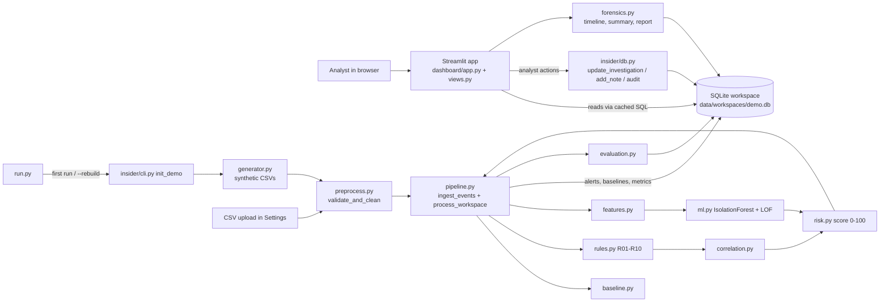
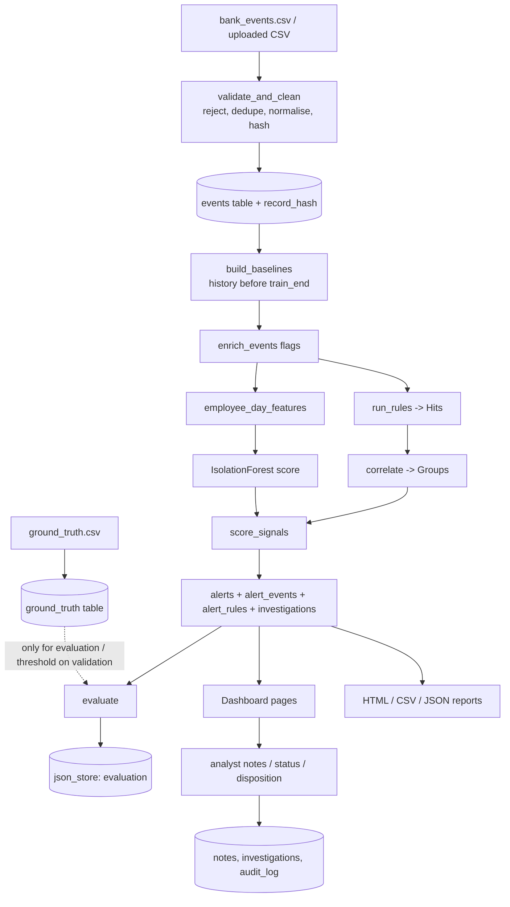
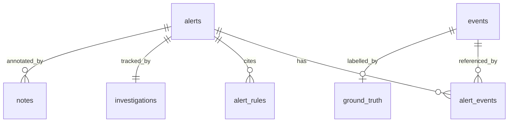

# Project Study Guide & Viva Preparation

**Behavioral and Forensic Analytics-Based Insider Threat Detection System for Banking Environments**

> How this document was made: every statement below was checked against the actual repository (source files, the SQLite demo database and the stored evaluation results). Where something is **not** implemented it is said plainly. Nothing in the project's code was changed to write this guide; this file is the only addition.
> Numbers (events, alerts, metrics) are from the seeded synthetic demo run (seed 42) stored in `data/workspaces/demo.db`. They are **synthetic** results, not real-bank results.

---

## Table of contents
1. Project title · 2. Abstract · 3. Problem statement · 4. Objectives · 5. Existing system · 6. Proposed system · 7. Architecture · 8. Technology stack · 9. Folder structure · 10. File-by-file explanation · 11. System workflow · 12. Data flow · 13. Machine learning & analytics · 14. Database design · 15. Frontend & dashboard · 16. Important code explained · 17. Testing & evaluation · 18. Actual results · 19. Limitations · 20. Future scope · 21. Presentation script · 22. Viva Q&A (70 questions) · 23. Files to study · 24. Quick revision notes · Appendix: Implemented-features table

---

## 1. Project title
**Behavioral and Forensic Analytics-Based Insider Threat Detection System for Banking Environments** (code name in the UI: *Sentinel Intelligence – Banking Threat Analytics*).

## 2. Abstract
Employees of a bank legitimately hold access to customer data, so misuse by an insider is hard to see with perimeter security. This project analyses employee activity logs from a **simulated** bank and prioritises suspicious activity for a human analyst. It builds a behavioural *baseline* for each employee, applies ten configurable *rules*, an *Isolation Forest* anomaly model, and a *correlation engine* that links related events into attack-like sequences. A transparent *0–100 risk score* ranks the resulting *alerts*, each with an explanation, a forensic *timeline*, source references and integrity checks. Analysts record notes, status and a final disposition in SQLite, and can export reports. The system is evaluated on a reproducible synthetic dataset (21,863 events, 24 employees, 22 simulated incidents). A high score is never treated as proof of malicious intent.

## 3. Problem statement
Banks log millions of employee actions (logins, customer lookups, downloads…). Most are normal. Simple fixed-threshold rules raise many false alarms (an auditor legitimately downloads a lot), while a pure ML anomaly score is hard to explain and trace to evidence. Analysts need **prioritised, explained, evidence-linked alerts** and a way to **document their decision**.

## 4. Objectives (what the code actually delivers)
1. Generate a reproducible, labelled synthetic banking dataset (`insider/generator.py`).
2. Validate/normalise uploaded or generated logs (`insider/preprocess.py`).
3. Learn per-employee baselines (`insider/baseline.py`).
4. Detect with 10 rules (`insider/rules.py`) and an ML model (`insider/ml.py`).
5. Correlate multi-event sequences (`insider/correlation.py`).
6. Score and prioritise (`insider/risk.py`).
7. Reconstruct forensic timelines, verify evidence hashes, write reports (`insider/forensics.py`).
8. Persist alerts, notes and dispositions (`insider/db.py`, `insider/pipeline.py`).
9. Present everything in an analyst dashboard (`dashboard/`).
10. Evaluate rule-only vs ML-only vs combined (`insider/evaluation.py`, `pipeline.evaluate`).

## 5. Existing system (background, not part of the code)
Typical approaches: SIEM correlation rules and DLP policies (transparent, brittle); UEBA tools that profile users statistically; research ML models on public insider datasets (e.g. CERT). Weaknesses addressed here: no personal baselines, no handling of legitimate unusual work, poor explainability, no investigation workflow.

## 6. Proposed system
Hybrid pipeline: **baseline + rules + ML + correlation → explainable risk score → investigation workflow**. Context tags (approved overtime/tickets) lower priority but never hide an alert. It is a local prototype for a single analyst.

## 7. System architecture
There is **no separate REST API / backend server and no login**. The Streamlit app (frontend) imports the Python library `insider/` (backend logic) and calls it directly in the same process. SQLite is the database.



## 8. Technology stack (verified)
| Area | What is used | Where |
|---|---|---|
| Language | Python 3.13 | everywhere |
| Frontend | **Streamlit 1.57** (`st.navigation`, `st.dialog`, custom CSS) + Plotly charts | `dashboard/` |
| Backend | Plain Python library (no Flask/FastAPI) | `insider/` |
| Database | **SQLite** (`sqlite3` module, one file per "workspace") | `insider/db.py` |
| ML | scikit-learn: `IsolationForest`, `LocalOutlierFactor`, `StandardScaler`; joblib for saving | `insider/ml.py` |
| Data | pandas, NumPy | all of `insider/` |
| Testing | pytest + Streamlit `AppTest` | `tests/` |
| Lint | ruff (run manually, not configured in the repo) | – |
| Config | Python dict `DEFAULT_CONFIG` + optional `config/detection_config.json` override; `.streamlit/config.toml` for theme/server | `insider/config.py` |
| Authentication | **None** (single local user; analyst name is just a text label) | – |
| Deployment config | **None** (no Docker/cloud); run locally with `python run.py` | – |
| External APIs | **None** (no network calls) | – |

## 9. Complete folder structure
```
forensic/
├── run.py                  single-command launcher
├── start.bat               Windows shortcut for run.py
├── requirements.txt        pinned-range dependencies
├── README.md               setup + overview
├── .gitignore  (project is not a git repository)
├── .streamlit/config.toml  light theme, server bound to 127.0.0.1, no telemetry
├── insider/                BACKEND / core library (all detection logic)
│   ├── config.py  generator.py  preprocess.py  baseline.py  rules.py
│   ├── features.py  ml.py  correlation.py  risk.py
│   ├── db.py  pipeline.py  forensics.py  evaluation.py  cli.py
├── dashboard/              FRONTEND (Streamlit)
│   ├── app.py  views.py  design.py  common.py
│   └── assets/logo.svg  icon.svg
├── tests/                  69 automated tests
├── scripts/make_eval_doc.py   writes docs/EVALUATION.md from stored results
├── data/
│   ├── synthetic/          bank_events.csv, ground_truth.csv, dataset_meta.json, sample_upload.csv
│   ├── workspaces/         demo.db (SQLite)   active_workspace.txt
├── models/                 demo_iforest.joblib (saved model); uploadtest_iforest.joblib (leftover from a test upload run)
├── outputs/evaluation.json exported evaluation results
└── docs/                   ARCHITECTURE, DATASET, DETECTION_METHODOLOGY, EVALUATION, DEMO_GUIDE,
                            PROJECT_REPORT, PRESENTATION_OUTLINE, PROJECT_STUDY_GUIDE (this file)
```
| Folder | Purpose |
|---|---|
| `insider/` | The "brain": generating, cleaning, profiling, detecting, scoring, storing, investigating, evaluating. Contains no UI code. |
| `dashboard/` | The user interface. Reads the DB, calls `insider` functions when the analyst acts. |
| `tests/` | Proves the above works (units, integration, UI rendering). |
| `data/` | Input CSVs (synthetic) and the SQLite databases. |
| `models/` | Persisted ML model (joblib). |
| `docs/` | Documentation for reports/viva. |
| `scripts/`, `outputs/` | Helper script and its exported JSON. |

---

## 10. File-by-file explanation

### File: `run.py`
**Purpose:** The only command you need: prepare data, then start the dashboard.
**Main functions:** `main()`.
**How it works:** parses `--port`, `--rebuild`, `--no-ui`; if `--rebuild` or `data/workspaces/demo.db` is missing it calls `insider.cli.init_demo("demo")` (generate → ingest → analyse); otherwise just re-activates the current workspace; then runs `python -m streamlit run dashboard/app.py` bound to `127.0.0.1` with telemetry off (`subprocess.call`).
**Input:** command-line flags. **Output:** a running web app; prints event/alert counts.
**Connected files:** `insider/cli.py`, `insider/db.py`, `dashboard/app.py`.
**Simple explanation:** "`run.py` prepares the demo data once and then launches the dashboard."
**Example:** `python run.py --port 8600` → first run prints `21,863 events, 34 alerts` then serves on port 8600.

### File: `insider/config.py`
**Purpose:** One place for paths, the event schema, and **every threshold/weight**.
**Main items:** constants `ROOT, DATA_DIR, SYNTH_DIR, WORKSPACE_DIR, MODEL_DIR, SEED=42, MAX_UPLOAD_MB=20, MAX_UPLOAD_ROWS=500000`; `REQUIRED_COLUMNS`, `OPTIONAL_COLUMNS`; `EVENT_TYPE_ALIASES` (e.g. `"download"→"bulk_download"`); `SENSITIVITY_WEIGHT` (data_transfer 1.0 … login 0.1); `DEFAULT_CONFIG` (baseline, severity weights, rules R01–R10 with params, correlation window, ML settings, risk weights/thresholds, split fractions); functions `load_config()` (deep-merges optional `config/detection_config.json`), `_merge()`, `priority_for(score, cfg)` (score → Low/Medium/High/Critical).
**How it works:** `priority_for` compares the score with thresholds 30/50/75.
**Input/Output:** none/dicts. **Connected files:** imported by almost every module.
**Simple explanation:** "All magic numbers live here, so I can explain and change them in one place."
**Example:** `priority_for(82, cfg)` → `"Critical"`; `priority_for(42, cfg)` → `"Medium"`.

### File: `insider/generator.py`
**Purpose:** Creates the **synthetic** bank dataset (fixed seed, reproducible) and the ground-truth labels.
**Main functions/classes:** `build_employees(rng)` (24 employees: 7 tellers, 4 loan officers, 5 support, 3 auditors, 4 admins + 1 new hire `EMP-1099` who starts on day 52); class `_Gen` with `normal_day()` (Poisson-distributed daily activity per role), `legit()` (overtime, support surge, approved bulk export, untagged late session, replacement laptop), `malicious()` (8 incident types), `pick()` (random employee/day placement), `build()`; `generate(out_dir, seed)` writes four files.
**How it works:** loops over 60 days (weekdays), writes normal events, then places legitimate-unusual episodes in all partitions and malicious incidents **only after day 35** (validation: 4, test: 17 + one deterministic showcase chain for `EMP-1003` on day 51). Events are sorted, given `EVT-xxxxxx` IDs and `source_ref` like `core-log-20260302.log#L17`.
**Input:** seed. **Output:** `bank_events.csv` (no labels), `ground_truth.csv`, `dataset_meta.json`, `sample_upload.csv` (first 200 rows); returns the metadata dict.
**Connected files:** `cli.init_demo`, tests. **Simple explanation:** "We don't have real bank data, so we simulate normal behaviour plus labelled attacks, and keep the labels in a separate file."
**Example:** the `full_chain` scenario: 3 failed logins → off-hours login from a new device/location → ~28 unrelated accounts → ~13 sensitive searches → ~900 MB download → transfer to `external:file-share-77`.

### File: `insider/preprocess.py`
**Purpose:** Safe ingestion: validation, cleaning, duplicate handling, quality report, per-record hash.
**Main functions:** `read_csv_safely(data)` (size/row limits, raises `IngestError`), `validate_and_clean(df_raw)` → `(clean_df, report)`, `normalise_event_type()`, `record_hash(row)` (SHA-256 of all original fields), `_limitations()` (explains which rules will be skipped because a column is empty).
**How it works:** lowercase column names → check required columns → strip blanks to NA → parse timestamps (to UTC, naive) → reject bad rows with reasons (missing ID, bad timestamp, non-numeric/negative volume) → normalise event-type aliases → drop exact duplicate rows → reject later rows reusing an `event_id` → fill `role="unknown"`, default `source_ref="upload:rowN"` → compute `record_hash`.
**Input:** raw string DataFrame. **Output:** clean DataFrame + report (rows in/accepted/rejected, duplicates, missing counts, unknown types, limitations).
**Connected files:** `cli.py`, dashboard Settings upload, `forensics.verify_event_integrity` (reuses `record_hash`).
**Simple explanation:** "Nothing dirty enters the system silently; every rejection has a reason and an uploaded file with missing columns is handled honestly."
**Example:** a row with timestamp `"not-a-date"` → rejected with reason `unparseable timestamp`; `"LOGIN"` → `login_success`.

### File: `insider/baseline.py`
**Purpose:** Builds each employee's "normal" profile and flags per-event deviations.
**Main functions:** `prepare_events` (adds date, hour, weekday), `daily_metrics` (per employee-day: events, failed logins, distinct accounts/resources, download MB, privileged ops, max sensitive searches in 30 min), `_stat` (median, MAD, p95, max, mean), `upper_fence`, `robust_z`, `_profile_from`, **`build_baselines(events, baseline_end, cfg)`**, **`enrich_events(events, baselines)`**.
**How it works:** uses only events **before `baseline_end`**; removes days that carry any `context_tag` (so approved exceptions don't widen "normal"); computes login-hour window (p1/p99 ± 1 h), usual weekdays, daily stats, familiar customers, known devices/locations/resources. Employees with < 7 active days are `insufficient` → they inherit the pooled role profile and skip account/device/location novelty checks. `enrich_events` adds boolean flags `off_hours_login, off_hours, unfamiliar_customer, unfamiliar_resource, new_device, new_location`.
**Input:** events DataFrame, cutoff timestamp, config. **Output:** dict `{"employees","roles","meta"}`; enriched DataFrame.
**Connected files:** `pipeline.analyze`, `rules.py`, `features.py`, dashboard Behavioral Analytics.
**Simple explanation:** "Each person is compared with their own past, not with a global average."
**Example:** `EMP-1003` (teller) has login window ≈ 7.7h–14.4h, 83 familiar accounts, 1 device; a login at 01:07 is flagged `off_hours_login`.

### File: `insider/rules.py`
**Purpose:** The ten rule-based detectors R01–R10.
**Main items:** dataclass `Hit` (rule_id, name, severity, employee, time range, `event_ids`, `evidence`, `explanation`, `low_confidence`), dataclass `Rule` (id, required columns, function, description, condition), helper `_densest_burst()`, functions `r01`…`r10`, registry `RULES`, `available_rules()` (skips rules whose columns are empty), **`run_rules()`**, `describe_rules()`.
**How it works:** `run_rules` loops employee by employee and calls each rule function with the employee's events, baseline and the thresholds from config; only events at/after `since` (monitoring start) are considered. Each rule returns `Hit` objects with evidence and a plain-English explanation.
| Rule | Detects | Severity |
|---|---|---|
| R01 | login outside own hours/weekdays (+ the following 2 h of off-hours session) | medium |
| R02 | ≥4 failed logins in 15 min then success + sensitive activity within 60 min | high |
| R03 | distinct accounts/day above personal fence (floor 35) | medium |
| R04 | ≥8 never-seen accounts and ≥50 % of the day's accounts | medium |
| R05 | resource never used by employee | high |
| R06 | ≥ max(10, 1.5×personal max) sensitive searches in 30 min | medium |
| R07 | download ≥ max(200 MB, 3×personal p95 daily MB) | high |
| R08 | privileged ops where none are normal, or too many/off-hours | high |
| R09 | login from new device/location (established baselines only) | medium |
| R10 | `data_transfer` to `external:*` | high |

**Input:** enriched events, baselines, config. **Output:** `(list[Hit], skipped_rules_dict)`.
**Connected files:** `pipeline.analyze`, `correlation.py`, dashboard Settings → Rules table, `tests/test_rules.py`.
**Simple explanation:** "Rules are readable if-conditions with thresholds from the employee's own history; each hit tells you exactly why it fired."
**Example (R07):** if an auditor's p95 daily download is 20 MB, threshold = max(200, 60) = 200 MB; a 900 MB download fires R07 with text *"Download of 900 MB exceeds threshold 200 MB…"*.

### File: `insider/features.py`
**Purpose:** Turns events into one numeric row per employee-day for the ML model.
**Main items:** lists `RAW_FEATURES` (19), `Z_FEATURES` (7), role one-hots (5) → `FEATURE_COLUMNS` (31); `employee_day_features(enriched, baselines, z_cap)`; `top_deviations(row, n)`.
**How it works:** groups by (employee, date); counts events, logins, failures, distinct/unfamiliar accounts and resources, download totals, privileged ops, sensitive searches and 30-min burst, transfers, off-hours and novelty events; adds robust z-scores `(x − median) / max(1.4826·MAD, floor)` against the employee's baseline (clipped); adds role indicators.
**Output:** DataFrame with `FEATURE_COLUMNS` plus `employee_id, date, role`.
**Connected files:** `ml.py`, `pipeline.py`. **Simple explanation:** "ML needs numbers, so each person-day becomes a 31-number summary."

### File: `insider/ml.py`
**Purpose:** Unsupervised anomaly detection.
**Main items:** `InsufficientDataError`; dataclass `AnomalyModel` with `fit()`, `set_threshold_quantile()`, `_if_score()`, `_lof_score()`, `score()`, `save()`, `load()`.
**How it works:** `fit` trains `IsolationForest(n_estimators=300, random_state=42)` on training-period employee-days, plus a `LocalOutlierFactor(novelty=True, n_neighbors=20)` on log-scaled standardised features for comparison. `anomaly_score = −score_samples` (higher = more unusual). Threshold = chosen quantile of the training scores. `ml_norm = clip((score − median_train)/(p99.9_train − median_train), 0, 1)`.
**Input:** features DataFrame. **Output:** DataFrame `anomaly_score, ml_norm, ml_flag, lof_score, lof_flag`.
**Connected files:** `pipeline.analyze/_select_threshold/process_workspace` (saves to `models/<workspace>_iforest.joblib`).
**Simple explanation:** "The model learns what a normal employee-day looks like and gives higher scores to days that are easy to isolate from the rest."
**Example:** the showcase day gets anomaly score ≈ 0.811 (training threshold 0.6275) → `ml_flag=True`, `ml_norm=1.0`.

### File: `insider/correlation.py`
**Purpose:** Joins related suspicious events into one story.
**Main items:** `CORE_STAGES` (`login_anomaly → account_access → sensitive_search → bulk_download → data_transfer`), `STAGE_OF` (event type → stage), dataclass `Group`, **`correlate()`**, `_explain()`, `find_missing_stages()`.
**How it works:** the "signal events" are the events cited by rule hits. Per employee they are sorted by time and split into groups when the gap > 90 min or the span > 12 h. Each event is in exactly **one** group (no double counting). A group is `sequence` (≥4 core stages), `partial` (2–3) or `isolated` (1); stage order is checked.
**Output:** list of `Group`. **Connected:** `pipeline.build_alerts`, `risk.py`.
**Simple explanation:** "One odd login is weak evidence; odd login → many accounts → searches → download → transfer within an hour is strong evidence."

### File: `insider/risk.py`
**Purpose:** The transparent 0–100 score.
**Main functions:** `rule_signal(severities, cfg)`, `score_signals(...)`.
**How it works:** five signals in [0,1]: rules (noisy-OR over *distinct* rule IDs), ML severity, baseline deviation (max z / 8), correlation ((stages−1)/4, ×0.8 if out of order), sensitivity (highest event-type weight). Score = 100 × Σ weight×signal (weights 0.30/0.20/0.15/0.20/0.15) × (1 − 0.40 × share of tagged events). If ML is unavailable its weight is removed and the others renormalised. Returns signals, weights, contributions, raw score, discount, final score, priority.
**Simple explanation:** "A weighted checklist whose points you can read on the dashboard."

### File: `insider/pipeline.py`
**Purpose:** The orchestrator that connects everything and writes to the DB.
**Main functions:** `analyze()` (pure analysis), `compute_split()`, `_partition()`, `_select_threshold()`, `build_alerts()`, `_alert_dict()`, `alert_id_for()`, `evaluate()`, `ingest_events()`, `load_events()`, `process_workspace()`.
**How it works:** see Section 11 and 16.
**Connected:** `cli.py`, dashboard Settings upload, tests. **Simple explanation:** "`pipeline.py` is the conveyor belt: events in → alerts, scores and metrics in the database."

### File: `insider/db.py`
**Purpose:** SQLite schema, workspaces, investigations, notes, tamper-evident audit log.
**Main items:** `SCHEMA` (11 tables), `STATUSES`, `DISPOSITIONS`, `safe_workspace_name`, `workspace_path`, `list_workspaces`, `get/set_active_workspace`, `connect`, `session` (context manager that commits/rolls back), `audit`, `verify_audit_chain`, `update_investigation`, `add_note`, `set_json`, `get_json`.
**How it works:** all SQL uses `?` placeholders; workspace names must match `^[A-Za-z0-9_-]{1,40}$`; every audit row stores `prev_hash` and `hash = SHA256(prev|ts|actor|action|target|details)`.
**Simple explanation:** "The persistence layer; also prevents path tricks and makes log edits detectable."

### File: `insider/forensics.py`
**Purpose:** Everything about investigating one alert.
**Main functions:** `alerts_df`, `get_alert` (alert + rules + investigation + notes + baseline + timeline), `timeline`, `verify_event_integrity`, `investigation_summary` (5 sections), `report_html`, `alerts_to_csv`, `evidence_json`.
**How it works:** the timeline = the employee's events inside the alert window (±30 min) marked `in_alert` and annotated with the rules citing each event. Integrity check recomputes each record's SHA-256 and compares with the stored `record_hash`.
**Simple explanation:** "It rebuilds what happened, in order, with proof pointers, and prints the report."

### File: `insider/evaluation.py`
**Purpose:** Metric maths. `confusion_metrics(y_true, y_pred)` → TP/FP/TN/FN, precision, recall, F1, accuracy, balanced accuracy (None when undefined); `compare_methods(days, methods)` → table. (`pipeline.evaluate` builds the employee-day table and incident-level results.)

### File: `insider/cli.py`
**Purpose:** `init_demo()` (generate → validate → ingest → process → activate) and a small CLI (`init-demo`, `process`, `verify`). Called by `run.py` and the dashboard's "Regenerate demo" dialog.

### File: `dashboard/app.py`
**Purpose:** Frontend entry point and application shell.
**How it works:** `st.set_page_config` → `design.inject_css()` → `st.logo` → creates 9 `st.Page` objects mapped to functions in `views.py` → `st.navigation` (4 sidebar sections) → `topbar()` (global search, notification menu with pending High/Critical alerts, profile menu) → shows queued toasts → `nav.run()` runs the chosen page.
**Connected:** `views.py`, `design.py`, `common.py`, `insider.db`.

### File: `dashboard/views.py` (1,081 lines)
**Purpose:** The nine pages and shared widgets.
**Pages:** `overview`, `security_events`, `employee_risk`, `behavior`, `alerts_cases`, `investigations`, `timeline_page`, `reports` (+ `_evaluation`), `settings`. **Helpers:** `alert_table`, `alert_dialog`, `render_alert_detail`, `pick_alert`, `_load_detail`, `_events_filtered`, `event_dialog`, `reset_dialog`, `go_to`.
**How it works:** each page queries SQLite through `common.query`, builds KPIs/Plotly charts, and for actions (save status, add note, import CSV, regenerate demo) calls `insider.db` / `insider.pipeline` functions directly.

### File: `dashboard/design.py`
**Purpose:** Design system: colour tokens, one big CSS string, and components `kpi()`, `badge()`, `page_header()`, `card_title()`, `empty_state()`, `callout()`, `stepper()`, `plot()`, `severity_styler()`, `paginate()`; a Plotly template named `sentinel`.

### File: `dashboard/common.py`
**Purpose:** Data access for the UI. `query()`, `json_store()`, `alerts()` are cached with `st.cache_data` keyed on the DB file's modified time, so after an analyst edit the file changes and the cache refreshes. `flash()` queues a toast message.

### Files: `tests/*.py` (69 tests)
`conftest.py` (session fixture running the whole pipeline in a temp DB), `test_generator_preprocess.py`, `test_baseline_features.py`, `test_rules.py` (each rule firing/not firing), `test_ml_correlation_risk.py`, `test_db_forensics_eval.py` (persistence, SQL-injection text, audit tamper, integrity tamper, metrics), `test_end_to_end.py` (showcase alert, no leakage), `test_dashboard.py` (each page renders; a UI form test saves a note/status).

### Other files
`requirements.txt` (dependency ranges), `.streamlit/config.toml` (light theme; `address=127.0.0.1`; telemetry off; 20 MB upload), `scripts/make_eval_doc.py` (generates `docs/EVALUATION.md` from DB), `data/*` (generated), `docs/*` (documentation).
Not present: Dockerfile, `.env`, API routes, authentication code.

---

## 11. System workflow (numbered execution flow)
**Start-up**
1. `python run.py` → `main()`.
2. If `demo.db` is missing (or `--rebuild`): `init_demo("demo")`.
3. `generator.generate()` writes the CSVs (seed 42).
4. `validate_and_clean()` cleans them and computes `record_hash`.
5. `db.session(path)` opens SQLite (creates schema). `ingest_events()` inserts events + ground truth + quality report + metadata; audit row written.
6. `process_workspace()` loads events, computes the split (`train_end=2026-04-06`, `val_end=2026-04-16`) and calls `analyze()`:
   1. `build_baselines()` (history before train_end).
   2. `enrich_events()` (per-event flags).
   3. `run_rules()` (monitoring period only).
   4. `employee_day_features()` → `AnomalyModel.fit()` on **train** days → `_select_threshold()` on validation → `score()` for all days.
   5. `correlate()` → groups.
   6. `build_alerts()` → `score_signals()` per group; ML-only alerts for ML-flagged days with no rule hit; keep alerts with score ≥ 30.
7. Persist: baselines, `employee_days` table, alerts (upsert; analyst work preserved), alert events/rules, an `investigations` row (`Pending review`) per alert, model info (+ joblib file), evaluation JSON.
8. `set_active_workspace("demo")`, then `run.py` launches Streamlit.

**Running**
9. Browser loads `http://127.0.0.1:8501`; `dashboard/app.py` runs top to bottom on each interaction (Streamlit's model), builds the navigation and runs the selected view.
10. A view calls `common.query(sql)` → cached read of SQLite → pandas → KPI cards/charts/tables.
11. Opening an alert: `forensics.get_alert()` assembles alert + rules + timeline; `verify_event_integrity()` re-hashes the events.
12. Analyst saves status/note → `db.update_investigation()` / `db.add_note()` (parameterised SQL) → `audit()` row → commit → file mtime changes → cache invalidated → `st.rerun()` shows the new state and a toast.
13. Reports/exports: `forensics.report_html/evidence_json/alerts_to_csv` → Streamlit `download_button`.
14. Upload: Settings → `read_csv_safely` → `validate_and_clean` → preview → confirm → **new** workspace via `ingest_events` + `process_workspace` (no overwrite).

**Stop**
15. Ctrl+C stops Streamlit. There are no shutdown hooks; SQLite commits were already done, so alerts, notes, dispositions and the audit log remain. Streamlit `session_state` (selected alert, analyst name) is lost.

## 12. Data flow


## 13. Machine learning & analytics (only what is implemented)
**Dataset:** synthetic (`data/synthetic/bank_events.csv`, 21,863 rows, CSV). **No real bank data. Not a public dataset.** Labels live in `ground_truth.csv`.
**Split:** by **time**: train/baseline 2026-03-02→04-06 (no malicious incidents), validation →04-16, test →04-30. Every incident lies fully in one partition (no incident leakage).

| Method | Implemented? | Where | Input → output |
|---|---|---|---|
| Behavioural profiling | Yes | `baseline.py` | history → per-employee/role profile |
| Statistical anomaly detection (median/MAD, p95, robust z) | Yes | `baseline.py`, rules, `features.py` | daily metrics → fences, z-scores |
| Rule-based detection | Yes (10 rules) | `rules.py` | events + baseline → `Hit` |
| **Isolation Forest** | Yes (primary ML) | `ml.py` | 31 features/employee-day → anomaly score |
| LOF | Yes (comparison only) | `ml.py` | same → `lof_flag`; not used in risk score |
| Event correlation | Yes (heuristic grouping) | `correlation.py` | hits → groups |
| Risk scoring | Yes (weighted) | `risk.py` | signals → 0–100 |
| Random Forest / Logistic Regression / Decision trees / clustering | **No** | – | – |
| Supervised classifier | **No** | – | – |

**Isolation Forest in simple words:** it builds many random decision trees that repeatedly split the data by random feature thresholds. Unusual points are separated from the rest in very few splits (short path), normal points need many. Short average path → higher anomaly score.
*Why chosen:* works without labels (real insider labels are rare), handles many numeric features, fast, no scaling needed. *Limits:* score is not a probability; weak for incidents that change only one or two features; depends on what "normal" looked like in training.
**Training/prediction:** `AnomalyModel.fit(train_rows)` (576 employee-day rows); `score()` for every employee-day. **Threshold:** quantile of training scores (candidates 0.95/0.97/0.98/0.99) chosen by F1 on the **validation** days (selected 0.99 → threshold 0.6275). **Saving:** `AnomalyModel.save` → `models/demo_iforest.joblib` (whole object via joblib), `load()` exists and is tested.
**Metrics:** TP/FP/TN/FN, precision, recall, F1, accuracy, balanced accuracy at **employee-day** level (a day is positive if it contains ≥1 malicious event), plus alert precision, false alerts per employee-week, explanation/timeline/source-reference completeness, and detection of the 5 full-chain incidents.
**Honesty points:** threshold selection used validation labels; during development I adjusted rules after looking at validation *and test* alerts, so the test split is not a clean hold-out; the dataset was designed together with the detectors, so results are optimistic.

## 14. Database design (SQLite, `insider/db.py` → `SCHEMA`)
One file per workspace in `data/workspaces/` (`demo.db`: 21,863 events, 34 alerts).
| Table | Key fields | Purpose / rows in demo |
|---|---|---|
| `events` | PK `event_id`; timestamp, employee_id, role, event_type, resource, customer_id, device_id, location, volume_mb (CHECK ≥0), record_count, outcome, context_tag, source_ref, `record_hash` | raw activity (21,863) |
| `ground_truth` | PK `event_id`; is_malicious, scenario_type, scenario_id | labels, evaluation only (21,863) |
| `baselines` | PK `employee_id`; role, status, history_days, `baseline_json` | profiles (24) |
| `employee_days` | created by `DataFrame.to_sql` (40 columns) | features + ML scores per employee-day (1,019) |
| `alerts` | PK `alert_id`; employee_id, kind, ts_detect, window_start/end, `risk_score` (CHECK 0–100), priority, ml_anomaly_score, explanation, `signals_json`, stages_json, context_coverage, `stale` | 34 |
| `alert_events` | PK (alert_id, event_id) FK→alerts (CASCADE), seq | which events form each alert (718) |
| `alert_rules` | alert_id FK, rule_id, severity, explanation, evidence_json, event_ids_json | rule hits (89) |
| `investigations` | PK/FK `alert_id`; status, disposition, conclusion, updated_at | workflow state (34) |
| `notes` | id, alert_id FK, author, note, created_at | analyst notes |
| `audit_log` | id, ts, actor, action, target, details, prev_hash, hash | hash-chained log |
| `json_store` | name PK, value, updated_at | quality_report, dataset_meta, model_info, evaluation, baseline_meta, role_baselines |
| `meta` | key, value | **created but unused** (0 rows) |

Indexes: `ix_events_emp_ts`, `ix_events_type`, `ix_alerts_emp`, `ix_alerts_prio`, `ix_alert_rules_alert`, `ix_notes_alert`. Foreign keys are on (`PRAGMA foreign_keys=ON`).
**Insert:** `ingest_events` (`executemany`), `process_workspace` (upserts). **Read:** `common.query` (pandas `read_sql_query`), `forensics.*`. **Update:** `db.update_investigation` (UPSERT), `process_workspace` (`ON CONFLICT DO UPDATE` for alerts). **Delete:** `ingest_events` clears tables for a re-import; `process_workspace` deletes alerts that disappeared **unless** they have notes/non-pending status (then flagged `stale=1`).


## 15. Frontend and dashboard
Streamlit re-runs the page script on each interaction; `st.session_state` keeps the selected alert/employee and analyst name. Navigation: Dashboard (Overview, Security Events), Analytics (Employee Risk, Behavioral Analytics), Operations (Threat Investigations, Forensic Timeline, Alerts & Cases, Reports), System (System Settings). Top bar: global search over alerts, bell (pending High/Critical alerts), profile popover. Dialogs: alert details, event details, regenerate-demo confirmation.
| Page | What it shows | Real data source |
|---|---|---|
| Overview | 6 KPIs, events+alerts over time, severity, risk distribution, anomaly trend, categories, roles, status donut, recent alerts table | `events`, `alerts`, `employee_days` |
| Security Events | filter/search events, linked alert severity, event dialog, data-quality tab | `events` ⟕ `alert_events` |
| Employee Risk | ranked employees, risk-factor chart | `alerts.signals_json`, `baselines` |
| Behavioral Analytics | baseline vs observed, hour-of-day pattern, anomaly score, explained deviations | `baselines`, `employee_days` |
| Alerts & Cases | filters, table, full explanation | `alerts` |
| Threat Investigations | status stepper, evidence summary, notes/status forms, report | `forensics`, `db` |
| Forensic Timeline | event map, vertical timeline, event detail, integrity | `forensics.timeline` |
| Reports | CSV/JSON/HTML exports; Evaluation tab | `json_store['evaluation']` |
| System Settings | rules, model, risk formula, workspaces, upload, reset, audit log, analyst name | config, `json_store`, `db` |
Report formats supported: **HTML, CSV, JSON** (no PDF).

---

## 16. Important code explained

### 16.1 Application entry: `run.py` → `main()`
```python
if a.rebuild or not db.workspace_path("demo").exists():
    r = init_demo("demo")
...
return subprocess.call([sys.executable, "-m", "streamlit", "run", str(ROOT / "dashboard" / "app.py"),
                        "--server.address", "127.0.0.1", "--server.port", str(a.port), ...], cwd=ROOT)
```
*Line by line:* check whether the demo DB exists → build it if not → start Streamlit as a child process bound to localhost. *Why:* one command to run. *Connects:* `cli.init_demo`, `dashboard/app.py`.
**Professor's question:** "Why bind to 127.0.0.1?" **Answer:** the prototype has no authentication, so it must not be reachable from other machines.

### 16.2 The pipeline: `pipeline.analyze()`
```python
baselines = build_baselines(events, split["train_end"], cfg)
enriched  = enrich_events(events, baselines)
hits, skipped = run_rules(enriched, baselines, cfg, since=split["train_end"])
feats = employee_day_features(enriched, baselines, cfg["ml"]["z_cap"])
...
model.fit(train, cfg["ml"]["min_train_rows"], cfg["ml"]["default_threshold_quantile"])
groups = correlate(enriched, hits, cfg)
alerts = build_alerts(groups, enriched, feats, baselines, cfg, ml_ok, split)
```
*Explanation:* learn normal → mark deviations → apply rules → summarise days → train/score ML (only on training days) → group related events → score and create alerts. A `try/except InsufficientDataError` disables ML and renormalises weights if there are fewer than 100 training rows. *Why:* it is the whole detection chain in 7 lines. **Question:** "What if a new dataset is tiny?" **Answer:** ML is switched off with a visible warning; rules still run (tested with the 200-row sample).

### 16.3 Baseline: `build_baselines()`
Key lines: `hist_all = ev[ev["timestamp"] < baseline_end]`; tagged days removed via `keys = set(zip(tagged["employee_id"], tagged["date"]))`; `status = "established" if n_days >= min_days else "insufficient"`; fallback to role profile if insufficient.
*Why:* no future data leaks in, approved exceptions do not pollute "normal", new employees are not all flagged. **Question:** "How do you treat a new employee?" **Answer:** < 7 active days → `insufficient` → role baseline, familiarity/device checks skipped, rules that fire are marked low-confidence.

### 16.4 A rule: `rules.r07()` (large download)
```python
thr = max(p["abs_min_mb"], p["p95_mult"] * st["p95"])
for _, row in d[d["volume_mb"] >= thr].iterrows(): hits.append(_mk("R07", ...))
```
*Explanation:* the threshold is the larger of a fixed floor (200 MB) and 3× the employee's own p95 daily download — so a heavy-downloading auditor isn't flagged for normal volumes. *Question:* "Why not a fixed 200 MB?" *Answer:* different roles have different normal volumes; personal baselines reduce false positives.

### 16.5 Correlation: `correlation.correlate()`
`if cur and (ts - t_prev > gap or ts - t_first > span): batches.append(cur)` splits the sorted signal events of one employee when the pause exceeds 90 min or the span exceeds 12 h. Then stages are read from event types and `g.kind` is set by the number of core stages. *Why:* avoids counting an event in two groups and distinguishes isolated noise from a chain. *Question:* "What if an attacker waits two hours between steps?" *Answer:* the heuristic would split it (limitation); the window is configurable.

### 16.6 Risk score: `risk.score_signals()`
Shown in full in Section 10 (`insider/risk.py`). Key lines: `rule_signal` = `1 − Π(1 − w)`; `contrib = {k: 100*w[k]*s[k]}`; `final = raw * (1 - discount)`. *Worked example (showcase alert `ALR-44ED9840`):* rules 29.99 + ML 20 + deviation 15 + correlation 20 + sensitivity 15 → 99.99 ≈ **100, Critical**; no tags, so no discount. *Question:* "Why noisy-OR?" *Answer:* firing the same rule many times shouldn't multiply the score; several *different* rules should raise confidence with diminishing returns, staying ≤ 1.

### 16.7 ML: `AnomalyModel.fit()/score()`
See code in the ML file section. *Key:* `IsolationForest(...).fit(X)`; `anomaly_score = -score_samples(X)`; `ml_norm = clip((s − q50)/(q99.9 − q50), 0, 1)`; `ml_flag = s ≥ threshold`. *Question:* "Is 0.81 an 81 % chance of an attack?" *Answer:* No — it is an anomaly index only meaningful relative to the training scores.

### 16.8 Database action + audit: `db.update_investigation()` and `db.audit()`
```python
prev = row["hash"] if row else "GENESIS"
con.execute("INSERT INTO audit_log(ts, actor, action, target, details, prev_hash, hash) VALUES (?,?,?,?,?,?,?)", ...)
```
Each audit row's hash includes the previous hash; changing or deleting an earlier row breaks `verify_audit_chain()`. *Question:* "Is it tamper-proof?" *Answer:* No, tamper-**evident**: someone with file access could rewrite the whole chain.

### 16.9 Idempotent persistence: `process_workspace()`
Alert IDs are deterministic (`alert_id_for` = SHA-1 of employee|type|first event). The insert uses `ON CONFLICT(alert_id) DO UPDATE`, `INSERT OR IGNORE` for the `investigations` row, and alerts with analyst work are kept (`stale=1`). *Why:* re-processing doesn't duplicate alerts or erase notes (tested in `test_reprocessing_does_not_duplicate_and_keeps_analyst_work`).

### 16.10 Frontend shell: `dashboard/app.py` and caching in `common.py`
`nav = st.navigation({...}); ... nav.run()` runs the selected page. `@st.cache_data def _q(path, mtime, sql, params)` caches reads per DB file modification time. *Question:* "How does the UI refresh after saving a note?" *Answer:* the DB file's mtime changes, so the cache key changes; `st.rerun()` re-renders with fresh data.

### 16.11 Authentication
**There is none.** `st.session_state["analyst"]` is only a display/audit name. Say this clearly in the viva and mention it as future work (login, roles).

---

## 17. Testing & evaluation
`python -m pytest tests -q` → **69 passed** (≈20 s). Highlights: each rule triggers and does **not** trigger when it shouldn't; reproducible data; no incident leakage; model determinism, save/load round trip; suspicious vs isolated vs tagged sequences; risk bounds; DB persistence across reconnect; SQL-injection text stored literally; audit chain tamper detection; event tamper → integrity mismatch; every dashboard page renders without exceptions; a UI test saves a note and status. Lint (`ruff --select F,E9`) was clean at the last run. Evaluation method: Section 13.

## 18. Actual results (synthetic demo, seed 42; from `docs/EVALUATION.md` / stored JSON)
Dataset: 21,863 events · 24 employees · 22 simulated malicious incidents (4 validation, 18 test). Test: 259 employee-days, 18 positive.
| Method (test) | TP | FP | TN | FN | Precision | Recall | F1 |
|---|---|---|---|---|---|---|---|
| Rule-only | 18 | 16 | 225 | 0 | 0.529 | 1.000 | 0.692 |
| Isolation Forest | 6 | 7 | 234 | 12 | 0.462 | 0.333 | 0.387 |
| LOF | 13 | 19 | 222 | 5 | 0.406 | 0.722 | 0.520 |
| Combined (any alert) | 18 | 8 | 233 | 0 | 0.692 | 1.000 | 0.818 |
| Combined (High/Critical) | 14 | 0 | 241 | 4 | 1.000 | 0.778 | 0.875 |
34 alerts total (5 Critical, 12 High, 17 Medium). All 22 incidents were covered by a combined alert; 5/5 full chains detected as a single correlated sequence; 8 false alerts in the test period (0.16 per employee-week) which are legitimate-unusual episodes. **Read these as illustrations on synthetic data, not as real-world accuracy.**

## 19. Limitations
Synthetic, regular data · small number of incidents (wide uncertainty) · test split not a clean hold-out (rules tuned while inspecting it) · context tags are unverified claims (an insider could forge one) · no authentication or multi-user roles · batch only (no real-time) · baselines rebuilt, not updated online · expert-set weights (not learned/calibrated) · correlation window heuristic · audit log tamper-evident not tamper-proof · no PDF export · no supervised model · employee-day granularity may miss very short incidents · `meta` table unused; a leftover `models/uploadtest_iforest.joblib` file exists from a test run.

## 20. Future scope
Real-time streaming ingestion · login/roles and approval workflow · verify tags against a ticketing system · learned or calibrated risk model with real labels · peer-group baselines · sequence models · signed/append-only logs · PDF/STIX export · evaluation on public insider datasets and with real, authorised data under legal/ethical review.

---

## 21. Presentation script
### A. 30-second introduction
"My project is an insider-threat detection system for banks. It studies each employee's normal behaviour, spots unusual activity using rules and machine learning, links related events into a story, gives each alert a risk score, and helps an analyst investigate it on a dashboard. It runs on simulated data, and a human always makes the final decision."

### B. 1-minute explanation
"Banks give employees access to sensitive customer data, so misuse by insiders is a real risk. Fixed rules cause many false alarms and plain machine learning is hard to explain. My solution combines four things: a personal baseline for every employee, ten readable rules, an Isolation Forest anomaly model, and a correlation engine that joins related events. The result is an explainable risk score from 0 to 100. I built it in Python with Streamlit and SQLite. The output is a dashboard with alerts, a forensic timeline, notes and a downloadable report. Because I have no real bank data, I generated a seeded synthetic dataset with labelled attacks to test it."

### C. 3-minute explanation
"The problem: employees such as tellers and admins legitimately access customer data, so attackers inside the bank do not trigger normal security alarms.
My system takes activity logs — logins, customer lookups, searches, downloads, transfers — and first cleans them, rejecting bad rows and recording a fingerprint for each record. Then it builds a baseline for each employee from their own past: usual hours, how many accounts they touch, how much they download, which devices they use. New employees get a role-based baseline instead of being treated as suspicious.
Next, detection. Ten rules check things like a login at 2 a.m., a sudden burst of searches, or a very large download — always relative to the person's own history. In parallel an Isolation Forest model looks at a 31-number summary of each employee-day and gives an anomaly score. A correlation engine then groups suspicious events for the same employee within a time window and checks whether they follow an attack-like order: odd login, many accounts, searches, download, transfer.
A transparent formula combines rule matches, ML score, deviation, correlation and the sensitivity of operations into a 0–100 risk score, with a reduction for approved activity like overtime tickets. Each alert shows the exact reasons.
The analyst opens the alert, sees a chronological timeline, checks that the source records are unchanged using SHA-256 hashes, writes notes, sets a status such as Escalated or Explained, and exports an HTML report. Everything is stored in SQLite, including a hash-chained audit log.
On my synthetic test data the combined approach caught all 18 positive employee-days with higher precision than rules alone, and all five full attack chains were recognised as one sequence. The limits: the data is synthetic, there is no login system, and these numbers don't predict real-world accuracy."

### D. 5-minute detailed explanation
Use the 3-minute script, then add:
- **Objectives:** reproducible dataset; per-employee baselines; rules + ML; correlation; transparent score; forensic traceability; analyst workflow; honest evaluation.
- **Architecture:** Streamlit frontend calling the Python library `insider/` directly (no separate API); SQLite storage; one "workspace" DB per dataset; uploads never overwrite existing data.
- **Technology:** Python, pandas/NumPy, scikit-learn (Isolation Forest, LOF), SQLite, Plotly, pytest.
- **Data flow:** CSV → validation → events table → baselines → flags → rules/features → ML → correlation → risk → alerts table → dashboard → analyst actions → notes/audit tables.
- **Algorithms:** median/MAD statistics, Isolation Forest, noisy-OR rule signal, weighted risk formula.
- **Dashboard:** 9 pages; show Overview, an alert, timeline, report.
- **Results:** the table in Section 18, with the caveats.
- **Limitations & future:** Sections 19–20.

---

## 22. Viva questions and answers (70)

### A. Basic project questions
**1. What is the main objective?** To help bank analysts find and investigate suspicious insider activity by combining personal baselines, rules, ML and correlation into explainable, prioritised alerts. *(whole project)*
**2. Why did you choose this project?** Insider misuse is costly and hard to detect because insiders have legitimate access; it also combines analytics, ML and digital forensics. *(Also: no real data needed to demonstrate a complete pipeline.)*
**3. What is an insider threat?** A risk from someone with authorised access (employee/contractor) who misuses it, intentionally or accidentally.
**4. What is behavioural analytics?** Learning what is normal for a user and flagging departures from it. *`baseline.py`*
**5. In one sentence, how does your project detect suspicious behaviour?** It compares each employee's activity with their own history using rules and an Isolation Forest, groups related events, and scores the result.
**6. What is the final output?** A ranked list of alerts with explanations, timelines, evidence and report exports, plus stored investigation records.
**7. Is the data real?** No. It is synthetic, generated by `generator.py` with seed 42; stated everywhere in the UI and docs.

### B. Problem statement and objectives
**8. What problem do fixed-threshold rules have?** They ignore who the person is: an auditor's normal download looks suspicious for a teller. Baselines fix this (`r07` uses personal p95).
**9. What problem does pure ML have?** Scores are hard to explain and trace; so alerts here carry rules, evidence and a score breakdown.
**10. Why did you separate alerts from "threats"?** An alert is a prioritisation for review; a confirmed threat needs human investigation. Dispositions such as *False positive* exist for that.
**11. What is the difference between an anomaly and a confirmed threat?** An anomaly is unusual behaviour; it may be legitimate (approved overtime). A confirmed threat is established by an analyst with context.
**12. What is a false positive / false negative here?** FP: an alert on a day with no simulated incident (e.g., a legitimate support surge). FN: an incident day with no alert.
**13. How do you handle legitimate unusual behaviour?** `context_tag` approvals reduce the score (max 40 %, proportional to tagged share) and tagged days are excluded from baselines; alerts are still shown.

### C. Frontend
**14. Which frontend framework?** Streamlit (with custom CSS and Plotly). *`dashboard/`*
**15. How is navigation done?** `st.navigation` with `st.Page` objects in `dashboard/app.py`.
**16. How does the frontend get data?** Directly from SQLite via `common.query` (cached) and by calling `insider` functions; there is no REST API.
**17. How does the UI refresh after saving?** DB mtime changes → cache key changes → `st.rerun()`.
**18. What are session_state variables used for?** Selected alert (`sel_alert`), focused employee (`emp_focus`), analyst name, filtered alerts, flash messages.
**19. How is the design made consistent?** `dashboard/design.py` centralises tokens, CSS and components (`kpi`, `badge`, …) and `.streamlit/config.toml` sets the light theme.
**20. How did you test the UI?** Streamlit `AppTest` renders every page and drives a form; I also took real browser screenshots with Playwright during development.

### D. Backend
**21. What is the backend?** The `insider/` Python library; there is no web server of its own.
**22. Which module orchestrates everything?** `pipeline.py` (`analyze`, `process_workspace`).
**23. What does `analyze` return?** Baselines, enriched events, rule hits, features + ML scores, groups, alerts, warnings.
**24. Why is `analyze` separate from DB code?** It is pure (DataFrames in/out), so it is easy to unit-test.
**25. How are uploads protected?** Size/row limits, text-only parsing, validation, import into a new validated workspace name; never executed.
**26. Why no FastAPI?** A single-process Streamlit app made an extra API layer unnecessary; it is listed as a possible future step.

### E. Database
**27. Which database and why?** SQLite: zero setup, a single file, enough for a local prototype, supports constraints/indexes.
**28. List the main tables.** `events, ground_truth, baselines, employee_days, alerts, alert_events, alert_rules, investigations, notes, audit_log, json_store`.
**29. How are SQL injections prevented?** Parameterised queries (`?`) and validated workspace names; a test stores `x'); DROP TABLE alerts;--` as plain text.
**30. How do you avoid duplicate alerts when re-processing?** Deterministic alert IDs + `ON CONFLICT DO UPDATE`; investigations use `INSERT OR IGNORE`.
**31. What happens to analyst notes if an alert disappears after re-processing?** The alert is kept and flagged `stale=1` if it has notes or a non-pending status.
**32. What is the audit log?** A table of actions where each row's SHA-256 includes the previous row's hash.
**33. What is `json_store`?** A key-value table for JSON blobs: quality report, dataset metadata, model info, evaluation results.
**34. Why keep ground truth in the same DB?** For evaluation only; it is never read by detection code (`test_ground_truth_never_used_as_feature`).

### F. Machine learning and analytics
**35. Which ML algorithm?** Isolation Forest (primary); LOF for comparison.
**36. Why Isolation Forest?** Unsupervised (labels are rare), fast, handles multi-feature numeric data.
**37. How does it work?** Random trees isolate points; anomalies are isolated with fewer splits; shorter path = higher anomaly.
**38. What are the input features?** 31 per employee-day: 19 behaviour counts, 7 robust z-scores vs the person's baseline, 5 role flags (`features.FEATURE_COLUMNS`).
**39. Why employee-day as the unit?** Daily behaviour is a natural, comparable summary; rules still look at finer time windows. Limitation: can't time-localise within a day.
**40. How was it trained/tested?** Trained on 576 employee-days from the baseline period; threshold quantile chosen on validation; evaluated on test days.
**41. What is the anomaly score? Is it a probability?** `−score_samples`; no, it's an index relative to training scores.
**42. How is the threshold decided?** A quantile of training scores (0.99 chosen on validation F1 → 0.6275).
**43. Is the model saved?** Yes, `models/demo_iforest.joblib` via joblib; `AnomalyModel.load` restores it.
**44. What if there isn't enough data?** `InsufficientDataError` (<100 rows) → ML disabled, weights renormalised, warning shown.
**45. What is a robust z-score and why use it?** `(x − median)/(1.4826·MAD)`; median/MAD resist outliers so a few bad days don't distort "normal".
**46. What does the correlation engine do?** Groups signal events per employee within 90-minute gaps/12-hour span, maps to stages, classifies as sequence/partial/isolated.
**47. How is the risk score computed?** Weighted sum of five normalised signals × (1 − context discount) → 0–100 → Low/Medium/High/Critical (`risk.py`).
**48. Why noisy-OR for rules?** Avoids stacking the same rule and keeps the value ≤ 1.
**49. Why do rules and ML both exist?** Rules give precise, explainable reasons; ML catches combinations rules don't anticipate. In my results, ML alone had recall 0.333 vs the combination 1.0.
**50. Where do weights come from?** Chosen by me (expert judgement), documented in config; not learned. Limitation.

### G. Security and insider-threat questions
**51. Examples of insider attacks your scenarios model?** Off-hours login, unrelated-account browsing, search burst, huge download, unusual privileged actions, failed-login then access, unusual resource access, and a full exfiltration chain.
**52. How do you protect privacy?** Pseudonymous IDs, synthetic data, local-only, no telemetry, and the UI states that scores are not proof.
**53. Could an insider fake an approval tag?** Yes; that's a known limitation. Tags only reduce priority and the alert text tells the analyst to verify them.
**54. What ethical concerns exist?** False accusations, bias toward roles with unusual duties, staff transparency; hence human-in-the-loop and no automatic sanctions.
**55. How is evidence integrity handled?** SHA-256 `record_hash` at ingest; `verify_event_integrity` recomputes hashes; mismatch is flagged. It detects changes; it isn't immutable storage.
**56. How would you deploy in a real bank?** Add authentication/roles, secure DB (PostgreSQL), real log connectors, streaming, secrets management, access logging, legal approval, and validation on real data.
**57. Why bind to localhost?** No authentication exists.

### H. Code-specific
**58. How is a new employee handled in code?** `build_baselines`: `status="insufficient"` if `n_days < min_history_days` → role fallback.
**59. How are baselines kept free of future data?** Filter `ev["timestamp"] < baseline_end`.
**60. How does R06 detect bursts?** `np.searchsorted` computes how many searches fall in each 30-minute window; fires if count ≥ threshold, then skips past that window.
**61. How are alert IDs generated?** `"ALR-" + sha1(employee|type|first_event_id)[:8]` (`alert_id_for`).
**62. What does `enrich_events` add?** Booleans: `off_hours_login`, `off_hours`, `unfamiliar_customer`, `unfamiliar_resource`, `new_device`, `new_location`.
**63. Why does `correlate` use `id(h)`?** To count each rule hit object once per group even if it covers many events.
**64. How does the generator ensure no leakage?** Malicious incidents are only placed on days ≥35 and each is inside a single partition; tested in `test_no_incident_leakage_between_partitions`.
**65. How does the timeline mark context?** `forensics.timeline` fetches window events and sets `in_alert` and `contributing_rules`.

### I. Testing and evaluation
**66. How do you evaluate?** Employee-day confusion matrix (TP/FP/TN/FN, precision, recall, F1, accuracy, balanced accuracy) comparing rule-only, ML-only, LOF and combined; plus alert-quality and incident-level checks.
**67. What are the results?** On the synthetic test split, combined F1 0.818 (precision 0.692, recall 1.0) vs rule-only F1 0.692 and Isolation Forest F1 0.387.
**68. Are the results trustworthy for real banks?** No: synthetic data, few incidents, test split influenced my tuning.
**69. How many tests and what do they cover?** 69; units, integration, DB, UI rendering (Section 17).

### J. Limitations and future scope
**70. Main limitations and next steps?** Synthetic data, no authentication, forgeable tags, expert weights, batch only; next: real data pilots, authentication, streaming, calibrated models, ticket verification.

**Bonus quick answers**
- *Rule-based vs ML?* Rules = explicit, explainable, only catch what you wrote; ML = learns patterns, can catch novel ones, harder to explain. I combine them.
- *Tamper-evident vs tamper-proof?* Evident = changes can be detected; proof = changes impossible.
- *Why synthetic?* Real insider data is confidential and rare; synthetic data allows labelled, reproducible experiments.

---

## 23. Files to study before the viva (priority order)
1. `insider/pipeline.py` — `analyze`, `build_alerts`, `process_workspace`, `evaluate` (the heart).
2. `insider/baseline.py` — `build_baselines`, `enrich_events`.
3. `insider/rules.py` — read `r01`, `r03`, `r06`, `r07` and `run_rules`.
4. `insider/ml.py` — `AnomalyModel.fit/score`.
5. `insider/correlation.py` — `correlate`.
6. `insider/risk.py` — `score_signals` (51 lines).
7. `insider/db.py` — `SCHEMA`, `audit`, `update_investigation`.
8. `insider/forensics.py` — `get_alert`, `timeline`, `verify_event_integrity`, `investigation_summary`.
9. `dashboard/app.py` and the `overview`, `investigations` functions in `dashboard/views.py`.
10. `insider/generator.py` — `malicious("full_chain")` and `build()` placement logic.
11. `insider/config.py` — thresholds and weights.
12. `tests/test_end_to_end.py`, `tests/test_rules.py` (to explain how you verified it).
Run live before the viva: `python run.py`, open **Alerts & Cases → ALR-44ED9840**, then **Forensic Timeline**.

## 24. Quick revision notes
- **One line:** baseline + rules + Isolation Forest + correlation → explainable 0–100 risk score → investigation workflow on SQLite + Streamlit.
- **Key numbers:** 21,863 events · 24 employees · 60 days · 10 rules · 31 features · 300 trees · 576 training rows · threshold quantile 0.99 · 34 alerts (5/12/17) · 69 tests.
- **Splits:** train 03-02→04-06, validation →04-16, test →04-30.
- **Score formula:** `100 × (0.30 rules + 0.20 ML + 0.15 deviation + 0.20 correlation + 0.15 sensitivity) × (1 − 0.40 × tagged_share)`; priorities 30/50/75.
- **Correlation:** gap 90 min, span 12 h, stages login → accounts → searches → download → transfer.
- **Never say:** "probability of being malicious", "tamper-proof", "real bank data", "has login/authentication", "uses Random Forest/FastAPI".
- **Always say:** synthetic data, human review, prioritisation index, tamper-evident, limitations.
- **Showcase:** `ALR-44ED9840`, EMP-1003, 2026-04-22, risk 100, Critical, R01+R09+R03+R04+R06+R05+R07+R10, 5-stage sequence.

---

## Appendix — What is actually implemented
| Feature | Implemented? | Actual implementation | Relevant file | Notes |
|---|---|---|---|---|
| Employee behavioural profiling | **Yes** | Robust per-employee + role baselines; exclusion of tagged days | `baseline.py` | rebuilt in batch; no online update |
| Insider threat detection | **Yes** (on synthetic logs) | Rules + ML + correlation + scoring | `rules.py`, `ml.py`, `correlation.py`, `risk.py` | alerts are for human review |
| Anomaly detection | **Yes** | Isolation Forest (+LOF comparison); statistical fences | `ml.py`, `baseline.py` | unsupervised |
| Risk scoring | **Yes** | Weighted 5-signal formula, context discount | `risk.py` | index, not a probability |
| Event correlation | **Yes** (heuristic) | time-gap grouping + stage mapping | `correlation.py` | window heuristic |
| Alert generation | **Yes** | `build_alerts`, deterministic IDs, ≥30 score | `pipeline.py` | includes ML-only alerts |
| Forensic timeline | **Yes** | window events + rule citations + integrity check | `forensics.py`, `views.timeline_page` | not immutable storage |
| Dashboard | **Yes** | Streamlit, 9 pages, real DB data | `dashboard/` | local, single user |
| User authentication | **No** | – | – | analyst name is just a label |
| Database | **Yes** | SQLite, 11 tables + indexes | `db.py` | `meta` table unused |
| REST API / backend server | **No** | Streamlit calls library directly | – | FastAPI not used |
| ML model (trained) | **Yes** | IsolationForest trained on 576 synthetic employee-days, saved with joblib | `ml.py` | unsupervised; no supervised model |
| Report generation | **Yes** | HTML, CSV, JSON | `forensics.py` | no PDF |
| Evaluation metrics | **Yes** | confusion matrix metrics, method comparison, incident-level | `evaluation.py`, `pipeline.evaluate` | synthetic; test split not clean hold-out |
| CSV upload | **Yes** | validate → preview → new workspace | `preprocess.py`, `views.settings` | no ground truth for uploads |
| Real banking data / integrations | **No** | – | – | synthetic only |
| Docker / deployment config | **No** | – | – | run locally |
